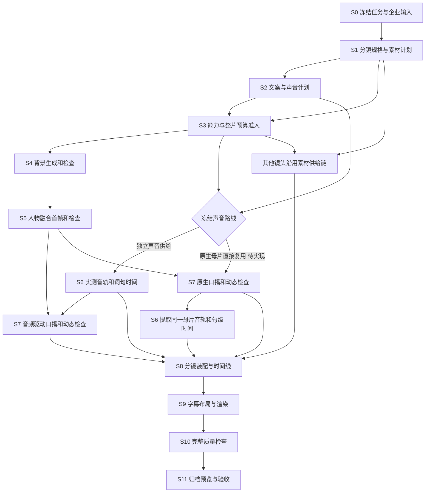

# 数字员工内容创作管线开发规范

日期：2026-10-26（Asia/Shanghai）

状态：产品路线已确认，后端按批实施中；各批实现和验证证据见文末实施记录。本文不是整链完成或上线证明。

## 1. 目标与已确认决定

目标是把一次内容任务的业务输入，自动转换为可预览、可下载、质量状态可信的完整视频。正常输入不需要用户逐镜头批准；无法自动解决的异常有明确原因、已有产物和继续执行入口。生成式模型存在随机性，可靠性通过可测的交接协议、质量检查、有限修正和断点恢复实现，不能承诺所有任意输入都必然成片。

本轮确定的口播路线：

> 对标分镜分析 → 干净背景 → 企业人物与背景融合的完整首帧 → 首帧检查 → HeyGen 驱动口播 → 分镜装配 → 字幕与混音 → 渲染 → 检查与归档 → 人工口型验收。

约束如下：

1. 选定对标视频后，默认复用对应分镜的场景与构图，不再询问“是否复用对标场景”。没有对标时沿用已有原创策划路线，不伪造对标证据。
2. 不采用透明人物层后期叠加作为本路线默认方案。人物、透视、接触关系、阴影与光照在完整首帧阶段协调，再驱动人物说话。
3. 首期复用 Seedream；Wan 图像编辑适配是后续可选扩展。现有 Wan 图生视频适配不能当作已接通 Wan 生图。
4. 首选人物、音色、默认语种、平台等来自企业配置；创建任务时冻结版本。更换企业默认值不修改已执行任务。
5. 产品镜头只有在对应对标分镜明确指向单个 SKU 时，才施加单 SKU 限制。其他镜头按用途、动作、景别和可剪辑区间匹配；不因缺少产品绑定一律排除企业素材。
6. 素材优先使用已有可用素材；生成仅补真实缺口。历史测试占位授权只属于对应测试任务，不能成为新客户任务默认值。
7. 不增加固定成片时长门槛；参考时长是规划依据。供应商单次长度限制通过合规分段处理，不转化为产品对整条视频的任意时长上限。
8. 保留预计交付时间，按真实阶段与供应商状态更新预估；不得把该时间显示成已保证的完成时间。
9. 沿用当前已确认的 HeyGen 原生口播加人工口型验收策略。自动制作到完整可预览导出，与最终人工验收通过是不同状态。
10. 无用户部署指令，不部署、发布或改生产环境。完成制作不触发社媒发布。

### 1.1 当前推进原则：产品链条优先

当前首要目标是让一个正常的数字员工内容任务沿现有产品主链自动完成输入冻结、素材与分镜计划、预算准入、静态画面、口播、装配、渲染、检查、预览和恢复。推进成果按“多少产品节点已经真实连通、节点之间是否能可靠交接、失败后是否能从原产物继续”衡量，不按某一条测试成片或某一个镜头的精修程度衡量。

这里的“优先”是排期和验收约束：同一批次若同时存在跨节点断点与节点内部增强，先修复跨节点断点；同一节点若同时存在可继续的质量问题与会破坏身份、预算、产物或恢复的错误，先保证错误被稳定识别并让任务按原身份恢复。只有主链已能连续到达下一产品状态后，才把该节点的非阻断质量增强列为当前主任务。不得用增加门禁数量、提高单点通过率或完成一条人工辅助样片替代产品链推进。

各阶段仍保留必要门禁，但门禁分成两类：会造成重复付费、错误身份、损坏文件、错误画幅、漏句、截断或不可追溯产物的硬失败必须阻断；非关键的美学优化、可局部返工项和已明确交给成片人工验收的口型判断应保留证据并进入后续检查或返工，不得无限阻塞整链工程联调。阶段测试首先证明输入输出合同、状态推进、预算回执和恢复路径，随后在同一产品链上逐步提高质量阈值，不能为单条视频增加旁路、特殊任务判断或临时成功状态。

当前开发顺序因此调整为：先贯通 S0→S11 的最短真实后端路径及跨节点恢复，再补齐会普遍阻断自动推进的质量与恢复能力，最后在冻结的集成基线上做真实供应商 E2E 与上线验收。该顺序不降低第 3 节完成定义；它只改变实施优先级。已经完成的通用静态候选修正继续作为主链能力使用，不再单独占用后续推进里程碑。

实施采用**链条广度优先、节点质量渐进收敛**：先让每一个阶段都具有可消费的输入、可持久化的输出、明确的下游接收方和可恢复状态，使普通任务能连续经过整条产品链；再沿同一合同提高该阶段的质量阈值。这里的广度优先不允许跳过身份、预算、文件可读性、画幅、完整性和防重复付费等硬约束，只允许把不会损坏下游且能够结构化记录的质量问题带到后续检查或有限返工。任何节点都不得以“尚未做到最终质量”为由长期占住整链联调，也不得用假产物或假通过来换取状态推进。

当前阶段的单一推进目标是：**让有对标和无对标两类普通数字员工任务，都从标准创建入口进入同一持久生产图，在原预算和原产物身份下自动穿过首帧、口播、装配、字幕、渲染和技术检查，到达可预览状态；任一节点中断后由原任务继续，且不会重复付费。** 本目标完成前，单镜画质、美学模板扩充、字幕第三位置和单条成片人工修补均作为后续增强或诊断输入，不改变主链排期。

截至第 34 节记录，生产图阶段顺序、直接上游依赖证据、交接血缘和预览工作区恢复已经完成离线回归，并已收敛为独立集成候选提交。当前最近目标不再继续扩展单个节点，而是依次完成三个产品级出口：第一，关闭集成候选的 CI 与合并门禁，使标准创建入口、持久队列、生产图、迁移登记和预览投影在同一共享基线上成立；第二，在该基线上分别用一条有对标任务和一条无对标任务执行真实创建到预览 E2E，记录预算账本、供应商回执、节点产物哈希、成片 SHA 和至少一次原任务中断恢复；第三，仅在上述证据成立后进入部署验收，核对部署提交、服务状态和 readiness。单镜画质精修、更多模板和孤立供应商能力扩展不进入当前主里程碑。

当前推进目标按以下产品状态管理：

| 目标 | 产品完成证据 | 当前状态 |
| --- | --- | --- |
| 稳定集成基线 | 同一提交包含标准入口、v4 队列与生产图、迁移登记和预览恢复；定向回归、lint、架构检查、迁移检查及完整生产工作流通过 | 进行中；候选提交 `5f60dd956cd4f3e892b868f4ca504053c5fadcf3` 已推送并建立 PR #20，本地验证已通过，远端 CI 与合并仍是当前出口 |
| 参考任务真实整链 | 普通有对标任务从创建进入同一持久图，到达可预览状态；预算、供应商回执、产物和恢复证据可追溯 | 未开始；集成基线合并后立即执行，不得用历史样片或离线 mock 替代 |
| 原创任务真实整链 | 普通无对标任务沿原创场景合同经过同一队列、渲染、质量检查和预览；不伪造参考分析身份 | 未开始；与参考任务使用同一任务图和恢复协议，不另开原创旁路 |
| 部署验收 | 部署提交明确，服务健康且 readiness 返回真实结果；运行态、供应商态与源码态分别记录 | 受外部环境阻塞；生产 SSH 与 `/api/overseas/ready` 当前均不可达，恢复后仍须按正式路径验收 |

推进看板只在证据发生变化时更新。“源码实现”“离线回归”“真实供应商 E2E”“部署可用”必须分别陈述，上一状态不能自动推导下一状态。任一真实任务失败时，优先修复可复用的节点合同、恢复或执行缺口，并在原任务身份下复验；不得为该任务增加例外路线。

本阶段只用**产品里程碑**衡量推进：一项改动必须延长主链、稳定一个跨节点协议、消除一类通用阻塞，或补齐原任务上的恢复能力。单条样片更好看、人工搬运后得到成片、为某个 `taskId` 放宽规则，以及孤立供应商调用成功，都只能作为诊断证据，不能记为产品链条完成。质量改进也必须回到同一任务图、预算、产物身份和恢复协议中，成为后续所有任务可复用的能力。

排期时采用以下判断顺序：先判断问题是否阻断普通任务继续流转；再判断修复是否复用现有任务图、预算、产物和恢复协议；最后判断它是否能覆盖后续同类任务。只有同时满足后两项的改动才能成为产品能力。若问题只影响一条样片的观感，则记录为质量样本并进入对应阶段的通用规则，不打断当前主链里程碑；若问题会造成错误付费、错误产物继续流转或无法恢复，则立即作为主链阻塞处理。

每个开发批次优先交付一段可恢复的纵向产品切片，而不是在单个节点追求全部能力一次完备。纵向切片至少包含真实上游输入、冻结后的节点输入、持久化产物、下游消费、稳定错误状态和原任务恢复入口；只有函数单测、供应商孤立调用或人工搬运产物不构成切片完成。节点的增强项可以分批补齐，但跨节点身份、预算、画幅、时间线和产物谱系不得以后补为由省略。

当前推进以产品出口为单位收敛，而不是以文件、函数或单镜检查项计数。一次开发若只让某个节点“更完善”，却没有让普通任务更接近下一个可见产品状态，则不计入当前主目标；一次改动即使范围较小，只要消除创建、排队、供应商交接、渲染、预览或恢复中的通用断点，就优先进入主线。局部验收用于定位断点和保护合同，整链能否连续推进才决定当前批次是否完成。

主链联调允许把非阻断质量问题带到后续节点并形成结构化报告，但不得把未知伪装成通过。当前批次若遇到缺口，应先补通所有普通任务都能复用的最小协议，再在同一协议内提升检查精度；不得为测试任务增加特殊字段、绕过门禁、直接改运行数据或复制一条平行执行链。产品推进看板按“已连通、可恢复、受阻、尚未实现”记录节点状态，成片观感只作为对应阶段的质量输入。

## 2. 工程事实与适用范围

核查工作树：`/Users/julia1/Documents/ChatGPT/1025新建1条内容`。分支：`feature/content-creation-20261025`。HEAD：`dfc9b0c8af85175485cf39370eed92c4be3daedd`。编写前 `git status --porcelain` 为 259 项，包含已有源码与运行资料变更；本文描述的是该工作区可见实现，不是该 HEAD 单独包含的能力。

[BASELINE.md](../../governance/BASELINE.md) 的当前集成记录指向另一工作树和分支。本任务不据此推进集成基线，不做合并判断，也不把脏工作区称为已验收基线。实施前须保存本轮实际源码清单和差异；真正推进基线时才更新治理记录。

适用现有约定：[架构边界](../ARCHITECTURE.md)、[人物与声音策略](2026-10-25-presenter-source-voice-policy.md)、[外部 E2E 准入](../../runbook/EXTERNAL-E2E-READINESS.md)、[本任务真实队列运行记录](../../runbook/SINGLE-CONTENT-REAL-QUEUE-20261025.md)。本文细化新路线的阶段协议，不追溯改写历史供应商回执和验收记录。

### 2.1 现有技术栈与复用位置

以下路径均相对于仓库根目录。依赖版本按本次 `package.json` 核查，开发时以锁文件为准。

| 层 | 已有技术与入口 | 本轮目标职责（不表示已经实现） |
| --- | --- | --- |
| 前端 | React 19、TypeScript、Vite 8、Ant Design 6；`src/components/contentCreation/NewContentTaskModal.tsx`、`SingleContentTasks.tsx`、`SingleContentQueueDialog.tsx` | 复用入口和任务卡，展示真实阶段、预览、异常与继续动作 |
| HTTP | Express 4；`server/starter198/singleContentCreationRouter.ts`、`socialContentRouter.ts` | 认证、边界校验、幂等请求、领域调用；不承载生成业务 |
| 业务编排 | `socialContentProductionExecution.ts`、`socialContentProductionGraph.ts`；`@langchain/langgraph` 1.4.21 | 沿用当前生产图和任务身份，新增其内部阶段，不另建执行平台 |
| 持久化与租约 | `DataStore`、现有 PocketBase/适配存储；`server/contentExecution/durableQueue*.ts`、`server/runtime/durableLease.ts` | 任务唯一执行、检查点、并发保护、重启恢复 |
| 付费控制 | `socialContentPaidOperationPlan.ts`、`socialContentProductionBudgetRoutes.ts`；`server/lib/socialContentTaskBudget*.ts`、`socialContentPaidOperationPermit.ts` | 整片预算、每次调用预留、提交边界、结果不明对账 |
| 图片 | `server/lib/firstFrameGenerator.ts`、`seedreamFirstFrameGenerator.ts`；Sharp 0.35 | 复用 `environment_plate` 和 `presenter_replace` 契约，校验尺寸、哈希和输出 |
| 首帧与证据 | `socialContentPresenterFirstFrameRuntime.ts`、`socialContentPresenterFirstFrameApproval.ts`、`socialContentPresenterFirstFrameAssetProvenance.ts` | 两阶段产物、质量报告、依赖与确认记录 |
| 口播与声音 | `server/lib/heygen.ts`、`heygenVoiceCapabilities.ts`、`presenterVoiceResolution.ts`；`socialContentHeyGenBridge.ts`、`socialContentPreparedWholeVoice.ts` | 完整首帧上传、选定声音、能力路由、供应商任务与实测音轨 |
| 视觉检查 | `server/agents/qwen.ts`、`storyboardFirstFrameQualityEvaluation.ts`、`socialContentProductionTechnicalQuality.ts` | 图片语义检查、视频技术检查和最终报告 |
| 渲染 | FFmpeg、Sharp；`desktop/render.cjs`、`socialContentProductionRenderManifest.ts`、`socialRenderFrameContract.ts` | 单一渲染清单、切片、字幕、混音、帧数与画幅检查 |
| 返工与交付 | `socialContentSceneReworkService.ts`、`socialContentProductionHandoff.ts`、`socialContentPreviewProjection.ts`、`socialContentReleaseQuality.ts` | 局部修订、版本失效、可预览归档、正式交付条件 |

不得为本轮引入第二套队列、预算账本、任务 ID、素材库、供应商凭据管理或独立前端组件体系。新逻辑优先放到现有领域模块；确需新增文件时保持职责单一、生产 TypeScript 文件不超过 800 行，历史超限文件不增加行数预算。

### 2.2 已核实缺口

| 编号 | 当前代码事实 | 必须实现的结果 |
| --- | --- | --- |
| G01 | 首帧执行器单次 `presenter_replace` 同时去人和合人 | 背景、融合图分别生成、落盘、检查、恢复 |
| G02 | 当前 `backgroundPlateSha256` 使用原始参考图哈希 | 原参考图、真实背景图、融合图三个身份分开，不修改旧 v1 字段含义 |
| G03 | 首帧执行器读取 `group.compositions[0]`；部分口播母片分组仅按相邻时间合并 | 分组加入场景和构图兼容性；不同场景不能共享第一张构图 |
| G04 | 图片视觉检查不可用时存在仅技术检查后 `qa.passed=true` 的分支，下游自动确认 | 技术、视觉与人工判定分别保存；未知视觉结果不能成为自动通过 |
| G05 | 计划预留一次首帧生成和一次检查 | 两次图片生成及其检查、修正操作纳入同一预算与回执链 |
| G06 | 目标比例主要靠提示词和比例校验；局部首帧修复写死 `720:1280` | 单一画面规格贯穿首帧、视频、修复与导出，横屏/方屏不被强制改竖屏 |
| G07 | `socialRenderFrameContract.ts` 的帧数合同只支持 1–45 秒；长片可能没有该合同 | 用帧整数时间线支持长片，不以省略质量合同绕过长度问题 |
| G08 | 动态连续性检查集中于开始的两帧，不能代表完整口播质量 | 整段技术检查、时域抽样视觉检查，口型人工验收独立保留 |
| G09 | 文案只确定性修正部分英语重复词；原画面文字无坐标，字幕主要移到上方 | 文案校对与时序重建、坐标化字幕布局和完整技术重评 |
| G10 | 已有素材、任务、返工与归档逻辑，但新背景产物没有完整接入 | 原库中保存生成素材谱系，任务 UI、返工和归档使用同一版本身份 |

### 2.3 本轮代码复核补充（2026-10-26）

结论：路线建立在现有技术栈上，但不是已有端到端能力的描述。以下边界是实施前置条件：

| 核查点 | 直接代码依据 | 对开发范围的约束 |
| --- | --- | --- |
| 多语种 | `singleContentPreparation.ts` 只允许 en/zh；`singleContentCreationRouter.ts` 按语言生成独立 taskId | 首期中英验收；西班牙语等为后续适配。跨任务静态缓存、共享预算不能当作已实现 |
| 人物首帧预算路由 | `socialContentProductionBudgetPreflight.ts` 的 readPresenterRoute；`socialContentProductionBudgetRoutes.ts` 的阶段白名单；首帧 runtime 要求两个静态 requirements | 修改 planner 之外，还要改人物路由、输入数量/QA 帧数、tariff 映射、恢复读取器和 runtime 数量校验。背景与融合使用可区分的 operation 身份，不能把新增阶段直接传入旧白名单 |
| 自动质量修正 | `socialContentPaidOperationPlan.ts`、`socialContentProductionBudgetPreflight.ts`、`socialContentPresenterBackgroundFirst.ts` | 已接入显式重试预留下的一次背景或融合候选修正；后续只补更多策略覆盖和真实 E2E，不回退到特定任务授权条件 |
| 声音与母片 | `socialContentProductionExecution.ts` 先准备 whole voice；`socialContentWholeTrackPresenterAudio.ts` 明确识别 phrase/非独立 ASR | 原生母片直接用于画面属于编排改动；句级字幕不能冒充逐词时间 |
| 局部返工 | `socialContentSceneReworkService.ts` 已有视觉素材修订路径 | 新背景/融合图的依赖撤销、预算、检查、下游重算需要扩展，不能理解为现有返工覆盖所有新阶段 |
| 并发恢复 | `server/runtime/durableLease.ts`；DataStore 可选条件更新 | 租约与产物写入的原子绑定尚需验证/补齐；本地通过不证明多 worker 无重复付费 |

本表和第 2.2 节描述的是当前工作区源码，不是 HEAD 已提交能力。本文只修改开发文档，不改变供应商调用或运行任务。

复核验证：使用桌面内置 Node 路径补入 PATH 后，执行 `pnpm exec tsx --test server/starter198/singleContentCreation.test.ts server/starter198/socialContentPresenterFirstFrameRuntime.test.ts server/starter198/socialContentPaidOperationPlan.test.ts server/starter198/socialContentWholeTrackPresenterAudio.test.ts`，41 项通过、0 失败。初次执行因 shell 找不到 node 未启动测试，补 PATH 后完成。上述回归验证现有基础行为，不证明本文新增背景链路已经实现。文档相对链接、代码围栏和新增文件空白检查通过；未运行全仓 lint/architecture、真实供应商 E2E 或部署，本次只修改此文档。


## 3. 完成定义

必须同时满足以下三种结果，才能称新路线可用：

- **制作完成**：每个目标语种得到整条视频、字幕与分镜映射；可通过租户鉴权预览和下载；没有空镜、漏句、截断尾句或测试占位混入正式产物。
- **运行可靠**：任一阶段中断可从已持久化产物恢复；已受理的付费任务不会因刷新或重启重复提交；超预算与未知结果可解释且有唯一下一步。
- **质量可信**：通过项有对应产物哈希和报告；未知不等于通过。人工口型验收仅覆盖口型，不覆盖文件损坏、错人物、错字幕或错误场景。

在人工口型策略下，自动化目标是“完整视频已导出且技术/内容检查完成，等待一次口型验收”。不得把每个镜头加上人工确认，也不得在用户尚未验收时显示“全部质量自动通过”。

### 3.1 当前阶段推进目标

在宣称整条路线完成之前，每一开发批次至少要使一段真实产品路径比上一批更长，并给出上下游交接证据。当前里程碑依次为：

1. 新任务能够在原执行图和整片预算内完成背景、背景检查、人物融合与融合检查，并把同一版本产物交给口播节点；重启不重复提交已受理操作。
2. 口播节点能够消费上述完整首帧和冻结声音路线，把真实母片、实测音轨和检查状态交给装配节点；供应商等待、结果未知和人工口型验收是可恢复状态。
3. 装配、字幕、混音和渲染消费同一冻结时间线，生成可预览的整片；局部返工只失效受影响下游。
4. 任务列表、详情和恢复入口读取原任务状态与产物，不要求为新链路复制前端流程；真实 E2E 在已合并稳定基线上证明创建到预览闭环。

局部测试只有在证明上述交接、阻断条件或恢复不变量时才算当前阶段的推进证据。孤立的画质样片、手工拷贝产物或只为一个 taskId 生效的处理不计入产品里程碑。

当前推进目标是：**让一条具备有效企业配置、素材、预算和供应商能力的普通数字员工内容任务，不依赖手工搬运产物、临时数据库改写或任务专属旁路，从创建后自动推进到“完整视频可预览、自动检查完成、等待一次人工口型验收”；任一中断均可在原任务和原预算身份上继续。**

当前实现已把背景、背景检查、人物融合、融合检查及一次显式预留的质量修正接到原计划、账本、审批和口播输入；跨 worker fencing、供应商受理状态恢复、母片父文件 GET-only 恢复，以及原创/参考两类 production handoff 与逐镜 scene cache 也已进入同一主链。当前最先要补的是生产图对真实执行顺序的准确表达、阶段依赖哈希传播、严格恢复校验和完成后工作区恢复，然后用同一普通任务证明口播、装配、字幕、渲染、检查和预览连续推进。达到这一目标后再以稳定集成基线上的真实供应商 E2E 验证整条产品链；单个供应商调用成功或单条成片导出均不足以替代该里程碑。

#### 3.1.1 当前推进目标快照

| 优先级 | 产品结果 | 当前推进状态 | 本阶段完成证据 |
| --- | --- | --- | --- |
| P0 | 普通任务沿同一任务图从创建推进到可预览整片 | 静态首帧链已接到口播输入；新任务已冻结 HeyGen 原生口播初始路线，生产图阶段只接收真实领域检查点；仍需证明普通任务连续流转到预览 | 无任务专属改写；每个节点都有持久化输入输出；一次创建可自动到达可预览状态 |
| P0 | 无对标的原创数字人口播任务使用显式原创场景协议进入完整首帧及逐镜交接 | 已接通：参考任务保持 handoff v3；原创任务使用 handoff v4 保存真实 `sourceContract`，不伪造 reference analysis；两类任务共用逐镜 scene cache、返工和恢复链。向前迁移已登记但尚未执行 | 原创场景规格由 Director 与 `SceneVisualContract` 冻结；两类任务都能保存、读取、校验逐镜 cache；迁移在稳定基线上通过只读检查并按发布流程执行 |
| P0 | 创建重放能恢复尚未建立执行 dispatch 的任务 | 已接通：直接重放仅适用于全部版本已有 `runId`；无 run 版本重新准入，原 processing/failed start 使用冻结 admission version，已提交 dispatch 仍由既有 recovery 接管 | 相同幂等键重放复用原 task/source；无 dispatch 时继续原 start 准入，有 dispatch 时走既有 recovery；不得绕过失败 operation 或创建第二任务 |
| P0 | 中断后沿原任务、原预算和原产物继续 | 队列检查点已有 worker generation fencing；accepted/unknown/submitting 可回到 reconciling；母片父文件可 GET-only 恢复；原创与参考逐镜 cache 已统一。当前重点是让每个图节点绑定直接上游哈希，并在恢复时由领域权威产物重新验证 | 在任一节点故障注入后只重跑受影响下游，不重复付费、不覆盖新 worker 结果、不改变冻结身份；已完成节点若证据漂移必须稳定拒绝复用 |
| P0 | 生产图阶段与真实付费副作用保持一致 | 当前图合同声明 assets → voice，但主执行路径会先准备整轨声音/口播，再完成素材供给；阶段名称、检查点与真实调用所有权不完全一致 | 新图版本明确 `source_assets → voice → presenter_assets → trim`；旧图版本保持可恢复；每个供应商 POST 只属于一个阶段并由该阶段保存受理回执 |
| P0 | 队列成功后自动恢复可预览工作区 | 归档产物和文件所有权已有恢复能力；当前工作区正在把恢复接入图完成出口和 completed/succeeded 扫描 | 队列成功后在标记业务 run 完成前建立工作区绑定；重启扫描可幂等补建；坏哈希或跨任务绑定失败关闭，不重新渲染或调用供应商 |
| P0 | HeyGen 原生口播成为已明确选择该策略的新任务默认执行路线 | 标准新任务已冻结 `heygen_native_human_review`，首次未资助预算直接规划 `native_video`；历史已资助任务继续使用原计划或正式 amendment | 新建普通任务的初始计划直接得到一致的声音路线、报价和执行输入；旧冻结计划不被静默改写 |
| P1 | 装配与质量检查使用同一冻结画幅、时间线和字幕证据 | 目标画幅已向人物视频传递，源画面文字占位已接到字幕布局；仍需验证整片恢复和下游版本失效 | 横屏、竖屏、方屏均保持冻结规格；恢复后 manifest、字幕、音轨和最终产物身份一致 |
| P1 | 质量提升成为所有任务可复用的阶段能力 | 已有静态候选修正、完整音轨检查和字幕冲突证据；更完整的文案修订、视觉抽检和局部返工继续在主链增强 | 规则不依赖具体 `taskId` 或测试占位；失败报告能定位到阶段并触发有限返工或人工验收 |
| P2 | 在稳定集成基线上完成真实供应商 E2E 和上线验收 | 尚未开始；开发工作区、运行数据和供应商 Ready 状态仍分别管理 | 已合并基线上的创建→付费回执→供应商→渲染→预览→恢复证据齐全，再判断发布就绪 |

当前开发只能从 P0 向后推进；P1 可以与 P0 同批实现，但不能以画质优化替代 P0 的连续流转和恢复证据。P2 必须等待源码进入稳定集成基线，不能使用当前脏工作区的一次成功供应商调用作为完成证明。

当前最近的推进出口按以下顺序固定：标准创建入口、唯一持久生产 job、“有对标复刻/无对标原创”共用的 scene-source projection、handoff 和逐镜 cache 已建立；先把生产图升级为符合真实执行所有权的阶段拓扑，并保留旧版本恢复；再用直接上游哈希和领域权威读取完成下游失效传播；随后确保成功归档自动投影为可预览工作区；最后在正常任务上证明完整首帧自动交给 HeyGen，并连续贯通装配、字幕、渲染、检查和预览。供应商受理状态恢复和母片父文件 GET-only 恢复已经接通，不再作为待开始事项。任一批次应优先延长这条链上的最短板，不以继续精修已能通过的节点替代下一段交接。

为尽快验证这条产品闭环，开发与验收按以下顺序执行：

1. 已接通创建重放、统一恢复入口、供应商受理状态恢复、母片父文件恢复，以及原创/参考两类 production handoff 与逐镜 scene cache；当前先让生产图的阶段拓扑与真实调用顺序一致。
2. 随后完成阶段依赖哈希、权威产物恢复校验、受影响下游失效和成功后工作区恢复；已经接通的通用候选修正与供应商恢复作为主链基础继续复用。
3. 随后在同一主链补强文案校对、字幕避让、全长视觉检查和局部返工，不另建一条“高质量”旁路。
4. 最后在已合并的稳定基线上运行真实供应商 E2E；只有创建到预览、恢复、预算回执和人工验收入口均有证据时，才进入上线验收。

每个批次的交接记录必须回答四个问题：本批打通了哪一段产品链；上下游使用了什么稳定身份和产物；失败后从哪里恢复且是否会重复付费；还有哪个通用缺口阻止普通任务继续前进。无法回答这四项的局部优化不应排在主链缺口之前。

## 4. 阶段图与编排所有权



图中的 S0–S11 是本文阶段标识，不是要求新增 12 个队列任务。保留现有生产图的 assets、render、quality、delivery 所有权；背景与首帧是素材阶段的可持久化子步骤。声音原生整轨路线若由 HeyGen 先产出母片再提取音轨，S6/S7 按第 7 节采用显式分支，不产生循环依赖。

跨语种可并行准备文本，共享符合缓存条件的静态场景；语音、口播、字幕与导出按语言独立。并发必须服从已有租户、账号、任务类型限额和供应商限流，不能用无限 `Promise.all` 调用付费接口。

## 5. 节点交接协议

### 5.1 通用身份与产物信封

以下是**待实现的目标协议示意**。开发时用现有共享合同扩展和运行时校验表达，不直接复制松散接口取代已有类型。`schemaVersion` 必须可被旧任务读取器识别或明确拒绝。

```ts
type ArtifactRef = {
  artifactId: string;
  storageRef: string;        // 租户媒体/对象存储稳定引用，不是临时签名 URL
  sha256: string;            // 实际字节哈希
  mediaType: string;
  byteLength: number;
};
type StageEnvelope<T> = {
  schemaVersion: string;
  tenantId: string;
  taskId: string;
  runId: string;
  planHash: string;
  stageKey: string;
  subjectId: string;         // sceneId / presenterGroupId / languageVersionId
  attempt: number;           // 产物尝试号，区别于队列抢占和轮询次数
  policyVersion: string;
  inputHash: string;
  parentArtifactHashes: string[];
  outputs: ArtifactRef[];
  providerReceiptRefs: string[];
  qualityReportRefs: string[];
  payload: T;
  recordHash: string;
};
```

所有接收方必须验证：身份与当前 run 一致、父产物哈希吻合、字节实际可读、schema 支持、必需质量项满足、回执与账本绑定正确。不能信任前端传入的 `approved`、模型返回的“通过”文本或临时文件路径。

`inputHash` 包含规范化业务参数、父产物哈希、模型/账号绑定、提示词模板版本、规格和检查策略版本；排除更新时间、签名 URL、轮询次数等非业务波动。同一输入同一操作身份；业务输入改变使用修订身份，不覆盖旧记录。

### 5.2 画面规格

新增或扩展共享规格 `PresenterSceneSpec`，冻结以下字段：

| 字段组 | 必需内容与含义 |
| --- | --- |
| 参考身份 | 视频 ID、分镜 ID、源片段时间、参考图哈希、分析版本 |
| 输出画布 | `width`、`height`、`aspectRatio`、`fpsNumerator/fpsDenominator`、像素宽高比、色彩空间 |
| 来源几何 | 参考分辨率、参考画幅、方向 metadata 归一化后的实际宽高 |
| 构图 | 归一化人物框、脸部/眼线锚点、景别、机位、背景布局、主体完整性要求 |
| 场景融合 | 光线方向与软硬、色温描述、接触平面、前后遮挡、参考证据和置信度 |
| 动作 | `static_talking` / `simple_gesture` / `requires_camera_or_object_motion`，分镜起止状态 |
| 时间 | 目标起止帧、预计时长、实际语音区间和供给路线 |
| 适配 | `match_reference` 或已有任务显式选择导致的 `adapt_to_output`，适配原因和参数 |

默认遵守对标画幅。任务未明确改画幅时，企业历史默认比例不能悄悄覆盖对标比例。若用户明确要求另一画幅，任务规划中记录这一适配，首帧阶段完成构图重建，后续不再自行猜测裁切。

视频输出采用当前渲染器支持的固定帧率（现为 30fps），参考帧率不同则显式记录时间采样变换；不声称保留了未经支持的原始帧率。背景和首帧可用模型允许的更高分辨率，但归一到共同的交付画布后再检查。高分辨率图不能证明低分辨率视频具备相同清晰度。

现有 `FirstFrameRequest.ratio` 只支持 `9:16`、`16:9`、`1:1`。其他对标比例须在 S1/S3 明确识别：扩展供应商尺寸与渲染适配并通过测试后才声明支持，不能静默改成最近的比例。长片的检查采用分块解码/抽样和受控资源预算，不能因超过 45 秒就取消帧数与覆盖检查。

人体框使用 `[0,1]` 坐标，禁止超界和负尺寸。原画面的字幕安全区与目标字幕区域分别保存。检测不到的人物位置、光线方向记录为未知，由既有视觉分析补齐或使用经过标定的可用构图，不虚构坐标。

### 5.3 核心产物

| 产物 | 必需字段 | 唯一消费者入口 |
| --- | --- | --- |
| `ReferenceScenePlan` | 源片段/图引用、分镜规格、语义用途、素材决策、SKU 约束来源、分组键 | 素材规划与首帧执行器 |
| `BackgroundPlateArtifact` | 原图哈希、背景图引用/哈希、规格哈希、去人操作回执、背景质量报告、生成参数版本 | 人物融合步骤 |
| `PresenterCompositeArtifact` | 背景产物哈希、人物资产/版本/参考图哈希、必要产品参考、融合图、实际画布、质量报告 | 已批准首帧解析器 |
| `VoicePlan` | 校对后文本哈希、语言、人物/音色/引擎绑定、分句映射、发音配置、允许的能力路线 | 配音与 HeyGen 编排 |
| `MeasuredVoiceArtifact` | 音频哈希、供应商来源、实际时长、逐词/逐句时间、对齐报告、文本版本 | 口播驱动与时间线 |
| `PresenterVideoArtifact` | 融合图哈希、上传 asset ID、声音/文本身份、供应商 task ID、视频哈希、实测音轨、动态报告 | 母片切片与装配 |
| `SceneAssembly` | 每镜 source asset/hash、源帧区间、目标帧区间、裁切/缩放、人物组映射、理由 | 渲染清单构建器 |
| `RenderManifest` | 画布、全部镜头引用、音轨、字幕和坐标、字体/渲染器版本、策略哈希 | 现有渲染执行器 |
| `DeliveryArtifact` | 视频及附属文件、manifest 哈希、完整质量报告、待人工项目、testOnly、版本与上游谱系 | 原归档/预览/验收入口 |

临时下载地址过期不使业务产物身份变化；通过原回执重新取得地址。任何节点只收到 URL、没有哈希及来源时，视为未完成交接。

### 5.4 每条依赖边的消费条件

每个节点写出 `StageEnvelope` 后，消费者重新校验，不复用生产者进程中的临时布尔变量。以下检查函数名为职责说明，开发时复用或扩展现有校验器。

| 交接边 | 必需消费凭据 | 不满足时定位 |
| --- | --- | --- |
| S0 → S1/S2 | 同租户冻结任务、企业事实版本、来源可读证明 | 输入或版本错误，停止该版本规划 |
| S1/S2 → S3 | 完整镜头规格、文案版本、可执行声音路线、语言版本列表 | 缺失能力或输入，不创建付费 claim |
| S3 → S4/S6 | 当前计划批准、整片预留、该操作额度与路线绑定 | 预算/绑定错误，保持未提交 |
| S4 → S5 | 真实背景文件、对应哈希、必需背景检查通过、执行绑定完成 | 背景检查或存储恢复，不能把原参考图替代背景 |
| S5 → S7 | 完整融合图、人物/规格身份、必需首帧检查通过、上传引用与字节绑定 | 只修复首帧/上传，不回退目录人物场景 |
| S6 → S7 | 音频模式下的实测音轨与上传引用；文本模式下的冻结文本/音色计划 | 声音分支错误，不混传文本与音频参数 |
| S7 → S8 | 完成供应商回执、持久母片、技术通过、必需身份/场景检查、允许待人工口型 | 仅合规待口型可继续；其他失败进入对应修正 |
| 其他素材 → S8 | 已选窗口、可读字节、用途匹配证据、必要的业务约束 | 回到原素材匹配/补齐，不补假素材 |
| S8 → S9 | 全部镜头帧区间、实际音轨、无空档完整时间线、同一画布 | 装配错误，不能让渲染器猜剩余时长 |
| S9 → S10 | 导出文件哈希、manifest 哈希、真实渲染回执及必需 sidecar | 下载/渲染恢复，不跳过字幕检查 |
| S10 → S11 | 与最终视频绑定的报告；未通过也允许归档但不得标已验收 | 展示可预览、需修改或待人工的真实状态 |

若上游只具备人工视觉判定，只有当前任务策略明确允许该维度人工判定且收据绑定当前字节时，才可替代该项自动结果；不得借此覆盖技术硬失败。常规路线以自动检查通过继续为默认。

### 5.5 阶段结果与消息语义

阶段状态存于既有检查点的版本化 payload，建议采用以下判别联合；名称是新协议，不宣称现有队列已经提供这些阶段状态：

```ts
type StageOutcome<T> =
  | { state: 'ready'; artifact: StageEnvelope<T> }
  | { state: 'waiting_provider'; operationId: string; providerTaskId: string }
  | { state: 'reconciling'; operationId: string; claimRef: string }
  | { state: 'retryable_local'; reasonCode: string; retryAt: string }
  | { state: 'needs_revision'; artifact: StageEnvelope<T>; failedDimensions: string[] }
  | { state: 'blocked'; reasonCode: string; evidenceRefs: string[]; nextAction: string };
```

`ready` 指该阶段消费条件成立，不等于整片正式交付。`needs_revision` 的供应商操作可能已经完成并收费。`reconciling` 可以没有 provider task ID，但必须有原 claim，不允许作为可重提交状态。事件通知只用于唤醒和 UI 更新；消费者以持久记录为准，重复或乱序事件不改变业务结果。

### 5.6 最小可执行合同样例

建立固定 fixture：同一企业人物，两个连续的 6 秒口播镜头；第一镜为工厂，第二镜为办公室；目标 720×1280、30fps；英语和中文两版本（当前自动脚本支持范围）。测试音轨为每镜精确 6 秒的 fixture，真实生成不得假设也恰好 6 秒。

预期行为：

1. S1 输出两个视觉组，第一组目标帧 `[0,180)`，第二组 `[180,360)`。两组不能仅因时间连续合并。
2. S4 产生两个不同场景的背景产物；S5 产生两个完整人物首帧，分别绑定本组背景哈希。
3. 两种语言共享这两个合格首帧，声音与视频按语言各有两组。独立音频路线下假供应商口播请求数为 4，背景和融合请求数各为 2；真实路线次数由冻结的 VoicePlan 明确决定。
4. 强制办公室融合第一次失败，只有该融合操作新增一次尝试；工厂首帧和两个背景不重做。检查费用单独计数。
5. 每语种导出 360 帧完整视频；中文文案修订只影响该语言的声音和视频等下游，静态图仍可复用。
6. 任意步骤恢复后，两个输出版本都指向真实父产物链；同一已受理操作的生成 POST 次数不增加。

该样例作为协议集成测试，不替代真实自然语音时长、人物外观和场景融合验收。

## 6. S0 至 S5 的产物、检查与恢复

### S0 冻结任务与企业输入

- 输入：企业产品与知识库、任务目标、对标、人物开关、语言列表、交付目标、已批准预算和企业默认配置。
- 输出：任务版本及只读执行快照；每语种独立的现有 taskId/runId（languageVersionId 仅作为本文逻辑称呼，不新增任务身份体系）；当前选择人物与音色、授权范围和配置版本；明确任务级累计预算范围。
- 检查：当前租户可访问、必要资产可读、语种有执行能力、人物与音色映射真实存在。未支持语种可保存为偏好，但不能将其执行状态显示为 ready。
- 恢复：重复 create 使用原幂等键返回原任务；已开始任务使用冻结值，不因企业默认变更重跑。修改用户业务输入通过既有修订流程创建新版本。
- 复用：`singleContentCreationRouter.ts`、`singleContentProgram.ts`、`singleContentPreferences.ts`。

### S1 分镜规格、素材选择与人物分组

- 输入：已完成的对标分析、源片段、企业素材及逐段分析结果。
- 输出：每镜 `ReferenceScenePlan`，口播构图分组，其他镜头的具体素材和有效区间。
- 检查：分镜覆盖完整且无未解释时间空洞；每镜源图可读；SKU 限制有逐镜证据。素材按用途、动作、景别、方向、时长和可裁切范围评分，不能仅按标签命中判断质量。
- 分组：同一人物、同一场景/机位/景别/构图、兼容动作和相同画幅，且时间可连续，才能共用视觉母片。语音可以连续跨镜，视觉母片不因此强行合并。不同构图拆组；同构图不同语言可共享静态图。
- 恢复：参考文件字节或分析版本改变，重算受影响规格及分组；已绑定旧输入的产物保留，但不继续消费。未知分析不直接当作生成缺口，先沿现有分析路线补证据。
- 复用：`socialContentMaterialRoutingRequests.ts`、`socialContentExecutionPlan.ts`、`shared/contracts/presenterMotherSegments.ts`。

### S2 文案校对与声音计划

- 输入：参考原始语句与时间、企业事实、目标语种、已选声音能力。
- 输出：保留原文的文案修订记录、改动原因、最终文本版本、`VoicePlan`。
- 检查：重复、病句、截断、语言一致、产品名称发音、不能新增未经证实的产品承诺。确定性修正先执行；需要模型校对时纳入现有模型路由与付费计划，产物必须经过结构/事实校验。
- 恢复：文案变更使音轨、口播、字幕、时间线、渲染和对应检查失效；背景与融合首帧在视觉参数未变时可复用。不得直接改冻结字幕来掩盖旧音轨错误。
- 复用：`socialSpokenCopyReview.ts`、`socialContentScriptSources.ts`、现有脚本审核及版本记录。当前重复词修正不是完整校对实现。

### S3 能力与整片预算准入

- 输入：冻结方案、全部语种、图像与口播分组、供应商账号/模型/区域、授权范围、语音路线、累计预算。
- 输出：包含依赖关系的执行计划、每阶段调用上限、绑定的供应商路线、预留记录、质量修正次数上限。
- 检查：不能将 API Key 存在等同于模型、声音和账户有能力；人物融合需要图像供应商处理该人物的有效权利，视觉检查需要相应处理范围。原对标含人物的图像仍会被图像服务处理，不能声称“去掉人物”就不涉及输入来源权限。
- 恢复：资金、能力或资产条件补齐后仅重新准入未提交步骤；已受理操作只对账。模型切换需重新定价、冻结路线和失效依赖，不能在适配器 catch 中静默切供应商。
- 复用：现有 planner、route readers、预算账本、permit 与运行身份锁。扩展方式见第 9 节。

### S4 生成并检查干净背景

- 输入：真实参考图、`PresenterSceneSpec`、背景提示词模板、已绑定操作身份。使用 `environment_plate`，不发送企业人物参考图。
- 输出：真实 `BackgroundPlateArtifact`，保留原图独立哈希，不再用原图冒充背景产物。
- 生成要求：移除原人物并补全遮挡；保留场景语义、机位、景深与光线，按冻结画幅输出。原文字等处理遵守已确认素材使用范围；本轮不新增品牌归属审核项目。
- 检查：尺寸/解码/完整性；原人物残留；明显补洞错误；可用人物落点、接触平面与遮挡关系；构图和背景语义。背景没有可放置人物的空间属于需修正项。
- 恢复：下载失败只重新下载同一供应商结果；检查失败保留原输出和原因，在已批准修正额度内生成新候选。背景已合格时，后续人物融合失败不得重新做背景。
- 复用：`SeedreamFirstFrameGenerator`、现有媒体存储、技术与 Qwen 检查器；新增背景子步骤及报告映射，不调用 Studio HTTP 路由作为服务间旁路。

### S5 融合人物并检查完整首帧

- 输入：已检查背景图、企业人物图与资产版本、分镜规格、必要且有逐镜约束依据的产品参考图。
- 输出：完整 `PresenterCompositeArtifact` 和新版本首帧批准记录，绑定三个独立哈希：原参考图、背景图、完整融合图。
- 生成要求：人物身份保持；位置和占比符合分镜；光照方向、色温、透视、阴影、接触面与遮挡自然一致。不得用透明层合成后冒充生成融合完成。
- 检查：技术可用、人物一致性、背景保真、构图、光照/接触关系、手脸明显畸形、必要产品约束分别出结果。任何检查不可执行都记为 `unknown` 或 `review_required`，不能用技术通过替代视觉通过。
- 恢复：融合质量失败仅修正融合步骤；背景原因被确认时才回到 S4。人物图或规格改变时生成新融合版本，撤销下游旧版本的消费资格，保留历史证据。
- 复用：现有 static executor、approval、asset provenance；升级 schema，不能原地改旧 v1 的含义。默认自动检查通过即继续，用户只处理用尽自动修正后仍未解决的异常。

## 7. S6 至 S11 的产物、检查与恢复

### S6 声音生成、提取与实测对齐

`VoicePlan` 必须先区分以下分支。适配器已有 TTS 和原生口播能力，但下表原生母片直接复用为最终画面的编排尚待实现，不能视为当前默认执行顺序：

| 路线 | 执行顺序 | 交接要求 |
| --- | --- | --- |
| 支持独立 TTS | S2 → 现有 TTS → 实测对齐 → S7 使用同一音频 | 声音 ID、引擎、音轨哈希与音频 asset ID 一致 |
| HeyGen 原生口播 | S2＋S5 → S7 以文本/音色生成母片 → 提取实际音轨与字幕 → 回填 S6 → S8 | 复用该母片，不能为“拿音轨”和“拿画面”重复生成相同口播 |

原生整轨路线如需独立的整轨语音母片，必须在计划里明确其费用、用途与复用方式，不能隐性增加一次 HeyGen 调用。音色只支持某引擎时使用能力解析结果，禁止重回写死 Starfish 或静默换声。

当前 `socialContentProductionExecution.ts` 先执行 `prepareSocialContentWholeVoice`，后续使用实测音轨驱动母段；不能只调换两个函数调用就改成上述原生复用路线。实施时显式区分“独立 TTS/整轨声音供给 → 分组画面”和“按合格首帧原生生成 → 直接消费同一母片”，冻结声音/画面依赖，分别报价和恢复。多场景需要独立画面时允许独立生成，但必须证明用途不同，不声称已经消除重复生成。

实测输出包括解码音轨、实际时长、词句区间及完整性报告。必须保留 timingPrecision 和 provenance：现有原生字幕可为 phrase 且 independentAsr=false，不能作为逐词对齐或独立识别验证通过。逐词字幕或精确词边界剪切需要单独对齐能力，否则采用句级字幕和句间切点。文本长度比例不能替代实际对齐。说话速度与目标镜长不匹配时优先重新规划可接受切点或有界文案修订，避免直接截断词句；任何修订重新冻结受影响版本。

恢复只取原任务音轨或原 TTS 回执；词句对齐失败重做对齐，不能重新购买已完成音频。复用 `socialContentPreparedWholeVoice.ts`、`socialContentWholeTrackPresenterAudio.ts`、HeyGen 原生声音/字幕适配器。

### S7 HeyGen 口播与动态检查

- 输入：通过 S5 的完整首帧、选定人物/声音绑定、音频或文本路线、规格和操作身份。
- 输出：`PresenterVideoArtifact`，记录 HeyGen 上传 asset ID、provider task ID、实际使用首帧哈希、视频与音轨哈希。
- 调用约束：沿用 `HeyGenClient` 与 `socialContentHeyGenBridge` 的图像驱动路径。不能上传了完整首帧，却在最终请求中退回原 `avatar_id` 场景。图片路线的计费身份必须按真实请求类型核验，不能沿用不同目录人物路线的旧报价。
- 检查：全段解码、尺寸、时长、黑帧/冻结异常、音轨与计划一致；在开头/中间/结尾及异常区域采样检查人物和场景稳定性。检查范围、采样时刻和覆盖率写入报告，不将采样描述为逐帧视觉认证。
- 能力边界：静态口播、简单手势可进此路线；明确运镜、走动、复杂拿放产品镜头沿用现有动作路由评估，不能仅凭首帧声称复现了动态动作。
- 恢复：提交结果不明先查询，已完成视频先下载和检查。质量修正是新付费尝试，须在已批准额度内；重试不能覆盖原回执。旧“冻结开头几帧”修复只解决明确起始异常，不能掩盖整段构图或口型错误，且必须使用当前规格。

### S8 分镜装配与时间线冻结

- 输入：人物视频、其他镜头已选素材、实测音轨与词句区间。
- 输出：`SceneAssembly` 和每镜源区间到目标区间映射。
- 检查：镜头完整覆盖、切点连续、源区间足够、语句与画面用途一致；统计重复素材，允许合理同功能复用，但不能无解释地整片重复同一段。
- 时间：使用半开帧区间 `[startFrame,endFrame)`，共享边界只归属一个镜头；总帧数等于各镜帧数之和。音频按采样数与时间戳映射，避免逐镜小数舍入累积漂移。
- 恢复：裁切规则改变只重做装配及下游；保留可用母片。更长语音不能通过不透明倍速或删尾句“塞进”原时长。

### S9 字幕布局、混音与渲染

- 输入：冻结时间线、实际语音字幕、原画面文字区域、人物/产品区域、画布、字体和音乐。
- 输出：渲染清单、视频、字幕文件、无字幕基准/ASS 等现有检查 sidecar、渲染回执。
- 字幕：沿已有字幕路径增加坐标证据，选择不遮挡重要人物/产品和原文字的区域。没有位置证据时不能声称“上移后已解决冲突”；先检测、再布局。无可用位置才使用可读背景带或返回需修改，不能自动擦除未知来源文字。
- 画面：严格消费冻结画布及变换；去除隐式 720×1280。保留统一 30fps 能力，支持长片完整帧数合同；扩展现有 `socialRenderFrameContract` 而非删除校验。
- 恢复：只要输入清单哈希相同，复用已完成渲染；仅字幕/混音变更重渲染，不重新生成画面。渲染完成后归档失败不能触发供应商重新制作。

### S10 完整质量检查

- 输入：实际导出字节、最终 manifest、字幕 sidecar、实测音轨、冻结分镜规格和检查策略。
- 输出：与导出文件哈希绑定的技术、内容、参考一致性、字幕和口型待验收报告。
- 检查：实际时长/帧数、画幅、逐镜覆盖、解码、音轨/字幕完整、黑帧、意外长冻结、文字可读性、场景切换、最终语言与文案一致。
- 恢复：检查器故障只重做检查；发现具体产物问题则定位最小上游步骤返工。重评须覆盖请求的技术维度，不能把仅参考评价的 reevaluate 当作全技术重检。

### S11 归档、预览与验收

- 输出：租户可访问的完整视频及版本、下载引用、质量结果、剩余人工口型待办和明确完成状态。
- 即使质量未通过，完整文件仍可归档预览，显示“需修改”或“待检查”；正式交付由质量与人工策略决定。不得用有文件等同于已验收。
- 人工口型验收沿用原入口，绑定当前文件哈希；只更新口型判定，不覆盖技术或内容失败。版本变化使旧判定失效。
- 恢复：媒体已保存但任务投影未更新时，按原 artifact 幂等补齐投影；不重复写文件、不重复生成。客户取消后不提交新调用，已受理任务继续只读对账并保存成本事实。

## 8. 质量判定与自动修正协议

### 8.1 分维度结果

新增维度结果而非继续扩大一个 `qa.passed`：每项含 `status = passed | failed | unknown | not_applicable | review_required`、`method`、`policyVersion`、`inputArtifactHashes`、测量值/证据、失败原因、建议修正阶段。`not_applicable` 必须由路线规则产生，不能由调用方为跳过检查自行设置。

| 类别 | 自动继续条件 | 失败处理 |
| --- | --- | --- |
| 技术硬条件 | 文件、尺寸、哈希、音视频解码、时间覆盖有效 | 原因明确后修复对应步骤，不能人工点击覆盖 |
| 人物与关键业务语义 | 人物身份、必要 SKU、动作用途、文案事实与冻结输入一致 | 有界修正；更换人物/产品等业务决定需用户确认 |
| 视觉融合 | 背景、构图、光照、透视、接触关系达到标定策略 | 先修正；轻微偏差可警告，明显不自然为失败 |
| 美学偏好 | 不影响使用与用户明确要求 | 展示可改进项，不新增阻断门槛 |
| 口型 | 当前人工策略下保持待验收 | 可以导出预览；人工验收后才完成此维度 |

数值阈值不在业务代码里散落。建立版本化质量配置和标定集：正常口播、侧光、低对比背景、横/竖/方画幅、手部接触、不同肤色和多语种。人物相似度、框位置误差、黑帧/冻结时长等阈值必须有样本与误报记录。没有标定数据的分数不能被命名为“身份已保证”。

确定性验收要求：最终尺寸等于 manifest；音频区间覆盖所有应说语句；导出帧数与 manifest 相同（封装差异若允许最多一帧，必须在策略中明示并记录实测）；零未解释空档；零未知付费结果被标为失败/重提；零硬失败被自动放行。

### 8.2 有界自动修正

通用图片修正已在现有 planner、authority、preflight 和背景优先运行器中接入。新任务只有在冻结 brief 明确保存大于零的 `retryReserveCny` 时，才预留一个初次候选和最多一个质量修正候选；没有重试预留的任务保持原四步静态合同。次数是上限，不是必须消费，也不能在运行中隐式提高预算。旧 `appendPresenterFirstFrameCorrectionAttempts` 的历史定向规则继续兼容旧任务，但不再作为新背景/融合流程的授权依据。动态视频修正仍沿已批准视频重试政策，禁止把图片重试额度用于视频。

每次修正必须有结构化反馈、目标维度、父候选 ID、提示词版本、新尝试号和独立回执。已完成付费但质量不合格属于“已消费、产物失败”，不是供应商拒绝，不释放已发生费用。达到上限后保留最好可预览候选和原因，进入现有异常待办。

技术读取/下载重试、供应商状态轮询、质量重新检查与生成新候选分别计数。自动修正不允许未经用户许可换人物、换声音、换业务事实或提高累计预算。

## 9. 预算、未知父产物与幂等交接

当前 permit 将请求绑定到已预留 intent 的 `inputContractHash`。两阶段生成时，融合图的背景哈希在背景生成前未知，不能把空值当永久哈希，也不能提交时偷偷修改已批准 intent。

现有账本已经实现“计划依赖预留＋一次性执行绑定”。v1 支持一个固定父集合；`paid-execution-binding-policy.v2` 支持 planner 冻结多个允许父集合、运行时只绑定实际胜出的一个集合。以下规则是当前实现必须持续保持的协议：

1. 规划时冻结逻辑 operation、供应商、模型、账号、单位上限、尝试上限、依赖 operation 和输入选择规则，并预留整片上限。
2. 父产物验证通过后，在同一任务租约内生成 `executionBinding`：计划 intent 哈希、父操作回执、父产物哈希、实际请求指纹。
3. `executionBinding` 只允许空→绑定一次；重复相同值幂等，冲突必须返回稳定错误。绑定结果持久化并读回后才可执行 `beforeSubmit`。
4. permit 同时校验原计划和执行绑定。现有无依赖操作走兼容路径；新增扩展须在 authority、permit、recovery 中一起实现和测试，不能由图片适配器单独绕过。
5. 父候选改版需要对应子尝试/修订身份。旧绑定、旧费用保留；同一任务累计预算包含旧 run 已消费和未结算预留，不因新 run 重新得到一份额度。

现有任务账本的上限按单个制作任务控制，包括该任务已批准生成、付费检查、修正、不可释放的未知结果与历史消费。当前创建入口按语种拆成独立任务，并不具备本文新增的跨任务共享额度能力。若用户确认的是多语种累计上限，首期须在启动前将总额显式分配给各语言任务，分配总额不得超过授权额；不自动挪用其他语言额度，也不能把同一上限完整复制给每个任务。跨任务共享预留、静态产物费用归属和并发去重属于新增能力，未完成前按独立任务报价，不承诺共享生成只计费一次。企业默认是预算建议；本任务历史 ¥100 是该测试任务授权，不是全产品默认额度。

先复用现有 tariff 及 route evidence，按实际区域、账号与请求类型报价；本文不固定厂商单价。已知预算不足在首次付费前说明，不做到中途才发现少算背景步骤。估计交付时间也应包括重试余量，但不能保证供应商排队时间。

## 10. 状态模型与检查点持久化

保留已有队列状态：`queued`、`running`、`retry_wait`、`reconciling`、`blocked`、`paused`、`succeeded`、`cancelled`、`dead_letter`。阶段细节放进版本化检查点和领域产物，不在 UI 自建另一套状态机。

| 阶段事实 | 队列投影 | 下一步 |
| --- | --- | --- |
| 未提交、输入齐备 | queued/running | 获取租约并执行 |
| 供应商已受理且处理中 | running 或现有轮询状态 | 查询原 provider task |
| POST 超时/受理结果不明 | reconciling，超过轮询上限后 blocked | 原身份对账，禁重提 |
| 确认未提交的临时读取失败 | retry_wait | 有界退避重试 |
| 产物成功、质量修正可执行 | running | 按预算新增修正尝试 |
| 缺输入、超预算、检查未知且无法补齐 | blocked | 提供具体缺项和可执行恢复动作 |
| 自动制作结束、口型待验收 | 按现有工作流保存人工待办/交付投影 | 不把 queue succeeded 解释为验收通过 |
| 已验收版本完成 | 原任务完成投影 | 可交付，不自动发布 |

写入次序：获取并校验租约 → 读当前输入 → 绑定执行身份 → 写提交前 claim → 外部调用 → 尽早保存供应商回执 → 产物暂存并校验 → 原子发布稳定媒体引用 → 写产物记录 → 写检查报告 → 写阶段检查点 → 更新展示投影。

数据库与对象存储没有跨系统事务时，依靠稳定内容键、原子本地 rename/存储读回、租约和幂等记录补偿。数据库不得先宣称产物完成再依赖临时下载链接；失败留下的孤立文件可以后续清理，但不能让下游读取未发布文件。检查点只放引用和摘要，不放图片 Base64、全视频、全量供应商响应或密钥。

多进程运行必须验证实际 `DataStore` 的原子认领/条件更新能力以及 permit claim 所在共享卷的一致性。只在单进程内有效的锁不能作为多 worker 防重复证明；不具备共享 claim 存储或有效 fencing 的环境，readiness 应限制为一个写入实例。租约持有者须在外部提交前和结果写回前重新校验，检查点写入须拒绝过期持有者。这是新增验收要求：现有 durableLease 的令牌检查、续租和普通写入不等于结果落盘的原子 fencing；DataStore 的可选 compareAndSwap 也不代表所有部署和所有消费者已经接通。须补条件写入及过期 worker 并发测试，不能仅凭 assertLease 后普通 update 声称满足。

### 10.1 稳定错误码与恢复动作

以下是**建议新增的领域错误码**，开发时在原错误映射中集中登记；已有等价错误码优先复用，不同时维护两个含义相同的码。对外说明不暴露凭据、磁盘路径或供应商原始响应。

| 错误码 | 归类与下一动作 | 是否允许新生成 |
| --- | --- | --- |
| `presenter_scene_spec_missing` | 补分镜分析与规格后重新规划 | 补齐前否 |
| `presenter_scene_group_incompatible` | 按场景拆组，修订未提交计划 | 修订准入后 |
| `presenter_background_artifact_unavailable` | 从原回执恢复背景文件 | 不能直接重买 |
| `presenter_background_quality_failed` | 定向修正背景并记录新尝试 | 预算/次数允许时 |
| `presenter_composite_quality_failed` | 只修正融合图及依赖 | 预算/次数允许时 |
| `presenter_visual_quality_unverified` | 补原检查或任务允许的人工判定 | 否，不能用重生成替代检查 |
| `presenter_scene_spec_mismatch` | 定位尺寸/构图出错步骤，修订产物 | 依实际问题与预算 |
| `paid_dependency_binding_conflict` | 对比父产物与旧执行绑定，走修订或恢复 | 核验前否 |
| `presenter_first_frame_not_consumed` | 核对 HeyGen 提交与上传记录，保留错误母片 | 明确修正预算与身份后 |
| `presenter_dynamic_quality_failed` | 定位对应母片/分镜，不重跑所有素材 | 预算/次数允许时 |
| `caption_layout_unverified` | 补文字区域检测或可读布局方案 | 不需要重买画面 |
| `delivery_quality_evidence_stale` | 依据当前导出哈希重新检查 | 否，只重评 |

新码必须接入 `retryPolicy.ts`、任务检查投影和恢复服务。`recover-execution` 对质量失败不能直接原样重排队；先识别“补检查”“修订产物”“供应商对账”三类动作，执行后再恢复原图。请求结果未知沿用已有 provider reconciliation 规则，优先级高于普通网络重试。

## 11. 恢复矩阵

| 故障点 | 可信证据 | 恢复动作 | 禁止动作 |
| --- | --- | --- | --- |
| 调用前进程退出 | 无提交 claim，仍为 reserved | 同操作重新取得执行权 | 换 run 重置预算 |
| 写 claim 后、POST 前退出 | claim 存在，不能证明未提交 | 先对账；无法查证则保留未知 | 仅凭“可能没发出去”重提 |
| POST 超时 | 原 request ID、claim、可能的 provider ID | 查询/人工核对原身份 | 生成新幂等键直接重发 |
| 供应商完成、下载失败 | 完成回执与原输出引用 | 重新下载同产物 | 重买一张图/一段视频 |
| 文件已存、数据库失败 | 稳定文件键、哈希、回执 | 幂等补写产物与检查点 | 删除文件后从头生成 |
| 背景成功、融合失败 | 背景报告与哈希完整 | 仅重做融合，使用原合格背景 | 整条任务重新生成 |
| 质量检查器超时 | 原产物存在，检查无结论 | 重做检查；付费检查仍服从 permit | 设 passed 或重做产物 |
| 融合图通过、上传 HeyGen 失败 | 本地完整首帧及检查证据 | 恢复上传或查询既有 asset | 重新生成首帧 |
| HeyGen 已完成、切片失败 | 原 task ID、母片哈希 | 重做本地切片 | 重新提交口播 |
| 字幕/混音错误 | 正确视觉素材和音轨 | 修正清单并重渲染、重检 | 重新制作所有镜头 |
| 渲染成功、归档/投影失败 | 导出哈希、渲染回执 | 补归档/投影 | 重新调用供应商 |
| 素材字节被替换、ID 未变 | 当前字节哈希不符 | 新输入修订，定位下游失效 | 只按 ID 复用旧检查 |
| worker 租约过期后旧进程返回 | 所有者与 fencing 身份过期 | 保存可对账证据，由当前所有者接管 | 旧进程覆盖新状态 |
| 暂停/取消时供应商仍运行 | 已提交事实 | 不再提交新调用；对账、保存实际成本 | 假装取消外部任务或释放未知费用 |

供应商不支持可靠查询/幂等时，系统只能做到本地防重提交和结果不明保留，不能宣称外部请求 exactly-once。此能力限制必须出现在 readiness 结果中。

## 12. 输入变化与缓存失效

| 变更 | 必须失效 | 可以复用 |
| --- | --- | --- |
| 对标背景图、场景分析或画幅 | 背景、融合、对应视频、装配、渲染与检查 | 文案和声音在文本/语言未变时 |
| 人物参考图、版本或相关授权撤销 | 融合、人物视频及下游使用资格 | 不含企业人物的背景，须仍满足来源条件 |
| 声音/引擎/文案/语言 | 对应声音、口播、对齐、字幕、时间线与导出 | 合格背景和融合图，若动作/构图要求未变 |
| 字幕样式/位置/字体 | 渲染、字幕检查、最终验收 | 所有源画面与音轨 |
| BGM 或音量 | 混音渲染和音频/最终检查 | 图像、母片、文本时间证据 |
| 检查策略或检查器版本 | 对应检查与验收状态 | 原始产物；重检失败再决定返工 |
| 交付目标时间 | 调度与 ETA | 制作产物与质量结果 |
| 账号默认人物/默认语言变化 | 未来任务默认值 | 已冻结任务的所有合法输入 |

缓存键包括租户、源字节、规格、人物版本、模型/提示词版本和质量策略。跨租户不得按图片哈希直接共享可读产物。相同租户跨语种静态图复用需显式登记消费者，不能伪造新一次供应商消费。角色授权变化可停止未来使用，但不删除财务历史。

## 13. HTTP 与前端交接

沿用 `singleContentCreationRouter.ts` 已有相对路由：`/single-creation/options`、`/preferences`、`/prepare`、`/create`，以及 `/tasks/:taskId/queue-inspection`、`/recover-execution`。具体挂载前缀由原 router 决定，不新建平行生产端点。

响应扩展为版本化只读投影，至少包含：`currentStage`、已完成/总步骤、每镜产物引用、质量维度摘要、`blockingReasonCode`、`nextAction`、费用已消费/预留/上限、预计时间范围及估计依据。操作由服务端根据当前状态给出，前端不把按钮可点击当作供应商 ready。

每个变更请求绑定当前任务/run、期望版本或记录哈希与幂等键。冲突按现有错误模型返回；同一幂等键不同请求体必须拒绝。租户由认证上下文取得，不能信任请求体 tenantId。

用户主界面只需：新建任务、任务进度、已有完整视频、异常处理。后台正常检查/修正不弹窗；异常才提示“哪个镜头、哪项未完成、已有产物、下一步”。原分镜、背景和融合图放到已有任务详情的诊断/分镜预览中，不新增独立工作台。

前端实施遵守 [UI 设计规范](../../product/PRD-灵枢AI全系统UI设计规范-v2-2026-10-09.md)。使用已有主题、Ant 组件、焦点与加载行为。大幅布局改动先给用户具体稿确认；必要状态文案和字段复用不额外索取许可。

## 14. 工程拆分与实施顺序

下列命名属于建议职责，实际尽量扩展现有模块；新增合同必须共享，不能前后端各自声明相似结构。

| 批次 | 实施范围与交接物 | 验收后才能进行 |
| --- | --- | --- |
| A 质量语义与协议 | 维度化 QA、v2 背景/融合产物、规格、分组规则、依赖失效；修复技术检查自动冒充视觉通过 | 两阶段执行集成 |
| B 预算与恢复 | 依赖操作预留、执行绑定、候选尝试、claim/回执/产物崩溃恢复测试 | 任何新两阶段真实调用 |
| C 背景和融合执行 | 复用 Seedream，背景与融合独立落盘，Qwen 分维检查，有限修正，接入原 approval | HeyGen 完整链路验证 |
| D 声画与渲染贯通 | 首帧消费证明、场景分组、实测声音时序、动态检查、去除固定竖屏与 45 秒合同限制 | 全片质量验收 |
| E 文案字幕与交付 | 文案修订失效、坐标化字幕布局、完整重评、归档/预览/人工口型状态 | 产品级完整验收 |
| F 确定性故障联调和真实 E2E | 故障注入矩阵、浏览器真实交互、已冻结基线真实供应商验收、恢复证据包 | 宣称新路线可用 |

主要改动锚点：

- A/C：`socialContentPresenterFirstFrameRuntime.ts`、`socialContentPresenterFirstFrameApproval.ts`、`socialContentPresenterFirstFrameAssetProvenance.ts`；按职责提取背景生成和质量协议，避免主编排文件继续膨胀。
- A/D：`shared/contracts/presenterMotherSegments.ts`、已有 frozen presenter group 合同、`socialContentExecutionPlan.ts`，把构图分组证据传到底。
- B：`socialContentPaidOperationPlan.ts`、`socialContentProductionBudgetPreflight.ts`、`socialContentProductionBudgetRoutes.ts`、`socialContentTaskBudgetAuthority.ts`、`socialContentPaidOperationPermit.ts`，连同恢复读取器一次闭环。
- D：`socialContentHeyGenBridge.ts`、`socialContentPreparedWholeVoice.ts`、`presenterMotherSegmentExecution.ts`、`socialContentProductionRenderManifest.ts`、`socialRenderFrameContract.ts`、`desktop/render.cjs`。
- E：`socialSpokenCopyReview.ts`、`socialSourceTextReview.ts`、原字幕检测/布局模块、`socialContentProductionTechnicalQuality.ts`、`socialContentSceneReworkService.ts`、`socialContentPreviewProjection.ts`。
- F：`durableQueue`、`retryPolicy`、原任务创建和预览组件对应集成测试，沿用现有测试工具。

每批控制在可独立审核的约 10–20 个文件；不是把阶段拆成互不兼容的独立系统。每批交接必须给出：真实改动路径、提交或工作区差异、合同版本、样例输入输出、定向测试、已知阻塞和下一批入口。

## 15. 兼容、迁移与安全恢复点

1. 旧 v1 首帧记录仍可读取和展示，但其 `backgroundPlateSha256` 不能当作真实空背景证明。只有满足新契约的 v2 产物可进入新路线。
2. 执行图身份在 `langgraphIdentity.ts` 集中版本化；不得在旧 run 上静默换语义。旧任务沿原已冻结路径恢复，改用新路线走既有修订准入并保留原账本。
3. 已完成供应商任务、归档视频和验收记录保持不变；新检查产生新报告，不修改旧报告内容。
4. 优先使用现有产物/检查点 JSON payload。若需要字段、索引或集合，先列迁移文件和读写兼容矩阵，做只读清单检查与隔离测试；本文不授权生产迁移。
5. Web 与 worker 同时具备对应版本读取能力后才启用新任务路径。未知 schema 不自动降级执行。
6. 回退代码时停止新路线入队，保留新记录和回执；旧代码不能消费新 schema。必要时保留支持该版本的 worker 仅做对账，不以删除记录实现回退。

## 16. 测试矩阵

### 16.1 必须有的自动化验收

| ID | 测试场景 | 必须验证的结果 |
| --- | --- | --- |
| T01 | 选择对标后创建任务 | 默认场景复用，没有新增确认；任务输入冻结 |
| T02 | 相邻口播分镜场景不同 | 分成不同视觉组，第二组不用第一张参考图 |
| T03 | 同场景中英多语种 | 保持独立任务和预算分配；启用跨任务缓存前验证静态复用、费用归属与并发去重，未启用时按独立任务报价 |
| T04 | 参考横屏/竖屏/方屏 | 端到端规格一致，修复步骤无固定竖屏 |
| T05 | 明确输出画幅与参考不同 | 记录适配并在首帧阶段完成，不在导出时硬裁 |
| T06 | 背景生成成功、融合首次失败 | 只新增融合尝试，背景 POST 次数仍为 1 |
| T07 | 只有技术检查结果 | 不自动标为视觉通过，不能被自动确认接口放行 |
| T08 | 视觉检查服务暂不可用 | 保留图，重做检查；不会重新买图或假通过 |
| T09 | 人物图同 ID 换字节 | 缓存失效，旧首帧/口播不能继续使用 |
| T10 | HeyGen 请求检查 | 上传首帧 asset 与请求一致，不回落目录 avatar 原背景 |
| T11 | 文案或音色改变 | 音轨及下游失效，背景可复用；不静默换声 |
| T12 | 46 秒、90 秒及供应商分段任务 | 完整帧数合同存在，无产品 45 秒门槛、无漏句 |
| T13 | 原画面文字在上/下/多区 | 实测避让，不能一律上移并声称安全 |
| T14 | 字幕修改与完整技术重评 | 不生成新源画面，旧技术报告不被复用 |
| T15 | POST 超时/进程崩溃 | 按第 11 节恢复；未知任务零盲目重提 |
| T16 | 双 worker 同时抢占与旧租约返回 | 只有有效执行者写入，原付费操作不会重复调用 |
| T17 | 预算不足或修正额度耗尽 | 新付费前停止，旧产物和费用保留，提示具体缺项 |
| T18 | 渲染完成后归档失败 | 补归档不重生成，最终预览能读取相同文件哈希 |
| T19 | 非本租户产物/伪造通过字段 | 拒绝消费，前端不能绕过领域验证 |
| T20 | 口型人工确认但字幕检查失败 | 仍不可标记全部验收通过 |
| T21 | 任务暂停/取消时供应商已受理 | 不新提交，继续对账并正确保留费用 |
| T22 | 旧 v1 任务/新 v2 任务共存 | 旧任务可恢复，新任务不伪用旧空背景证据 |
| T23 | 素材充足且无逐镜单 SKU 绑定 | 使用适配的本地素材，不因缺 SKU 批量转生成 |
| T24 | 测试占位文件进入正式任务候选 | 不隐式沿用测试授权，正式交付状态不可假通过 |

网络和供应商测试使用 fake transport，断言外部 POST 次数、请求身份、字节哈希、回执和账本；不能只断言返回字符串。崩溃测试要跨进程或重新构造运行时读取持久数据，不能仅在同一个内存对象里调用两次。

### 16.2 现有定向回归入口

以下是实施后需执行的命令，不表示本文已经运行通过。新增测试补入同一批次命令；现有合同升级时同步调整 fixture，不放宽质量断言来获得绿色。

```bash
pnpm exec tsx --test \
  server/starter198/socialContentPresenterFirstFrameRuntime.test.ts \
  server/starter198/socialContentPresenterFirstFrameApproval.test.ts \
  server/starter198/socialContentPresenterFirstFrameAssetProvenance.test.ts \
  server/starter198/socialContentPresenterFirstFrameRepair.test.ts \
  shared/contracts/presenterMotherSegments.test.ts

pnpm exec tsx --test \
  server/lib/socialContentTaskBudget.test.ts \
  server/lib/socialContentTaskBudgetAuthority.test.ts \
  server/starter198/socialContentPaidOperationPlan.test.ts \
  server/starter198/socialContentProductionBudgetRoutes.test.ts \
  server/contentExecution/durableQueue.test.ts \
  server/contentExecution/retryPolicy.test.ts \
  server/starter198/socialContentExecutionRecovery.test.ts

pnpm exec tsx --test \
  server/starter198/socialContentHeyGenBridge.test.ts \
  server/starter198/socialContentNativeWholeVoice.integration.test.ts \
  server/starter198/presenterMotherSegmentExecution.test.ts \
  server/starter198/socialContentPreparedWholeVoice.test.ts \
  server/starter198/socialContentProductionHandoff.test.ts \
  server/starter198/socialContentProductionTechnicalQuality.test.ts \
  server/starter198/socialContentReleaseQuality.test.ts \
  server/starter198/socialContentRenderCachePolicy.test.ts \
  server/starter198/socialSpokenCopyReview.test.ts \
  server/starter198/socialSourceTextReview.test.ts

node --test desktop/render.timeline.test.cjs desktop/render.source-text-placement.test.cjs
pnpm run lint
pnpm run check:architecture
pnpm run test:architecture-ratchet
git diff --check
```

每批先定向测试，再类型/架构及必要领域回归。跨域完整集成时按仓库规则运行更宽 quality/verify；错误必须记录首个失败命令与原因，不能用局部通过冒充整体通过。涉及迁移另执行现有迁移清单只读检查和隔离升级测试。

## 17. 真实全链路验收与交接证据

严格遵守既有双泳道：在正常开发路径修复；真实 E2E 只使用已合并、冻结且可追溯的稳定源码。当前脏工作区不能直接宣称满足该准入。账号、人物权限、语音能力、模型区域、预算、唯一写入权及存储必须在执行前核验。

真实样本至少包含：一个单语静态口播、一个连续但换场景的口播、一个多语种任务、一个超过 45 秒的任务、一个已有素材足够的混合视频。不同画幅和失败恢复优先用离线/假供应商覆盖；真实付费样本数按已批准总预算安排，不为完成测试矩阵擅自追加支出。

每个真实样本交付以下证据包：

| 证据 | 内容 |
| --- | --- |
| 源码与环境 | commit、分支、工作区状态、Web/worker 实例、依赖锁与渲染器版本、store 标识 |
| 执行身份 | tenant/task/run/job、planHash、图版本、语种版本、各阶段输入哈希 |
| 产物链 | 原参考帧、背景、完整首帧、口播母片、音轨、字幕、清单、最终视频及各自哈希 |
| 外部事实 | request ID、provider task ID、账号引用、报价来源、预留/已消费/未结算金额 |
| 检查 | 每阶段报告、未知/失败项、修正历史、口型人工记录和最终文件对应关系 |
| 恢复 | 至少一次可重复的中断恢复证据，恢复前后调用次数、回执和账本对比 |
| 页面 | 正常账号下从任务入口到播放/下载/验收的证据，错误态和恢复动作可理解 |

通过标准：T01–T24 的适用项目全部通过；所有必要产物可读；技术硬失败和未知不会伪装通过；同一付费操作无盲重提；预算始终受控；真实样本完成从输入到完整导出与验收状态闭环。尚待人工口型验收的样本只记“自动制作完成”，不记“正式交付通过”。

本文自身的交付仅是开发规范。实现负责人须逐批填入实际证据，不能把“遵照本文开发”替代测试结果或真实成片质量评价。

## 18. 实施交接模板

```text
批次 / 负责人：
源码分支 / SHA / 工作区差异：
实现的 G 编号与协议版本：
改动文件及调用入口：
输入样例 / 输出产物与哈希：
状态与错误码映射：
实际测试命令 / 结果 / 失败日志：
外部 run/task/request ID（无则写无）：
已消费 / 预留 / 未结算 / 预算上限：
可恢复检查点 / 受影响下游：
已知阻塞 / 未决能力：
下一批唯一入口与开始条件：
```

文档冻结后，优先完成 A/B/C 的协议和确定性联调，再进入 D/E 的全片验证。任何新增模型、前端大改或新的业务范围先说明对上述交接协议和验收范围的影响，避免再次靠单条测试视频的临时处理代替产品能力。

## 19. 实施记录：后端基础批（2026-10-26）

本节覆盖第 2.2 节初次核查之后的实际增量，不把整份规范标为完成。分支/HEAD 仍为 `feature/content-creation-20261025` / `dfc9b0c8af85175485cf39370eed92c4be3daedd`；原有大量脏改动保留，未推进集成基线。

| 节点 | 本批实际接入 | 输入 → 输出与恢复边界 |
| --- | --- | --- |
| 图片生成/检查恢复基础 | 新增 `socialContentPresenterImageArtifact.ts`，由现有 static executor 调用；复用原 permit 和账本 | scope＋已预留 intent＋真实输入指纹 → 原供应商图片/报告及哈希；先原子落盘并同步，再结算原操作。恢复验证原 claim/账本回执和字节。文件缺失不清空付费状态，损坏进入阻塞，未知结果进入对账 |
| 首帧质量 | 技术检查单独存在时 passed=false；缺质检授权在新图片提交前停止；旧 local-technical 记录不能生成系统自动确认 | 技术检查结果不等于人物/场景视觉通过。已有明确人工决定仍可读；新流程仍需第 8 节完整维度合同 |
| 首帧修复 | 使用实际视频宽高，拒绝首帧与视频比例不一致；派生修复键升级到 source-geometry.v3 | 原视频＋合格首帧 → 同画幅、同帧数、音频不变的派生视频；保留供应商原文件 |
| 母段技术检查 | 上层传入冻结母段时长，不再用固定 4 秒采样 | 原母片＋冻结时长 → 覆盖完整母段范围的技术抽样报告；前两帧结构比较仍仅是开头连续性证据，整段身份/口型不冒充通过 |
| 渲染帧合同 | 正时长且至少一帧的毫秒时间线始终携带合同，去除 45 秒/1350 帧限制 | 冻结时长 → 30fps 预期帧数 → renderer attestation → 真实全流解码计数；0.5 秒和 46.02 秒均纳入测试 |
| 全媒体解码计数 | 最终媒体 SHA 改为流式读取，计数去除固定 45 秒限制 | 原 MP4 → 全帧 PTS、PCM 计数；保留子进程超时/输出资源限制，超限保持 unknown，不把解码通过等同于内容安全 |
| 队列错误归类 | 扩展原 retryPolicy | 权限/规格/损坏凭证 → 可解释阻塞；已付费但产物缺失 → 对账；不盲重提生成 |

本批结束时仍未实现：两阶段背景/融合的 v2 产物与默认执行、父产物 executionBinding 和对应完整预算预留、场景兼容分组、通用候选修正、原生母片直接复用编排、文案完整修订闭环、坐标化字幕布局、所有长片质量子检查的适配、版本失效与多 worker 故障矩阵及真实 E2E。后续第 20–23 节已经补齐其中的场景兼容分组、两阶段静态链、executionBinding 和一次显式预留的通用候选修正；其余缺口仍按第 3.1 节产品链条顺序推进。特别是 `socialFullFrozenAudioAudit.ts` 在本批时仍有短片时长保护，不能把本批全流解码通过写成所有长片检查均已贯通。

改动范围为现有后端、共享桌面渲染器及对应测试；没有前端界面或交互改动。没有供应商付费调用、任务重新制作、迁移、提交/推送或部署。

本批实际验证（命令执行时将桌面内置 Node bin 加入 PATH）：

```sh
pnpm exec tsx --test server/starter198/socialContentPresenterImageArtifact.test.ts server/starter198/socialContentPresenterFirstFrameRuntime.test.ts server/starter198/socialContentPresenterFirstFrameApproval.test.ts server/starter198/socialContentProductionExecution.test.ts server/contentExecution/retryPolicy.test.ts
# 35 通过，0 失败；包含真实本地预算账本/permit 的一次结算与恢复测试。
pnpm exec tsx --test server/starter198/socialRenderFrameContract.test.ts server/starter198/socialFinalPrivacyCoverage.test.ts
# 3 通过，0 失败；实际 FFmpeg 渲染/解码 46.02 秒并得到 1381 帧，0.5 秒得到 15 帧。
pnpm exec tsx --test server/starter198/socialContentPresenterFirstFrameRuntime.test.ts
# 最后一次测试输出目录隔离及缓存配置调整后，11 通过，0 失败。
pnpm run lint
# tsc --noEmit，退出 0。
pnpm run check:architecture
# 2794 个生产 TypeScript 文件通过；未设置 ARCHITECTURE_BASE_REF，未执行 ratchet。
git diff --check
node --check desktop/render.cjs
# 均退出 0。
```

首次长片测试曾揭示全流检查仍有 45 秒限制，已修复并重跑通过；旧源码断言只接受固定状态字面量、不识别已有目录人物分支，已保留自动确认要求并兼容该显式分支；首帧比例测试改用独立候选 operation，禁止以同一付费身份覆盖已有图片。没有跳过失败用例或把失败改成通过状态。

没有外部 run/task 新标识。安全恢复边界为旧 v1 记录/原供应商文件保持可读和不变；本批缓存使用独立产物键。若撤回本批，应按增量差异审查，不能按 HEAD 覆盖包含原有脏改动的整文件。下一批先统一场景兼容分组和父产物绑定，随后将已接入的图片/检查恢复原语用于两阶段背景与融合执行。

## 20. 实施记录：场景分组与父产物绑定（2026-10-26）

本节补充第 19 节之后的代码事实。工作位置、分支和 HEAD 未变；未提交、推送、迁移或部署。初始缺口表和第 19 节中的“未实现”描述为当时核查结果，当前增量以本节为准。

### 20.1 已接入的调用链和交接

| 节点 | 输入 | 实际输出、检查与恢复 |
| --- | --- | --- |
| 视觉兼容性计算 | 已有参考 visualContract/分镜描述、机位/构图、目标画幅、已选人物、明确产品资产锁 | `visualCompatibilityHash`；优先使用结构化环境，旁白描述不同不强制拆组。机位、场景/光照细节、动作、画幅或明确产品锁不同则拆分；信息缺失按单镜隔离，不新增用户确认、不阻断创建 |
| 预算分组 | 已冻结导演时间轴、规范化场景和视觉哈希 | `freezeSocialPresenterBudgetGroups` 调用已有 `freezePresenterMotherSegments`，输出同一套预算/口播/裁切组；v2 分组和其哈希绑定视觉证据，v1 记录仍按原算法读取 |
| 图片/检查输入上限 | 每组企业人物、源场景、明确产品参考图数量 | `staticReferenceImageCount` 写入组合同；例如带一张产品图时生成需要 3 张输入，QA 包含候选共 4 张。规划 requirements 和正式 route reader 使用相同数量，不再固定按 2/3 张估算 |
| 依赖计划 | 新视觉组的原 first_frame / first_frame_qa 操作 | `executionBindingPolicy` 随 intent 指纹冻结，父操作必须在同一计划中且位于子操作之前；整片原账本仍一次预留，不增加平行账本 |
| 一次性绑定 | 原预留 intent、实际请求指纹、已完成父操作的原回执及实际产物 SHA | 原 permit 的 `bindExecution` 原子写入 `paid-execution-binding.v1`；相同绑定可重读，改指纹或父产物返回冲突；绑定本身不创建供应商 claim、不结算费用 |
| 提交与完成 | 执行绑定哈希和实际用量 | `beforeSubmit` 验证绑定后沿用原 unknown claim；完成时将实际产物 SHA 与原回执一起保存。子步骤再次核验父 claim 的 completed 状态、回执和产物 SHA，不能只凭调用方给一个哈希继续 |
| 恢复 | 原图片、报告、claim、绑定记录与账本 | 图片与独立 QA 都消费这一协议；重启读取原回执，不重新提交；缺父完成证据进入对账，损坏/冲突进入原 blocked 模型。完整图片＋QA 的本地合同联调验证两次调用恢复后供应商模拟调用计数仍各为 1 |

主要文件：`shared/contracts/presenterMotherSegments.ts`、`server/starter198/socialContentPresenterGroups.ts`、`socialContentProductionBudgetPreflight.ts`、`socialContentPaidOperationPlan.ts`、`socialContentProductionExecution.ts`、`socialContentPresenterFirstFrameRuntime.ts`、`socialContentPresenterImageArtifact.ts`；预算/提交协议在 `server/lib/socialContentTaskBudgetAuthority.ts`、`socialContentPaidOperationPermit.ts`，错误映射在 `server/contentExecution/retryPolicy.ts`。

原声音和产品调用只需要提交/恢复方法，相关三个端口改为 `SocialPaidOperationSubmissionPermit` 的窄类型：`studioVoicePaidOperation.ts`、`studioNativeVoicePaidContext.ts`、`socialContentProductPaidContext.ts`。没有要求这些旧消费者伪造新绑定方法，也没有改变它们的生成流程。

### 20.2 执行版本和兼容边界

`server/contentExecution/langgraphIdentity.ts` 集中声明新任务 `content-production.v3`，保留 v1/v2 的识别和读取。新 LangGraph 任务采用视觉分组和绑定；v1/v2 或原 legacy executor 的未预留任务保留原时间分组和无绑定指纹。已有预算检查点优先恢复原计划，不重新计算组或重报价格。预算和恢复组的视觉键一直传到口播执行/裁切端，不由执行器另算一套组。

测试验证旧 v2 图仍可运行并恢复、重复入队不升级旧版本，以及新旧 preflight 分别得到对应组和费用。旧 worker 不支持 v3 时应在已有执行版本边界拒绝任务；发布时仍须核实 Web/worker 都具备新读取能力及唯一写入权。本批没有进行该部署或 Ready 验收。

### 20.3 验证与尚未完成项

实际执行包含以下 20 个测试文件的定向回归：**171 通过、0 失败**。新增旧任务重入队和交付/素材修订身份兼容检查另 **10 通过、0 失败**，其中 bridge 用例与前组部分重叠，不将两组相加为唯一用例数。

```sh
pnpm exec tsx --test shared/contracts/presenterMotherSegments.test.ts server/starter198/socialContentPresenterGroups.test.ts server/starter198/socialContentPaidOperationPlan.test.ts server/starter198/socialContentProductionBudgetPreflight.test.ts server/starter198/socialContentProductionBudgetRoutes.test.ts server/starter198/presenterMotherSegmentExecution.test.ts server/starter198/socialContentProductionExecution.test.ts server/lib/socialContentPaidExecutionBinding.test.ts server/lib/socialContentPaidOperationPermit.test.ts server/lib/socialContentTaskBudgetAuthority.test.ts server/starter198/socialContentPresenterImageArtifact.test.ts server/starter198/socialContentPresenterFirstFrameRuntime.test.ts server/contentExecution/retryPolicy.test.ts server/lib/studioNativeVoicePaidContext.test.ts server/lib/studioVoicePaidOperation.test.ts server/starter198/socialContentProductPaidContext.test.ts server/starter198/socialContentProductReplacementEnvironment.test.ts server/contentExecution/langgraphEngine.test.ts server/contentExecution/productionGraphBridge.test.ts server/starter198/socialContentProductionGraph.test.ts
pnpm exec tsx --test server/contentExecution/productionGraphBridge.test.ts server/starter198/socialContentGraphCompletion.test.ts server/starter198/socialContentProductFootageRevisionGraphIdentity.test.ts
```

新绑定指纹规范化依赖策略；新绑定计划的图片/QA 缓存复用原 `paidProductionHash`，不因 JSON 对象键顺序变化丢失恢复入口。legacy 缓存键保持不变。补充了 JSON 键重排后的恢复验证，最后对应定向回归 32 项通过。

本地联调使用原预算账本/permit、实际原子文件及模拟供应商，不是供应商真实 E2E。新绑定不允许循环依赖、跨计划借用父回执、缺产物 SHA 完成、变更已完成产物，或通过丢失绑定文件来重置付费身份。类型与架构检查结果见下方补记；不把这些检查解释为上线就绪。

本批结束时，绑定已接入现有人物首帧 → QA，背景 → 背景 QA → 人物融合 → 融合 QA 尚未成为默认生成流程。第 21 节随后完成背景专属操作、整片预留和 v2 首帧产物，第 23 节完成一次显式预留的通用候选修正。原生母片直接复用、文案/字幕、全面返工与多 worker 故障恢复以及真实 E2E 仍保留原验收要求。

下一批唯一入口：在同一 v3 冻结组和原 planner 内增加可区分的背景/融合操作及依赖，复用本批绑定与图片/QA 恢复原语，并把原参考帧、真实背景图、完整首帧的身份分开；不把旧 v1 的背景字段重新解释为已去人的背景。

本节最后验证：使用内置 Node 路径，`NODE_OPTIONS=--max-old-space-size=4096 pnpm run lint`（`tsc --noEmit`）退出 0；`pnpm run check:architecture` 对 2795 个生产 TypeScript 文件通过，未设置 ARCHITECTURE_BASE_REF，ratchet 未运行；`git diff --check`、文档相对链接和代码围栏检查通过。没有运行全仓 quality/verify、供应商真实 E2E 或部署。当前无新外部 run/task/request ID；原 ¥100 测试任务预算没有修改或发起新支出。

本批修复过程中的失败已定位而非跳过：缺参考记录时的 undefined 哈希改为显式空证据并隔离分镜；旧声音/产品端口因新增方法出现的类型耦合改为窄接口；模拟 Qwen 调用改用当前受支持的模型合同后才通过用量核验；v1/v2 与 v3 准入用例分别验证，不用更新旧任务的冻结版本换取通过。回退时仍按本批增量审查，保留新绑定/原 claim 与产物；旧 worker 无法读取 v3，不能将正在执行的 v3 任务降级给旧 worker。

## 21. 实施记录：背景优先静态链与口播交接（2026-10-26）

本批按第 1.1 节“产品链条优先”推进：在原 `content-production.v3`、整片预算、permit、首帧审批和人物母片供应链内接通背景 → 背景检查 → 人物融合 → 融合检查，没有增加前端页面、任务身份、队列或账本。工作位置、分支和 HEAD 与第 20 节相同；当前仍是含既有改动的开发工作区，不是已合并或上线基线。

| 交接 | 输入 | 输出与消费条件 | 中断恢复 |
| --- | --- | --- | --- |
| 计划 → 静态执行 | v3 视觉组、目标画幅、源分镜、企业人物和明确产品参考 | 同一整片计划预留四个独立 operation：背景图、背景 QA、融合图、融合 QA；依赖分别为 `[]`、`[背景]`、`[背景, 背景QA]`、`[融合]` | 已冻结的旧 v1/v2 任务保持旧两步合同；已有已预留计划不重新报价或升级图版本 |
| 源分镜 → 背景 | 源首帧字节及哈希、场景/机位/景别/构图、目标画幅 | `environment_plate` 只接收源场景；输出内容寻址的租户背景文件、真实像素尺寸、供应商回执和 SHA | 图片和回执先原子持久化再结算；批准记录写入失败时从原图片恢复，不重复 POST |
| 背景 → 背景 QA | 实际背景字节、原分镜作为环境参考 | 除通用技术/构图/场景维度外必须有 `person_absence` 候选证据；失败报告仍结算并保留，但不能购买融合图 | 质检服务失败保留同一背景，恢复只补同一 QA；已完成失败报告不可被后续重写为成功 |
| 合格背景 → 融合图 | 实际背景、企业人物、明确产品参考及同一目标画幅 | `presenter_replace` 输出完整自然画面；禁止透明叠层，检查 `lighting_perspective`、身份、环境和必要产品维度 | 子操作绑定背景及 QA 的真实回执/哈希；融合失败不重做合格背景 |
| 融合 QA → v2 审批 | 原参考哈希、背景/融合两份产物、四个 operation/回执、像素尺寸和 QA 报告 | `social-presenter-first-frame-approval.v2` 分开保存原图、背景和融合图身份；自动决定仍引用不可变审批哈希 | 公开租户副本缺失时从私有已结算缓存重新发布；字节、尺寸、租户路径或谱系漂移稳定阻断，不重新生成 |
| v2 审批 → 口播母片 | 已确认审批的 `compositeFirstFrameUrl`、`compositeFirstFrameSha256`、企业人物/声音绑定和冻结音轨 | 现有 `socialContentProductionExecution` 只把融合图组装为 `approvedFirstFrame` 交给原数字人 adapter；背景图只作为谱系，不会传给 HeyGen | 口播前重新读取当前审批、人物版本和两份公开产物；恢复继续使用原母片/裁切/检查协议 |

共享合同为 `shared/contracts/presenterBackgroundFirst.ts`；执行入口为 `server/starter198/socialContentPresenterBackgroundFirst.ts`，由原 `socialContentPresenterFirstFrameRuntime.ts` 调用。预算和恢复接线位于原 planner/preflight；审批使用原表的 v2 payload，旧 v1 语义没有原地改变。质量维度扩展仍通过原 Qwen/确定性报告构建器，视觉结果未知不能成为自动通过。

本批已证明第一项产品里程碑的静态部分以及到口播节点的代码交接，但没有宣称真实供应商口播、整片渲染或 S0→S11 真实 E2E 已完成。本批结束时通用图片修正尚未接通；该缺口随后由第 23 节补齐为“显式预留一次修正”。当前产品链的下一出口转为口播 → 装配 → 渲染 → 预览的普通任务自动推进，以及跨 worker 恢复与下游失效传播。

本批实际验证使用仓库锁定依赖和桌面内置 Node 路径，没有真实供应商请求：

```sh
pnpm exec tsx --test server/lib/storyboardFirstFrameQualityEvaluation.test.ts server/starter198/socialContentPresenterBackgroundFirst.test.ts server/starter198/socialContentPaidOperationPlan.test.ts server/starter198/socialContentProductionBudgetPreflight.test.ts server/contentExecution/retryPolicy.test.ts
# 65 通过，0 失败；覆盖四步预算、依赖、QA 失败边界、崩溃恢复、产物重发和横竖画幅。
pnpm exec tsx --test server/starter198/socialContentProductionExecution.test.ts server/starter198/presenterMotherSupplyBridge.test.ts server/starter198/presenterMotherSegmentExecution.test.ts server/starter198/socialContentDigitalPresenterAdapter.test.ts server/starter198/socialContentProductionGraph.test.ts server/starter198/socialContentGraphCompletion.test.ts server/contentExecution/productionGraphBridge.test.ts
# 26 通过，0 失败；覆盖融合首帧后的母片、裁切、图终态和交付边界回归。
NODE_OPTIONS=--max-old-space-size=4096 pnpm run lint
# tsc --noEmit，退出 0。
```

首次新增检查用例错误地把低层 QA 的 `canProceedToVideo` 当成静态自动判定；代码实际由受资助管线显式消费 `automatedPassed`，人物融合仍保留原人工边界。用例已改为同时验证自动维度通过和人工边界，没有放宽生产判断。公开背景被写入非图片字节时原先泄露 Sharp 解码错误，本批统一映射为稳定的 `presenter_background_artifact_changed`，避免恢复层依赖第三方错误文本。

## 22. 实施记录：完整音轨长内容检查（2026-10-26）

本批移除 `socialFullFrozenAudioAudit.ts` 对 45 秒内容的直接未知判定。最终媒体和冻结音轨改用流式 SHA-256，不再整文件读入内存；FFmpeg 将两条音轨解码到隔离临时 PCM 文件，核验器每次只读取一个一秒窗口及 120ms 延迟边界，内存占用不随成片时长增长。源媒体仍保留 1GiB/256MiB 资源边界、完整字节前后哈希、120ms 总时长容差和每个有声窗口的相关性门禁。

非整数时长的末尾不足 200ms 时并入前一个窗口，避免正常尾帧被误判为“窗口不足”；AAC 解码在容差内略短时，窗口终点使用两条实际 PCM 的共同可读边界，仍要求至少 100ms 核验样本。质量语义不变：匹配只证明最终音轨与冻结主音轨的全时域声学身份，不证明口型、转写内容或隐私。

```sh
pnpm exec tsx --test server/starter198/socialFullFrozenAudioAudit.test.ts
# 2 通过，0 失败；包括 2 秒后半段替换失败和 46.02 秒全轨匹配，后者实际检查 46 个窗口。
```

本批没有改变前端、供应商调用、渲染格式或任务状态。它补齐 S9→S10 的长内容硬检查，不把较长内容通过省略 `fullFrozenAudioIdentity` 的方式继续交付。

## 23. 实施记录：背景与融合候选修正（2026-10-26）

本批补齐 S4/S5 第一次质量检查失败后的通用有限修正，没有增加队列、任务 ID、预算账本或前端入口。新任务只有在冻结 brief 明确保存大于零的 `retryReserveCny` 时，才在原整片预算计划中预留第二个背景候选、背景检查、融合候选和融合检查；没有重试预留的任务继续使用原四步合同。所有候选费用仍计入用户确认的整片最高支出，报价超过上限时在首次供应商请求前停止，不在运行中隐藏追加支出。

节点协议如下：

| 节点 | 输入 | 输出 | 修正与恢复 |
| --- | --- | --- | --- |
| 背景候选 0 | 冻结源分镜、目标画幅、场景规格 | 内容寻址背景图与供应商回执 | 检查通过后直接选用；失败报告作为候选 1 的不可变父证据 |
| 背景候选 1 | 同一冻结输入、候选 0 图片与失败检查回执 | 新图片、新回执；提示明确要求修复人物残影、错误补景和构图漂移 | 最多执行一次；仍失败则保持 `presenter_background_quality_failed`，不购买融合图 |
| 融合候选 0 | 实际通过的任一背景集合、企业人物与产品参考 | 完整首帧与融合检查 | 付费绑定 v2 只允许 planner 冻结的背景父集合，运行时不能换成任意图片 |
| 融合候选 1 | 同一通过背景、候选 0 图片与失败检查回执 | 修正后的完整首帧与检查 | 不重新生成合格背景；仍失败则保持 `presenter_composite_quality_failed` |
| 候选选择 → 审批 | 唯一通过候选的 operation、回执、报告和 SHA | 原 `social-presenter-first-frame-approval.v2` | 审批只保存实际胜出候选；未使用预留操作不会被伪造为完成 |

`paid-execution-binding-policy.v2` 为现有 permit 增加“多个允许父集合、执行时只绑定其中一个”的能力。指纹会规范化集合和父 ID 顺序；每个父操作仍必须在同一 scope 中先完成，并同时匹配账本回执、permit claim 和产物 SHA。旧 v1 单一父集合的指纹与行为保持不变。planner 对依赖做稳定拓扑排序，因此第二候选、失败 QA 和选中背景的顺序可在付费前独立审计。

运行器使用已持久化图片和检查报告恢复：首个候选失败、进程中断后会继续第二候选；第二候选完成、审批写入中断后会读取原回执，不重新 POST。测试同时覆盖“背景失败后只重做背景”和“融合失败后复用合格背景只重做融合”。本批没有调用真实 Seedream、Qwen 或 HeyGen，也没有修改现有运行任务、生产数据或部署环境。

实际验证：候选与绑定定向测试 38 项通过；预算、permit、首帧、口播交接、执行图和交付边界回归 107 项通过；新增融合修正后首帧文件单独复跑 8 项通过。`NODE_OPTIONS=--max-old-space-size=4096 pnpm run lint` 退出 0；`pnpm run check:architecture` 检查 2797 个生产 TypeScript 文件通过，因未设置 `ARCHITECTURE_BASE_REF` 未运行 ratchet；`git diff --check` 通过。首次实现中发现候选按阶段排列会让父 QA 晚于子操作，已改为依赖拓扑顺序；融合运行器曾把依赖对象而非 operation ID 用于策略比较，修正后才计入上述通过结果。

## 24. 实施记录：执行检查点原子 fencing（2026-10-26）

本批补齐第 10 节中“旧 worker 结果写回”的确定性竞争窗口，不改变任务图、前端、供应商适配器或业务状态。原实现先读取 `content_execution_jobs.worker_id/attempt` 验证所有权，再用普通 `update` 写入整份检查点或结算状态；若新 worker 恰好在两步之间接管任务，旧 worker 仍可能覆盖新执行的检查点或把后继任务错误结算为成功/失败。

现在由 durable worker 传入 `expectedWorkerId/expectedAttempt` 的检查点写入必须使用 DataStore 已声明且已验证的原子 compare-and-swap，并以同一 `worker_id/attempt` 为写条件。任务认领冻结候选原状态、尝试号和空 owner；过期回收冻结旧 owner、尝试号和原始租约到期字段；续租投影冻结当前 owner、尝试号、运行状态和上一到期时间；成功/失败结算冻结 `worker_id/attempt/status`。任一条件不匹配只放弃当前动作，旧 worker 不能触发成功回调或重写后继状态。后端没有 collection/global CAS 能力证明时按检查点、claim、recovery、renewal 或 settlement 的稳定错误码失败关闭。没有 worker 身份的历史维护与测试上下文继续走原兼容写入，不把它视为多 worker 安全证明。

节点交接不变：阶段输入与父产物哈希形成 `inputHash`，阶段输出先完成自身持久化和检查，再把摘要写入当前 job；下游只读取版本与 `inputHash` 同时匹配的检查点。此次 fencing 保证该摘要只能由当前 worker generation 发布。供应商已受理后的回执仍使用 durable receipt lease 保存，因为失去执行权的旧 worker 必须能够补记已经发生的外部事实；锁粒度由单个 provider request 收敛为整个 job 的回执聚合，两个不同请求不能再同时读取旧数组后互相覆盖。旧 worker 不能借补记回执继续提交新工作。

定向验证覆盖正常检查点恢复、提前失去所有权、在所有权读取之后且 CAS 之前被新 worker 接管、缺少原子能力时失败关闭、不同 provider request 并行合并、结算前换主、认领前暂停、过期扫描后续租、LangGraph 节点恢复及内容执行错误分类。`server/contentExecution/*.test.ts` 加生产图和 scoped worker 回归共 86 项通过。原子更新被提取到 `durableQueueAtomic.ts`，避免调度器超过 800 行并让所有 job 状态边界复用同一能力证明。尚未完成的是领域产物投影原子故障矩阵、续租定时器的换主故障注入及真实多进程 DataStore E2E；这些继续作为“跨 worker 恢复”产品里程碑的一部分，不能仅凭本批通过宣称整链多 worker 已验收。

## 25. 实施记录：源画面文字占位与字幕布局交接（2026-10-26）

本批继续按“产品链条优先”处理 S8→S9 的通用交接：复用现有 `studioEmphasisPrepass.ts` 和 `studioCaptionOccupancy.ts` 的抽帧、OCR、视觉文字带与缓存能力，将实际使用的视频素材中的文字占位从源时间映射到冻结后的目标时间线。没有新增 OCR 服务、渲染器或前端配置，也没有为单条样片写特殊规则。

| 节点 | 输入 | 输出与消费规则 | 失败恢复 |
| --- | --- | --- | --- |
| 素材预分析 | 实际进入时间线的本地视频、内容哈希、源时长 | 复用缓存的 `CaptionOccupancy[]`，包含源时间窗、规范化坐标、文字与证据版本 | 文件/抽帧/OCR 不可用时不阻断装配；保留已有 `analysis_on_screen_text` 未测量风险，不伪造测量通过 |
| 时间线映射 | scene 的源区间、clip 的 trim/target 区间、目标字幕 cue | 仅映射与目标字幕真实重叠的占位；变速和裁切使用同一线性映射，输出 scene/asset/源区间/目标区间/坐标 | 无效区间被忽略；已有未测量证据仍可被质量报告检索 |
| 布局决策 | 映射后的文字框、现有 renderer 的 default/upper 两个稳定字幕位 | 默认位空闲则保持 default；默认位冲突且上方空闲则使用 upper；两处都冲突则 `review_required/unresolved`，不把它标成自动避让成功 | 测量证据只替换同场景同时间窗的未测量提示；其他提示和源证据保留 |
| 渲染与质量 | 布局后的 caption cues、`sourceTextReview`、冻结 manifest | 原 `desktop/render.cjs` 消费已有 placement；manifest 与字幕哈希进入 `social.graph_effects` 检查点，技术质量和预览投影沿用原报告 | 分析失败仍能产出可预览视频，但风险保持可见；恢复使用相同 manifest 身份，不需要重新调用付费供应商 |

这一步消除了“只要发现源文字就一律把新字幕移到上方”的粗粒度行为，同时保持当前渲染器的两个已验证位置，不引入任意坐标布局旁路。完整的动态安全区、遮罩或第三稳定位置仍属于后续质量增强；它们不应先于普通任务从装配到预览的主链联调。

本批定向验证共 20 项通过、0 失败：源裁切和变速映射、上下区域决策、双区域冲突、只分析实际使用的本地视频、分析失败降级、测量与未测量证据合并、生产执行以及桌面渲染字幕位置。`NODE_OPTIONS=--max-old-space-size=4096 pnpm run lint` 退出 0；`pnpm run check:architecture` 对 2799 个生产 TypeScript 文件通过，未设置 `ARCHITECTURE_BASE_REF`，ratchet 未运行。没有真实供应商请求、运行任务改写、前端改动、提交、推送或部署。

当前产品推进目标保持不变：下一批优先证明普通任务可从已批准完整首帧和冻结声音路线自动经过口播、装配、渲染、技术检查到可预览状态，并验证中断后从原任务、原预算和原产物恢复；字幕更精细的视觉优化在同一主链上继续迭代，不单独定义为成片完成。

## 26. 实施记录：新任务原生口播路线与阶段证据交接（2026-10-26）

本批继续处理第 3.1.1 节 P0 主链，没有增加前端字段、页面、队列或预算账本。它把用户在新建任务时已经确认的“使用企业 HeyGen 数字人”转换为稳定的后端执行策略，并保证该策略只影响首次未资助计划；已有预算计划的恢复仍读取原冻结计划或正式声音路线修订，不能因代码更新静默切换供应商或计费方式。

| 节点 | 权威输入 | 持久化输出或消费结果 | 恢复与错误边界 |
| --- | --- | --- | --- |
| 新建任务 | 已通过企业人物授权检查的 `presenterId`、`usePresenter=true`、企业默认声音和本次内容偏好 | 原任务 brief 同时冻结 `presenterPolicy=selected`、人物资产 ID 和 `presenterSpeechReviewPolicy=heygen_native_human_review` | 非数字人任务不写入该策略；已存在任务的幂等重放读取原 brief，不追加二次授权或修改路线 |
| 首次整片预算 | brief 中冻结的人工验收策略、脚本基线、人物声音绑定、整片时长和正式供应商能力 | 仅在尚无整片预算检查点时向现有声音计划读取器传入 `heygenSpeechMode=native_video`；原 planner 冻结 Avatar IV 路线、按供应商秒数计费的上界和实际人物声音绑定 | 报价或能力缺失时在付费提交前稳定失败；不能先按独立 TTS 报价再在执行期临时改成视频口播 |
| 预算恢复 | 原 `social.whole_film_budget` 检查点、账本、route binding、正式 amendment（如有） | 继续使用原付费计划和原 operation 身份 | 新增的首次规划提示不会进入恢复分支；历史任务只有正式 amendment 才能选择 `native_video`，防止重复报价和隐式迁移 |
| 完整首帧 → HeyGen | 已批准融合首帧、审批冻结的 `targetAspectRatio`、冻结人物和声音、精确音轨 | 人物 adapter 和 whole-track bridge 使用相同的 9:16、16:9 或 1:1 规格；画幅进入供应商请求和幂等身份 | 审批画幅、执行请求和供应商 body 不一致时在上传或付费 claim 前阻断；没有新字段的旧审批按 9:16 兼容 |
| 生产图阶段 → 下游 | 当前阶段的领域检查点、版本、输入哈希及真实输出 SHA | assets、voice、trim、effects、render、technical quality 只在对应领域证据存在且版本匹配时发布图阶段完成 | 不再用业务输入哈希伪装缺失的阶段输出；render 使用实际 `sha256` 字段，缺检查点、错版本或畸形 SHA 均保持可恢复失败 |

本批的产品结果是：以后从标准新建入口产生的已授权数字人任务，其任务事实、初始报价和真实执行使用同一条 HeyGen 原生口播路线，并保留“成片后人工口型验收”的真实状态。它没有为历史已资助任务批量改路线，也没有调用真实供应商或修改运行数据。

实际验证：创建、策略持久化、预算读取器、正式预算、执行、声音路线修订和恢复共 **37 项通过、0 失败**；完整 TypeScript `pnpm run lint` 退出 0；`pnpm run check:architecture` 检查 2,799 个生产 TypeScript 文件通过，因未设置 `ARCHITECTURE_BASE_REF` 未运行 ratchet。画幅相关的测试类型收窄同时修复并纳入 TypeScript 检查。没有运行真实供应商 E2E、全仓 `quality`/`verify`、提交、推送或部署。

## 27. 实施记录：同媒体技术重评与非 Graph 字幕证据（2026-10-26）

本批补齐“代码已升级但旧 artifact 直接让 Admission 判定完成”的恢复缺口。已有完整视频仍然阻止素材、配音、渲染和供应商工作重复执行；当且仅当技术检查策略版本变化、原媒体与全部重放证据可验证时，普通单条任务在原 Admission 内对同一媒体执行本地技术重评，并用现有 artifact 父子关系创建一个 same-byte 子版本。没有新增公开接口或前端操作。

| 节点 | 输入 | 输出与消费规则 | 失败与恢复 |
| --- | --- | --- | --- |
| 首次技术检查 → 重放快照 | 冻结 manifest、实际 render receipt、冻结语音 cues、字幕 ASS、同源无字幕基底及可选 BGM | 内容寻址的技术重放证据及 `replayEvidenceHash`；技术报告保存明确 `policyVersion` | 保存失败不会把报告标为可重评；缺少证据的旧片保持原 artifact，不重新制作 |
| Admission → 策略判断 | 同 run 的 AUTO_SCHEMA artifact、媒体 SHA、父版本/content hash、当前技术策略 | 策略相同直接幂等完成；普通单条任务策略过旧时进入本地重评 | foreign run、父版本变化、媒体变化或 weekly cache 边界均稳定阻断；不调用供应商、不重跑 replication evaluator |
| 本地技术重评 | 重新校验后的媒体、manifest、冻结声音和私有字幕证据 | 复用现有 visual/scene/audio QA 与 media hard probe；产出绑定新策略和证据哈希的技术报告 | 检测前后各校验一次输入；字幕、完整音轨、隐私覆盖或像素证据未知时不得通过 |
| 重评 → same-byte 子 artifact | 父 artifact、原 resourceRef、实际媒体 SHA、新技术报告 | 复用现有 artifact mutation，保留父 lineage；同步写新的 `social.graph_technical_quality` 报告哈希 | 并发修改父 artifact 时拒绝创建；重放相同请求返回同一子版本，不产生重复产物 |
| 非 Graph render → 技术检查 | renderer v2 attestation、实际 ASS 字节、同源无字幕分支 | 与 Graph render 相同地将 ASS 和 caption baseline 存入私有内容寻址目录，receipt 向技术检查提供 sidecars | 字节、权限、哈希或画面身份不一致时不提供对应证据；不能用 renderer 声明替代实际 sidecar |

周任务暂不自动创建技术子版本：其 scene cache 仍绑定父 artifact 的内容哈希，当前稳定返回 `social_technical_reevaluation_weekly_cache_migration_required` 并保留原片。旧 artifact 只有在原 scene cache、原 job render checkpoint、manifest、sidecars 和冻结音轨完全可验证时才能迁移；缺一项都停止，不推测、不重制作。技术子版本若进一步进入逐镜返工，仍需后续让现有返工入口解析父 lineage，本批没有伪造子版本的 scene cache。

合并定向回归 **73 项通过、0 失败**，覆盖新任务原生口播、恢复、预算、人物画幅、严格图阶段证据、字幕 sidecars、same-byte 重评、策略幂等、跨 run/版本/SHA 拒绝、未知技术结果不通过及 weekly 边界。完整 TypeScript 与架构检查在本批源码上通过；架构检查覆盖 2,802 个生产 TypeScript 文件。没有真实执行旧片重评、供应商请求、运行任务改写、提交、推送或部署。

## 28. 当前推进目标校准：创建恢复优先于单点成片优化（2026-10-26）

本批将下一出口前移到 S0，并补齐“新建一条内容任务”的幂等重放：创建接口可能已经保存任务、知识来源和参考来源，却在暂时无法启动时没有 `runId`；现在相同业务请求重新 prepare 后，只对已有 run 的语言直接返回，其他语言继续进入既有 start、quota outbox、dispatch recovery 和生产图。这个能力面向所有普通任务，不依赖测试 taskId。

修复必须复用原链路：原 task/source 身份保持不变；没有 dispatch 的任务重新执行原 start 准入；已有 dispatch 的任务交给 `socialContentOrderDispatchRecovery` 和 quota outbox runtime；已经持久化为 failed 的 mutation operation 不得通过更换幂等键伪装成新请求。多语种任务按各自 `runId` 恢复缺失项，不能因为一个语种成功就把其他未启动语种整体当作完成。

本阶段完成证据依次为：创建中断故障注入后相同请求只保留一组任务和来源；未启动项获得原执行图 `runId`；已有 dispatch 不重复入队；失败 operation 仍保持可审计；随后同一普通任务可继续经过已接通的原生口播、装配、渲染、技术检查和预览投影。预算恢复同时要求资产修订计划的 `maximumCny` 与冻结账本上限完全一致，既保留用户明确批准的整片上限，也禁止恢复时扩大授权。

创建路由测试覆盖：预览保存后执行环境恢复前必须重新 prepare；两语种中已有 run 的版本保持原身份，缺失版本重新准入；中断在 prestart 后的 processing 操作使用原 `expectedVersion` 恢复；业务失败继续重放原稳定错误且不创建第二 operation。已冻结 dispatch 和 outbox 的并发、取消、未知供应商结果继续由已有 `socialContentOrderDispatchRecovery` 及其回归矩阵负责。

此前离线整链回归 `pnpm run test:production-workflows` 已全部通过，包括 93 项预算与付费恢复、34 项生产图/素材/质量回归，以及渲染、发布日历和任务工作台合同。该结果与新增创建恢复定向测试共同证明现有确定性合同未被本批改动破坏；它仍不等同于真实供应商 E2E 或上线就绪。下一批唯一入口回到 S1–S11：用一条满足素材、权限、预算和供应商条件的普通任务证明从 run 建立到可预览产物的自动连续推进及中断恢复。

## 29. 实施记录：普通新任务默认进入分阶段生产图（2026-10-26）

创建恢复接通后，最早的主链分叉位于生产 executor 冻结：此前 weekly 任务默认进入 LangGraph，而普通 instant 任务只有进程显式设置 `SOCIAL_CONTENT_EXECUTOR=langgraph` 才进入本文 S1–S11；默认环境会把新任务冻结到旧 executor。这样即使新背景、融合、原生口播和严格阶段证据均已实现，标准“新建一条内容任务”仍可能绕开它们。本批将所有新准入且 `productionApproach` 不是 `shooting_plan` 的制作任务默认冻结为 `content-production.v3` LangGraph。

边界保持如下：

| 输入 | 冻结输出 | 恢复与兼容 |
| --- | --- | --- |
| 新任务 detail、approved context、生产方式 | `social.executor`、graph version、plan version、input hash、批准上下文快照 | job 首次准入时一次性写入；后续进程环境变化不能改写 executor |
| 已有 legacy job 或已开始的 graph job | 原持久化 executor binding | `socialProductionExecutor` 继续只读原绑定；缺绑定的历史 job 仍按 legacy 兼容，不批量迁移 |
| instant 运维显式设置 `SOCIAL_CONTENT_EXECUTOR=legacy` | 新 instant job 冻结 legacy | 作为短期回退开关，仅影响尚未准入的新任务；weekly 任务不能被该开关降级 |
| `shooting_plan` | legacy/non-producing 边界 | 不因默认切换变成自动付费制作任务 |

这项修改没有增加 executor、队列、任务状态或前端开关，只改变新普通制作任务在现有冻结点的默认选择。定向回归覆盖 graph/legacy 一次冻结、历史 job 重放、显式 legacy 回退、weekly 强制 graph、shooting plan 边界、durable queue 和 bridge，共 57 项通过；完整 `test:production-workflows` 随后通过。真实供应商请求和部署尚未执行，因此当前结论仍是开发链默认入口已接通，不是上线验收完成。

## 30. 实施记录：调度成功必须同步建立持久生产 job（2026-10-26）

审计标准入口之外的恢复运行时发现，`createStarter198OrchestratorQueue` 过去只在使用进程全局 store 时默认安装 `enqueueSocialContentAutoProduction`。当 managed recovery、quota outbox 或 weekly adapter 使用显式注入的 repository/dataStore 时，scheduler 仍会把业务任务写为 `producing` 并返回 run/queue receipt，但可选 production runner 为空，因此同一 DataStore 中没有 `content_execution_jobs`。这会形成无法由 worker 消费的假启动状态。

本批删除该存储身份分支：所有未显式提供自定义 runner 的 social-content queue 都复用现有 `enqueueSocialContentAutoProduction`。节点交接现在是：scheduler 先持久化 run 和任务投影，再以同一 repository、tenant、task、run 调用生产准入；生产准入幂等建立一个 job 并冻结 executor/graph bridge；任一步失败使原 start operation 保持 processing/failed 和 outbox 可恢复，不能仅以 `producing` 作为生产已接通的证据。调用方仍可显式注入 runner，用于受控测试或更窄的运行环境，不增加第二种生产队列。

定向测试验证注入式持久仓库在返回 `producing` 前已有且仅有一个同 task/run production job；同时覆盖 outbox 重启、未知供应商结果、跨租户坏记录、并发 tick、修订任务、投影恢复和正常类型化素材准入，共 12 项通过。该修改后的 `pnpm run test:production-workflows` 已完整复跑并通过，其中预算与付费恢复 93 项、生产图/素材/质量 34 项，以及数字员工生产集成、渲染、发布、调度、爬取和工作区合同均通过。真实多进程 worker 与供应商 E2E 仍是上线前独立证据。

## 31. 实施记录：原创场景来源接入预算、首帧与 HeyGen 母片交接（2026-10-26）

本批继续推进第 3.1.1 节 P0 主链，只修改后端合同、预算恢复、首帧 runtime、人物 adapter 和母片 bridge，没有增加前端交互、任务身份、队列或预算系统。目标是让无对标的普通原创任务使用显式原创场景合同进入既有四步静态链和 HeyGen 口播路线，同时保持有对标任务和历史冻结计划的恢复行为。

| 节点 | 权威输入 | 持久化输出或下游消费 | 检查与恢复 |
| --- | --- | --- | --- |
| Director → 场景来源投影 | 冻结 Director scene、`SceneVisualContract`、目标画幅、冻结人物组 | `reference_scene` 继续绑定真实参考镜头；`original_scene` 输出 `sceneContractHash`、`promptHash` 和结构化原创场景合同 | 参考证据缺失不得降级成原创；原创视觉、动作、时长或画幅漂移稳定拒绝 |
| 人物组 → 付费 requirement | group/member/person、visual compatibility、pipeline、静态候选数、execution kind、原创来源种类和合同哈希 | 所有影响 `presenterGroupContractHash` 的字段进入 requirement 及 `inputContractHash` | 新计划完整冻结；旧参考 visual-v2 可从原 sibling requirements 推导旧字段并复核原 hash；旧原创缺失来源哈希时失败关闭，不从实时规划猜测 |
| 预算准备 → 首帧 runtime | 同一冻结组、scene-source projection、四步静态 intents 与 permit | 原创路线生成背景、检查人物缺失、融合授权人物、检查融合，保存 v3 evidence/provenance/approval | 不创建 reference URL、CV/ASR 或去人证据；缺文件可从原已付费缓存恢复，字节或人物/产品版本变化拒绝复用 |
| 首帧审批 → 母片执行 | 当前确认的 v3 approval、完整人物组合同、冻结声音与画幅 | `socialContentProductionExecution` 在预算准备和母片执行两个调用点使用同一来源投影；仅把已重新核验的完整 v3 approval 交给人物 adapter | budget group、成员、人物、来源合同或审批媒体哈希变化时，在供应商提交前阻断；Seedance motion 继续要求原参考背景锁 |
| 人物 adapter → HeyGen bridge | 已批准原创静态画面、授权人物/声音、纯口播动作及静态机位 | 已由首帧满足的环境和静态构图不再错误要求 HeyGen 动态控制能力；画幅和完整审批进入幂等身份与 provider request | 产品使用、拿取/接触、走动、运镜、参考运动或未知动作仍要求对应能力并失败关闭；bridge 使用完整冻结组重算 hash，来源漂移零上传拒绝 |

本批定向组合回归 **64 项通过、0 失败**，覆盖原创来源冻结与漂移、v3 文件/人物/产品当前性、四步静态链、预算字段保留、恢复重建、完整组 hash、母片交接、静态口播放行以及动态动作继续阻断。`NODE_OPTIONS=--max-old-space-size=4096 pnpm run lint` 退出 0；`pnpm run check:architecture` 检查 2,803 个生产 TypeScript 文件通过，未设置 `ARCHITECTURE_BASE_REF`，ratchet 未运行；`git diff --check` 通过。主执行文件保持 792 行，未超过普通生产 TypeScript 文件 800 行上限。

跨域 `pnpm run test:production-workflows` 随后退出 0：预算与付费恢复 93 项、生产图/素材/质量 34 项，以及数字员工生产、真实 FFmpeg 临时媒体回归、发布日历、调度恢复、爬取和工作台合同均通过。测试使用 mock、内存记录或临时媒体；本批没有调用真实供应商、改写运行任务、提交、推送或部署。因此当前证据证明源码主链合同已接通，不证明 HeyGen/图片供应商真实 E2E 或上线完成。下一产品出口是用稳定集成基线上的普通任务验证首帧 → HeyGen → 装配 → 渲染 → 预览及中断恢复。

## 32. 实施记录：供应商受理状态与母片父证据统一恢复（2026-10-26）

本批处理 S7→S8 的通用恢复，不增加新的恢复队列或付费旁路。底层 durable queue 和 HeyGen bridge 原本能够保留 accepted/unknown 回执并按原 `providerTaskId` 查询，但单条内容任务的统一恢复入口只允许 completed 回执，导致产品入口与执行器能力不一致；同时 `social.asset_supply` checkpoint 已保留逐镜 crop 时，父母片或 QA 文件丢失会直接失败，无法进入 bridge 已有的 GET-only 恢复。

| 恢复节点 | 原任务输入 | 恢复输出 | 硬边界 |
| --- | --- | --- | --- |
| 用户恢复入口 → durable job | 当前 task/run/version/job、原 provider receipt、已结算 worker/lease | 同一 job 进入 `reconciling`，保留 provider state、receipts、错误和 attempt | 无真实 receipt 的 aggregate 状态、跨租户/错版本/错 job、仍有 worker 或 lease 均拒绝；不创建任务、预算、operation 或 correction |
| `social.asset_supply` checkpoint → 母片恢复 | 原 presenter execution、冻结音轨、现存 QA/crop 字节及其 SHA | 仅在缺少父母片/父 QA 文件且其余所有证据仍有效时退出 checkpoint 复用，进入原供给链 | JSON/媒体篡改、crop 缺失或不匹配保持 `unverified`，不得借“文件缺失”降级成可恢复 |
| 原供给链 → HeyGen bridge | 原 request identity、provider receipt/task ID、付费 permit recovery、已批准首帧 | GET 原任务结果、重新校验母片，按同输入重建 QA 和 crop，成功后由原 checkpoint 写入点更新 | 恢复轮次禁止新 upload、POST、付费 claim 和外部 custom adapter；未知且无可查询 ID 的请求保持未知，不盲重提 |

定向组合回归 **66 项通过、0 失败**，覆盖 durable queue 控制、accepted/unknown/submitting 恢复、并发控制、母片和 QA 缺失、混合篡改、完整母片执行、主生产执行及 whole-track bridge。恢复用例确认供应商 POST 数量和 paid claim 数量不增加，仅 GET 次数增加。`NODE_OPTIONS=--max-old-space-size=4096 pnpm run lint` 退出 0；`pnpm run check:architecture` 检查 2,804 个生产 TypeScript 文件通过，未设置 `ARCHITECTURE_BASE_REF`，ratchet 未运行；`git diff --check` 通过。`socialContentProductionExecution.ts` 为 798 行，`durableQueue.ts` 为 797 行，均未超过 800 行上限。

跨域 `pnpm run test:production-workflows` 再次退出 0。没有真实供应商请求、任务数据改写、迁移执行、提交、推送或部署。审计同时确认两个仍未完成的产品能力：HeyGen 原声背景首帧路线当前需要一条原生视频提取原声，再按不同视觉母组生成视频，属于不同冻结 operation，并非恢复重复扣费；原创首次成片可预览，但当前 `social-content-production-handoff.v3` 和数据库的 source analysis 索引均要求参考分析，尚不能保存原创逐镜 scene cache。后者须通过向前 schema/migration 扩展解决，不能填入虚构参考分析身份。

## 33. 实施记录：原创任务逐镜交接与返工缓存（2026-10-26）

本批解决第 32 节识别出的原创逐镜交接断点，继续复用现有 handoff、scene cache、返工服务和生产执行器，没有新增任务身份、缓存体系、队列、预算账本或前端交互。参考任务保持 `social-content-production-handoff.v3` 的既有结构与哈希；原创任务使用显式 `social-content-production-handoff.v4`，将真实原创场景合同写入 handoff，并将 `sourceAnalysis` 与逐镜 `sourceAnalysisRef` 保持为空，不制造参考分析记录。

| 交接节点 | 权威输入 | 持久化输出与下游消费 | 检查与恢复 |
| --- | --- | --- | --- |
| 最终渲染 → handoff | 当前 Director brief、已批准 execution plan/review、真实 source kind、画幅和逐镜原创场景合同 | 参考来源继续生成 v3；原创来源生成 v4 `sourceContract`，逐镜保存 `sceneContractHash` | 原创合同重新从 Director scene 计算；画幅、场景、参考血缘或哈希漂移均失败关闭 |
| handoff → 初始逐镜缓存 | 已执行 supply plan、脚本 baseline、实际 supply execution、最终 manifest、声音、质量报告和母片谱系 | 有对标与无对标任务共同调用原 `persistInitialSocialSceneCache`，保存原 scene cache 与 G4 receipts | 缺失批准执行镜头、原素材字节变化、父产物/报告/manifest 不一致继续由原检查拒绝 |
| scene cache → 返工与恢复 | 原 task/run/artifact、handoff ID/version、逐镜字节 SHA 和母片回执 | 继续由原 `socialContentSceneReworkService` 读取和创建局部返工，不增加原创专用旁路 | 原创缓存已通过真实持久化与读回测试；缓存篡改和缺失证据沿原错误模型失败 |
| 数据库投影 | v3 可选参考索引或 v4 原创来源合同 | 新增向前迁移，仅把 `source_analysis_id/version` 两个旧投影字段设为可空；payload 保存完整来源合同 | 旧迁移不修改；down 恢复两个字段必填；迁移已登记校验和但未在任何数据库执行 |

实现新增 `socialContentInitialSceneCacheInput.ts` 作为最终渲染合同到现有缓存输入的窄转换层，并移除主执行器对 `referenceVideoAnalysis` 的入口门槛。`socialContentProductionExecution.ts` 保持 800 行，未增加架构预算。参考 v3 固定 payload 哈希回归保持不变；原创 v4 覆盖构建、持久化、读取、场景合同篡改拒绝、参考字段为空、既有返工缓存读回和缺失执行镜头失败关闭。

验证结果：新增/相关定向测试 **13 项通过、0 失败**；`NODE_OPTIONS=--max-old-space-size=4096 pnpm run lint` 退出 0；`pnpm run check:architecture` 对 2,805 个生产 TypeScript 文件通过；`pnpm run check:digital-employee-migrations` 检查 202 个迁移且 0 blocker，`pnpm run test:migration-guard` 通过；`git diff --check` 通过。跨域 `pnpm run test:production-workflows` 退出 0，其中预算与付费恢复 93 项、生产图/缓存/返工 34 项及后续 FFmpeg、发布调度和工作台合同均通过。

本批没有执行数据库迁移、真实供应商请求、运行任务数据写入、提交、推送或部署。源码仍位于含其他未提交改动的开发工作区，不能据此声明真实供应商 Ready、集成基线或上线完成。产品链下一出口是验证原创和参考两类普通任务从已批准首帧连续经过 HeyGen、装配、字幕、渲染到预览，并补齐下游失效传播；真实 E2E 仍须在已合并、冻结且可追溯的稳定基线上执行。

## 34. 实施记录：真实阶段拓扑、依赖证据与完成恢复（2026-10-26）

本批完成第 3.1 节当前 P0 的后端实现，不修改前端。新准入任务冻结为 `content-production.v4`，生产图与真实执行副作用统一为 `source_assets → voice → presenter_assets → trim → effects → render → technical_quality → creative_quality → review → handoff → delivery`；v1、v2、v3 任务保留原图版本和恢复语义，不迁移或重新解释在途检查点。

| 节点 | 权威输入 | 持久化输出与下游消费 | 检查与恢复 |
| --- | --- | --- | --- |
| `source_assets` | 冻结素材供给计划、素材分析哈希、脚本基线版本、非人物镜头 ID 集 | `social.graph_source_assets`：阶段、计划哈希、实际执行镜头、选中资产及可恢复内容地址 | 执行器仍先校验完整冻结计划，再只执行本阶段镜头；临时工作区消失时从租户内容寻址归档恢复字节 |
| `voice` | 已验证的来源素材检查点、冻结企业声音、脚本文本、目标时长、预算 intent 与原供应商回执 | `social.graph_voice`：实际音频 SHA、时长、cue 数、对齐输入身份；人物任务保存可供下一节点切片的整轨声音 | 不存在来源素材证据时拒绝执行；已受理声音请求按原回执恢复；v4 后续导演/配音准备不得覆盖本节点权威证据 |
| `presenter_assets` | 来源素材结果、冻结整轨声音、人物分组、已批准完整首帧、人物供应商 permit | `social.graph_presenter_assets`：仅人物镜头执行与资产；随后与来源素材按冻结计划顺序合并并写既有完整 `social.asset_supply` | 缺失、重复、跨计划镜头或资产失败关闭；重启只恢复本阶段，不能重提来源素材或声音请求 |
| `trim` 及后续本地节点 | 完整合并后的供给检查点、导演时间线、音频与字幕证据 | 继续使用既有 trim、effects、render、技术质量和创意质量产物 | 每个节点身份包含直接上游证据哈希；恢复重新读取领域权威产物，上游漂移只使其真实下游失效 |
| `review → handoff` | 当前成片 artifact、质量报告、人工审批回执、逐镜 cache 和持久 handoff | handoff 节点只读返回当前 artifact/handoff/cache 血缘，不创建第二份存储记录 | artifact、run、cache、handoff 或审批任一身份变化均拒绝；该节点不调用供应商、不重新渲染、不产生费用 |
| `delivery → workspace` | 当前审批、交付包、归档媒体 SHA 和文件所有权 | 原交付包；同一归档产物幂等建立可预览工作区绑定 | 队列成功后、业务 run 完成前投影工作区；重启扫描补建遗漏项；跨任务绑定或媒体哈希漂移失败关闭 |

v4 节点证据使用新的阶段回执语义：`providerReceiptRefs` 和费用只包含该阶段拥有的供应商回执。节点开始后供应商已受理但 worker 硬停时，恢复使用上次尝试起点与持久回执重新归属该阶段，继续查询原任务，不重复提交。v1–v3 继续读取原 schema v2 累计回执；短暂生成的 v4/v2 证据只继承尝试时间，不把累计回执复制到 v3 阶段证据。

后端组合回归 **57 项通过、0 失败**，覆盖 v1–v3 在途恢复、v4 顺序、三个付费节点不重复提交、阶段回执隔离、上游依赖失效边界、素材分段合并、handoff 血缘和工作区恢复。`pnpm run lint` 通过；`pnpm run check:architecture` 检查 2,807 个生产 TypeScript 文件通过，主执行器保持 800 行；`git diff --check` 通过。完整 `pnpm run test:production-workflows` 退出 0，其中预算与付费恢复 93 项、生产图/素材/质量 34 项，其余数字员工、真实 FFmpeg 临时媒体、发布与工作区合同均通过。

本批测试使用内存记录、mock 或临时媒体，没有发起真实图片、HeyGen 或其他供应商付费请求，没有改写真实运行任务，没有执行数据库迁移，也没有提交、推送或部署。当前证据支持“v4 后端产品链合同和离线恢复已接通”，不支持“真实供应商 E2E 已通过”或“已上线”。下一出口是在可追溯的稳定集成基线上执行参考与原创两类普通任务的真实创建到预览 E2E，记录任务、供应商回执、预算账本、成片 SHA、人工口型入口和至少一个中断恢复证据；通过后才能进入部署验收。
