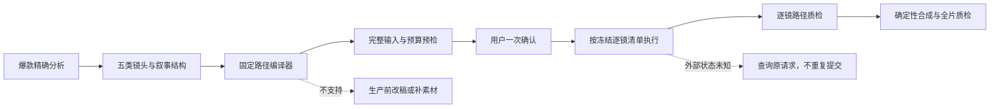
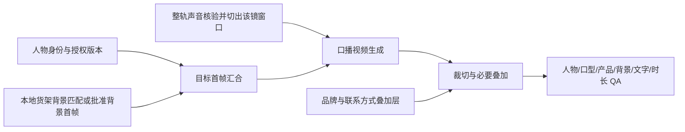

# 固定恒产视频生产路径 PRD

- 版本：`fixed-yield.v2`
- 日期：2026-10-15
- 状态：设计冻结；第二里程碑已实施（时间线、素材准入、计划 DAG、预算授权和运行状态合同），统一执行器尚未启用
- 范围：爆款分析完成后，到逐镜生产、合成与成片质检；不包含真实发布
- 设计依据：`docs/product/PRD-灵枢AI全系统UI设计规范-v2-2026-10-09.md`

## 1. 结论

生产链不再根据每条爆款视频临时拼接技术栈，而是把爆款分析结果编译到五条固定生产路径，按当前义乌 2B 工厂客户的实际重要性排序：

1. 真人口播；
2. 产品实拍；
3. 工厂实拍；
4. D2C 消费者演示；
5. 其他通用素材。

爆款视频提供叙事作用、镜头顺序、物理切点、每镜时长、景别与构图证据；不再决定供应商、模型、未验证复杂动作或跨路径降级。每个成片时间线镜头必须选择一个版本化镜头原型；原型固定输入、执行器、质检和失败处理，但输出时长默认继承爆款视频对应物理镜头的实测时长，不再压成固定 2/3/4 秒。

五条路径“固定”的是能力边界和执行拓扑，不是镜头时长。供应商只支持离散请求时长时，可以按供应商最小时长生成，但最终剪辑时间线必须裁切回参考镜头的实测时长，并保留生成时长与交付时长两个字段。

整个方案的核心不是再增加一层路由，而是取消运行中的二次路由：



### 1.1 本次工程里程碑边界与真实启用状态

本次实施只收口仓库中已经真实存在的能力，不新增模型、供应商、视频生成方式或发布能力：

- 已建立 22 个镜头原型的素材规则注册表，并把 P2–P5 新计划收口到企业本地已授权视频的同类、同原型、同 SKU 硬匹配；
- 已移除新计划中产品 I2V、图片动效、通用动态图形和跨类别素材兜底，旧冻结计划只保留兼容读取；
- 已定义数字人口播镜头的并行执行图，使人物、声音、背景、动作底片、CTA 叠加、合成与 QA 的依赖可测试、可恢复；
- 已定义开工资料偏好与服务端证据分离的预检合同，并把公开联系方式、CTA、本轮人物策略前移到新手引导；
- 新手引导生成首轮计划时强制关闭旧的“缺画面自由生成”开关，缺同类素材只能在零付费阶段补素材、换参考或改计划；
- 已完成无副作用的 `fixed-yield.v2` 逐镜时间线编译、版本化素材片段准入、不可变操作 DAG、一次返修预算授权、供应商 readiness 快照校验、逐操作状态机和结构化 QA 合同；这些模块均有独立回归测试。
- Digital Employee 周计划当前只写入 `fixed-yield.v2-preflight`，表示新的零费用编译与门禁已生效，但媒体执行仍由现有 legacy stage runner 完成。它不得在界面、接口或交付说明中被称为“V2 统一执行器已上线”。
- `fixed-yield.v2` 统一执行器、操作回执持久化、进程重启恢复、真实供应商探针和 Starter198/DigitalEmployee 两套运行时合并继续按第 14 节推进；在完整端到端验收前不切换版本标记，也不允许调用方用布尔值自行声明供应商可用。

## 2. 为什么当前链路会反复卡住

当前仓库已经有五类镜头、素材边界、预算预占、供应商回执、幂等键和质量门禁；缺的不是更多局部能力，而是一个唯一、贯穿全链的生产合同。

已确认的结构性问题包括：

- 五类 `materialType` 在部分分析到生产包的转换中丢失，后续又从文案或画面描述重新猜测，同一镜头可能在不同阶段得到不同分类；
- 能力注册表、五类素材策略、六条 capability route、七类 shot type 和前端推荐各自维护，没有同一版本真源；
- `general` 在规划阶段允许本地动态图形，但执行阶段又被纳入“必须存在真实本地视频”的门禁，合法计划会在执行时必然失败；
- `assets` 粗阶段内部同时做分析、路由、匹配、预算、配音、数字人和产品 I2V，单镜失败难以从准确检查点恢复；
- 运行时仍可能遍历适配器、改变路线或按错误文本判断重试；
- 历史任务与新 `type-aware.v1` 任务行为不同，Starter198 和 DigitalEmployee 也仍是两套执行运行时；
- 曾出现 37 个镜头进入 36.69 秒成片，造成 FFmpeg 输入数量、逐镜绑定与质检上限问题。参考片物理切镜数、成片时间线镜头数、实际生产资产数和供应商子请求数是四个不同口径，不得直接等同。

所以固定路径必须同时固定四件事：**业务分类、镜头原型、执行拓扑、恢复语义**。只固定供应商名称不能解决问题。

## 3. 设计原则

### 3.1 一个成片时间线镜头只归一类

- `talking_head / factory / product / consumer_demo / general` 是唯一业务分类。
- `unknown` 是分析缺口，不是第六条生产路径。
- `hook / pain_point / capability_proof / product_intro / effect_proof / cta / transition` 是叙事作用，不得与素材类型混用。
- 每个成片时间线镜头只有一个 `materialType`、一条路径和一个镜头原型；同一高层段内如果同时存在产品与工厂物理切镜，必须编译成多个时间线镜头，不能给一个镜头标两条路径。
- `materialType` 从爆款分析原样贯穿周计划、逐镜脚本、素材方案、执行回执和质量报告；任何阶段不得再次从自由文本推断。

### 3.2 爆款只决定结构，不决定生产拓扑

允许继承：

- 叙事作用及先后关系；
- 五类素材的相对顺序；
- 经确定性切镜得到的每镜起止时间与实测时长；
- 快、中、慢节奏及节奏在时间线上的变化；
- 能被固定原型表达的景别、构图或轻量运镜；
- 有证据的口播和画面作用。

不允许继承：

- 外部爆款参考的原像素、原人物、原声音或原台词；
- 供应商选择和模型参数；
- 无物理切点证据的伪精确时长、任意复杂动作和不可执行的构图；
- 当前能力地图不支持的动作、场景、产品效果或事实主张；
- 未通过授权与用途边界的参考素材。

参考资产必须分成两个不同角色：

- `trendReference`：用于学习结构、切点、时长、景别和叙事作用的外部爆款；默认禁止把原像素、原声音或原人物提交给生成模型或放入成片。
- `performanceReference`：企业自有，或已取得明确模型输入与派生使用授权的动作/场景底片；只有它可以进入数字人管道 2。外部爆款只有在权利证据完整且显式升级为此角色后才可使用，不能因链接可访问就自动升级。

### 3.3 前景讲话人优先于背景分类

- 只要镜头中有可确认的前景主讲人面向镜头讲话，`materialType` 必须是 `talking_head`；工厂、仓库、货架或产品堆只是口播场景特征，不能把该镜改分成 `factory` 或 `product`。
- 只有人物离开主体、镜头的视觉任务转为产品、机器、工人或工序时，才转入对应的实拍路径。
- 数字人生成尚不能稳定支持真实物理产品接触；参考镜头中人物拿、拆、按压或使用产品时，优先使用企业已有真人素材，否则拆成“口播 + 产品插镜”或生成补拍任务，不让数字人硬做握持动作。

### 3.4 逐时间段忠实匹配，不设默认时长占比

V2 不存在“默认成片时长占比”、周级口播多数或路径配额。真人口播仍是产品体验、质量投入和能力建设的最高优先级，但这个优先级只决定**口播路径要做得最完整**，不能改变已选爆款参考的物理时间线。

每条通过准入的参考视频都必须先形成完整且无重叠的物理切镜区间。对每个 `[sourceFrameStart, sourceFrameEndExclusive)` 区间：

- 该区间在参考片中是什么类型镜头，成片同一时间段就匹配制作什么类型镜头；人物口播、产品、工厂、D2C 和通用素材之间不得互相顶替；
- 除已有证据的转场噪声外，全部参考帧必须恰好映射一次，不能为了突出人物而删除产品/工厂段，也不能为了补素材而插入参考中不存在的人物段；
- 匹配结果必须保留原物理切点和实测时长，只有供应商请求时长可以向上取支持档位，交付仍精确裁回原区间；
- 某一非口播区间缺本地素材时，只能在付费前补充同类本地素材、更换参考视频或生成新的计划修订；不得重分类为数字人、图片动效或自由 AIGC；
- `contentStrategy/contentIntent` 只表达选题与叙事意图，不能改变镜头类型、时间范围、时长或当前可执行方式。

因此，样片 1 中人物约 44%、产品约 26%、工厂/研发约 30% 只是该参考片的分析结果，不是目标比例；系统必须原样覆盖这些区间。样片 2 几乎全片为人物 + 货架背景，也同样按其真实切镜逐段生产。

### 3.5 先编译完整计划，再开始生产

用户确认预算前必须一次性知道：

- 最终会生产多少个镜头；
- 每镜走哪条路径、哪个镜头原型和哪种生产模式；
- 使用哪个本地素材片段、人物版本或产品身份图；
- 哪些调用付费供应商；
- 正常生产与一次允许返修的总预留上限；
- 所有硬缺口和唯一补齐入口。

确认后，原计划不得在运行中新增付费步骤、改变供应商、改镜头时长或再次要求预算确认。确需改变时，生成新计划版本并重新确认。

### 3.6 生产中禁止跨路径自动降级

“降级”只能发生在生产前，并形成用户可见的新计划：

- 真人口播缺能力时，不能静默变成图文卡；
- 工厂或 D2C 缺真实素材时，不能生成虚构画面；
- 产品生成失败时，不能用静态缩放伪装成已生成产品场景；
- `unknown` 不能因库存中恰好有素材而被放行；
- 外部供应商结果未知时，只能查询原请求，不能换供应商重提。

## 4. 固定路径总表

| 路径 ID | 业务分类 | 优先级 | 可使用的已有生产方式 | 缺口处理 |
| --- | --- | --- | --- | --- |
| `P1_PRESENTER` | 真人口播 | 最高 | 当前实现数字人管道 1/2/3；共用冻结人物、声音和连续口播时间轴，并按镜头原型拆成可并行的声音、人物、背景、动作/构图和叠加层分支 | 缺人物/授权/声音/背景输入时在付费前阻断 |
| `P2_PRODUCT_REAL` | 产品实拍 | 高 | 当前只做已授权同 SKU 本地视频匹配、精确取段与 FFmpeg 标准化 | 无合格本地素材则补充或补拍；产品 I2V/图片动效仅属未来规划，不进入 V2 执行 |
| `P3_FACTORY_REAL` | 工厂实拍 | 高 | 当前只做已授权企业工厂视频语义匹配、精确裁切、FFmpeg 标准化 | 只能换同类真实素材或补拍，不生成或伪造工厂 |
| `P4_CONSUMER_REAL` | D2C 真人演示 | 中低 | 当前只做已授权真人使用视频语义匹配、精确裁切、FFmpeg 标准化 | 无真实使用素材则补拍，不生成消费者或效果证据 |
| `P5_GENERAL_EVIDENCE` | 其他通用素材 | 中 | 当前只做已授权展会、客户案例、仓储物流、品牌收尾等本地视频匹配和精确取段 | 缺同类本地素材、事实或授权时改稿/补充；动态图形与自由 AIGC 仅属未来规划 |

`customer_product_image_animation`、`product_scene_i2v`、`product_motion_graphics`、`motion_graphics`、`concept_visual`、`ugc_actor`、自由 AI B-roll 和浏览器本地推荐都不是 `fixed-yield.v2` 的当前执行能力。它们只能保留为未来版本的设计项，完成独立真实验收并升级路径版本后才能开放，不能进入当前能力快照、计划、预算或运行时。

## 5. V2 镜头原型与技术栈

V2 固定“原型 + 生产模式 + 质检”，不固定镜头秒数。每个原型的 `targetOutputDuration` 来自参考片实测切点。

### 5.1 两条样片形成的路径基准

- 样片 1 `trend_videos_abb247c15cd74f14af94817c6b52b357.mp4` 时长 33.576 秒，是“人物叙事主脊 + 产品/工厂证据插镜”，粗分为人物约 44%、产品约 26%、工厂/研发约 30%。人物段约 3.5–6.3 秒，产品、生产和质检插镜多为 1.0–2.0 秒。
- 样片 2 `Download-5.mp4` 时长 33.067 秒，几乎全片都是人物 + 货架/产品仓背景，五个主要画面段约为 9.2/8.7/6.0/4.0/5.2 秒。字幕约每秒更新，但不代表每条字幕都是新镜头。
- 两片都接近全程连续语音，因此声音、字幕、配乐必须使用一条连续主时间轴；人物、产品和工厂只是视觉层切换，B-roll 覆盖时口播不停止、不重新合成。
- 上述时长区间是 `observedValidationBand`，只用于能力风险提示，不作为统一秒数规则。

用户指定的 TikTok 产品货架案例归入 `P2B_PRODUCT_SHELF`；实际进入生产前仍须按通用参考视频流程完成下载、物理切镜、授权与准入，不仅根据链接文案直接生产。

### 5.2 四层媒体模型、操作 DAG 与动态时长合同

整条链必须显式分成四层媒体对象，计数、计费和状态不得混用：

1. `ReferencePhysicalShot`：参考片中由确定性切镜得到的原始物理镜头，保存原帧边界与切点置信度；
2. `FixedYieldTimelineShot`：成片编辑时间线上的逻辑镜头，只能有一个 `materialType/pathId/archetypeId`；
3. `FixedYieldProductionAsset`：为一个时间线镜头实际制作、验收和结算的媒体资产，冻结输入、执行绑定、成本与 QA；
4. `ProviderSegment`：当外部视频供应商时长上限要求拆段时，对最终视频输出的逻辑时间分段；它不是付费调用。未拆分的外部视频资产有且仅有一个分段，纯本地视频资产为零个。

V2 中 `FixedYieldTimelineShot` 与 `FixedYieldProductionAsset` 强制一一对应；需要多次供应商调用时只能拆 `ProviderSegment/ProductionOperation`，不能为同一时间线镜头增加资产。只有相邻参考物理镜头属于同一类型、同一原型，且其中切点没有独立叙事或动作意义时，编译器才可将它们映射到一个时间线镜头；每个原切点和输出窗口仍必须完整保存。不同路径的物理镜头绝不得合并。

实际执行另由不可变的 `ProductionOperation` DAG 表达。一个 `ProviderSegment` 可以有多项串行或并行操作，例如 `人物/本地背景准备 → Seedream 目标首帧 → HeyGen/Seedance 视频生成 → 本地裁切 → QA`。每项外部调用各自拥有供应商绑定、输入、成本和幂等键，不能再把“最终视频时间段”和“一次付费操作”当成同一个对象。

共享合同至少定义：

```ts
type ReferencePhysicalShotDisposition =
  | { state: 'mapped'; mappingId: string; timelineShotId: string }
  | { state: 'excluded_transition_noise'; evidenceRef: string };

interface ReferencePhysicalShot {
  referenceShotId: string;
  sourceRef: string;
  sourceTimebase: { numerator: number; denominator: number };
  sourceFps: number | null;
  sourceFrameStart: number;
  sourceFrameEndExclusive: number;
  referenceDurationMs: number;
  cutConfidence: number;
  disposition: ReferencePhysicalShotDisposition;
}

interface ReferenceShotMapping {
  mappingId: string;
  referenceShotId: string;
  sourceFrameStart: number;
  sourceFrameEndExclusive: number;
  shotOutputStartMs: number;
  shotOutputEndMs: number;
}

interface ProviderSegment {
  segmentId: string;
  targetStartMs: number;
  targetEndMs: number;
  videoRequestDurationMs: number;
  continueFromSegmentId: string | null;
  initialRenderOperationId: string;
  repairRenderOperationId: string | null;
  deliverableOperationId: string;
}

interface ReferenceBoundDuration {
  mappedReferenceDurationMs: number;
  targetOutputDurationMs: number;
  providerVideoRequestDurationMs: number | null;
  providerSegments: ProviderSegment[];
  speechBeatMap: Array<{ startMs: number; endMs: number; textRef: string }>;
}
```

规则：

1. `ReferenceShotMapping.shotOutputStartMs/shotOutputEndMs` 是相对当前 `FixedYieldTimelineShot` 起点的坐标，不是全片坐标。`mappedReferenceDurationMs` 是该镜所有映射输出窗口长度之和；`targetOutputDurationMs` 默认与它一致。单物理镜头映射直接使用该镜帧边界，多镜映射必须保存每个原切点。生产资产上的 `duration.mappedReferenceDurationMs/targetOutputDurationMs` 必须与其时间线镜头一致。
2. `providerVideoRequestDurationMs` 只统计该资产所有 `ProviderSegment.videoRequestDurationMs` 的总和；本地执行为 `null`。首帧生成、视觉 QA 等非时长计价操作的成本只进入对应 `ProductionOperation`。供应商只支持离散时长或最小时长时，每个视频生成请求选择能覆盖对应目标段的最小档，生成后本地精确裁回 `targetOutputDurationMs`。
3. 超出供应商单次上限的长镜只能在编译期显式冻结为多个 `providerSegments`，不能等执行时临时拆分。所选执行器必须声明并通过多段连续性验收；否则该镜在生产前改稿、改用合格真实素材或拆成新的内容任务。拆分点必须落在语音或动作安全点；后一段以 `continueFromSegmentId` 引用已验收前段 `deliverableOperationId` 的末帧，每个视频生成操作有独立幂等键，并通过接缝/背景/人物连续性 QA 后再拼接成一个逻辑镜头。
4. 不得用循环、冻结尾帧、无意义慢放或重复台词补时长。无法覆盖时在生产前改稿或换合法素材。
5. 物理镜头和 speech beat 必须分开。一个 9 秒画面可以包含多个字幕句子，不得因每句字幕重复生成画面。
6. 新口播文本必须在预算确认前完成一次无付费或已缓存的时长测算。文本无法在参考窗口内以可接受语速说完时，应先改写脚本或改选参考段；生产中不得强行加速、截断或延长镜头。
7. “误差不超过 1 帧”以 `ReferencePhysicalShot` 冻结的 `sourceTimebase/sourceFrameStart/sourceFrameEndExclusive` 计算；可变帧率源片先生成帧时间戳索引，不得只靠四舍五入后的毫秒值判断边界。
8. `providerSegments` 必须按 `targetStartMs` 升序，时间窗口无重叠、无空洞，并完整覆盖 `[0, targetOutputDurationMs)`。每段恰有一个始终激活的 `initialRenderOperationId`、零或一个预算前冻结的 `repairRenderOperationId`，并由本地 `deliverableOperationId` 在初稿/返修中选择唯一已验收输出；同一段还可被首帧生成、裁切和 QA 等操作引用。
9. `ProductionOperation` 必须构成无环 DAG：依赖必须存在，拓扑顺序固定，外部操作逐项计费与幂等，本地编排不隐式提交供应商。主操作与可选的一次返修操作都在预算确认前冻结为不同 `operationId/operationKey`；返修节点只有在指定 QA 失败码出现时才激活。
10. `speechBeatMap` 和声音 `cueMap` 只驱动整轨声音测算、音频切片、字幕与口型校验，绝不得创建新的 `FixedYieldTimelineShot`、`FixedYieldProductionAsset`、`ProviderSegment` 或视觉 `ProductionOperation`。视觉生产的最小单位永远是时间线镜头；供应商上限需要拆分时才按已冻结的 `ProviderSegment` 生成。
11. 下游依赖上游运行结果时，不在冻结计划中伪造结果 SHA；core 只用 `producerOperationId + outputName + selector + expectedMediaKind/dataClass` 冻结符号依赖，真实输出 SHA 和 producer operation key 只写入不可变回执与 resolved provider operation manifest。下游提交前必须核验上游回执、选择器与传递式 lineage。

### 5.3 P1 真人口播：精做主路径

口播原型：

| 原型 ID | 义乌 2B 典型画面 | 路由重点 |
| --- | --- | --- |
| `P1A_FACTORY_WALK_TALK` | 人物在工厂、研发走廊或展厅边走边讲 | 只有企业自有真人底片，或企业自有/明确授权的动态 `performanceReference` + 全保留人物替换可用 |
| `P1B_FACTORY_STAND_TALK` | 人物稳定中景讲解，背后是真实车间/研发环境 | 静态背景可用批准首帧 + 连续语音；背景中工人或机器持续运动时改走动态底片边界 |
| `P1C_SHELF_STAND_TALK` | 人物在货架、产品仓或样品间中景直说 | 背景必须是当前企业可用的真实图像/视频，不自由生成库存证据 |
| `P1D_SHELF_ACTION_TALK` | 人物推车、走动、转身或展示空间 | 优先真实实拍；数字人仅在动作和背景保留能力已通过时使用 |
| `P1E_PRESENTER_CTA` | 回到人物的中/近景收尾 | 可走标准口播，但联系方式与承诺须有事实引用 |
| `P1F_REAL_PRODUCT_CONTACT` | 真人手持、拆包或操作产品同时讲解 | 只使用已有真人实拍，或管道 2 中声明保留产品/背景/构图的 `local_head_pipeline`；其他情况拆成口播与产品插镜 |

数字人三管道映射：

| 已有管道 | 适用场景 | 真实技术栈 | 当前边界 |
| --- | --- | --- | --- |
| `pipeline_1` 标准口播 | 稳定中/近景、轻手势、无物理产品接触 | 冻结人物 + 冻结声音规格/整轨切片 + HeyGen v3 视频或照片口播 + 媒体检查 | 裸 HeyGen 不保证自定义动作、精确工厂/货架场景或背景保留；场景必须先成为批准首帧/预合成输入 |
| `pipeline_2` 整段参考驱动/人物替换 | 使用 `performanceReference` 保留原动作，或必须保留产品、背景和构图 | 先冻结 `replace` 或 `reenact + direct_reference` 子模式，再从下表的兼容执行器中选唯一一个；只有运行环境、对象存储、预算端口、开关和 `qualityInspection` 同时 ready 才进入快照 | 当前代码可能在视觉 QA 未就绪时仍注册适配器，这是待修 P0；不得把只支持“参考重演”的执行器冻结给“保留原像素的人物替换” |
| `pipeline_3` 时间线镜头首帧重建 | 保留爆款物理构图和节奏；外部爆款默认只提供结构化构图，不提供原像素 | 每个 `FixedYieldTimelineShot` 构图规格 → 企业人物/背景资产 → Seedream 目标首帧 → 背景锁定 → HeyGen 照片口播或方舟 Seedance → 每时间线镜头 QA 和拼接 | 保留现有 `sentence_first_frame` 路由 ID 仅为迁移兼容；V2 绝不按 speech beat/字幕句重复生成画面。需要源首帧像素时必须升级为有模型输入/派生授权的 `performanceReference` |

`pipeline_2` 子模式兼容矩阵：

| 子模式 | 必须保留的语义 | V2 当前可进入执行快照的适配器 | 不可混用的能力 |
| --- | --- | --- | --- |
| `method=replace` | 保留参考片原产品、背景、构图和动作，只替换人头/人物身份 | 只有 readiness 和视觉 QA 都通过的 `local_head_pipeline`；`runway_kling_motion` 目前未注册真实执行适配器 | Runway Act-Two、Seedance Reference 和 self-hosted reenact 不得宣称保留原像素 |
| `method=reenact, replicationMode=direct_reference` | 以驱动片重演动作/节奏，接受生成新像素 | readiness 和视觉 QA 都通过的 Runway Act-Two 或 Seedance Reference，二者中只冻结一个 | `local_head_pipeline` 不是当前该子模式候选；Kling/self-hosted 目前仅规划层 |

现有 `candidateToolsFor` 在默认路由下已基本区分 `replace` 与 `reenact`，但显式 `preferredProvider=sd/kling` 分支仍可绕过 method 兼容性。V2 编译器必须先校验上表子模式，再接受供应商偏好；偏好不能扩展能力边界。

口播的稳定主音频目标方案：预算确认前为每条单成片冻结一份 `CanonicalVoicePlan`；有已验证音频就锁定 `existing_artifact`，否则锁定 `generate`、其唯一供应商生成操作和后续本地核验操作。确认后每片只获取一次连续口播，再按冻结视觉镜头窗口切片，以音频哈希和回执复用，不对每个视觉镜头重复发起 TTS。`pipeline_2/3` 若无法绑定企业声音，目标行为是无声生成画面，再混入统一音轨，不使用供应商随机音色；这一点当前尚未在所有 Seedance/参考驱动分支完整接通，未通过验收前不得将这些分支标为自动可用。

人物构图也要进入口播路径 QA。两条样片中观测到的人脸占画面宽度区间为：工厂走播约 11%–12%，稳定讲解约 16%–21%，货架中景约 23%–33%，远景动作约 12%–13%。这些是 `observedValidationBand`，用来发现人物过小、过大或构图漂移，不是强制的新固定模板。

人物 + 动态工厂作业背景的额外门禁：背景中的工人、机器、生产节奏和遮挡都属于需要保留的真实证据，只允许企业自有真人底片，或企业自有/明确授权的 `performanceReference` + `local_head_pipeline`。QA 还必须检查企业归属、背景运动连续性、人物遮挡边缘和机器动作完整性；一张批准首帧不足以证明动态背景可执行。

#### 5.3.1 数字人口播镜头的并行执行子图

“走管道 1/2/3”还不足以成为可恢复的执行计划。每个 `P1_PRESENTER` 时间线镜头必须在编译期展开成一份 `PresenterShotExecutionGraph`：图中每个分支要么引用已冻结企业资产，要么对应一个有输入、输出、readiness、幂等键、成本和 QA 的 `ProductionOperation`。互不依赖的分支并行，汇合点只能消费已验收输出，任何分支都不能在运行中另选供应商或改成其他生产方式。

```ts
type PresenterBranchRole =
  | 'canonical_voice'
  | 'presenter_identity'
  | 'background_scene'
  | 'performance_motion'
  | 'brand_contact_overlay'
  | 'target_first_frame'
  | 'talking_video'
  | 'layer_composite'
  | 'presenter_shot_qa';

interface PresenterShotBranch {
  branchId: string;
  role: PresenterBranchRole;
  parallelGroupId: string | null;
  dependsOnBranchIds: string[];
  source: 'frozen_enterprise_asset' | 'production_operation';
  operationIds: OperationId[];
  outputRef: string;
}

interface PresenterShotExecutionGraph {
  graphVersion: 'presenter-shot.v2';
  timelineShotId: string;
  archetypeId: string;
  productionMode: 'pipeline_1' | 'pipeline_2' | 'pipeline_3';
  targetOutputDurationMs: number;
  branches: PresenterShotBranch[];
  joinBranchId: string;
  finalQaBranchId: string;
}
```

编译规则：

- `canonical_voice` 是单片级整轨声音的镜头窗口引用，不为每个镜头重复生成 TTS；人物、背景和品牌叠加层可与声音准备并行；
- `presenter_identity` 冻结人物版本、授权和外观基线；若直接使用已授权人物图/数字人 ID，它是冻结输入而不是伪造一个供应商调用；
- `background_scene` 优先匹配已授权本地工厂、货架、样品间或展厅素材。管道 3 只有在当前已验收的 Seedream 首帧能力范围内，才可依据企业素材生成批准目标首帧；不能自由生成工厂产能、库存或产品证据；
- `performance_motion` 只存在于管道 2，输入必须是有模型输入及派生授权的 `performanceReference`；
- `brand_contact_overlay` 只能消费已确认的 Logo、品牌名、公开联系方式和 CTA，不得由模型猜测；
- `target_first_frame/layer_composite` 是显式汇合点。人物层、背景层或叠加层缺一项时不得提交后续视频生成；
- `talking_video` 只消费该镜已验收的目标帧/动作底片与 canonical voice slice；最终输出必须裁回爆款对应物理时间段；
- `presenter_shot_qa` 同时检查人物身份、授权版本、口型/ASR、背景归属、产品与文字、联系方式、时长和接缝；通过后才能进入 `asset_finalize`。

六种口播原型展开为以下固定执行子图：

| 原型 | 可并行准备 | 汇合与生成 | 当前硬边界 |
| --- | --- | --- | --- |
| `P1A_FACTORY_WALK_TALK` | canonical voice；动态 `performanceReference` 权利/动作/背景校验；人物身份 | 管道 2 替换或重演 → 精确裁切 → 人物/背景运动/口型 QA | 不单独生成动态工厂背景；没有合格动态底片就不准入 |
| `P1B_FACTORY_STAND_TALK` | canonical voice；人物身份；本地工厂背景匹配/批准首帧 | 人物 + 背景目标帧汇合 → 管道 1 或 3 → QA | 背景若含持续工人/机器运动，改用 `P1A` 的动态底片边界 |
| `P1C_SHELF_STAND_TALK` | canonical voice；人物身份；同企业货架/产品背景匹配；产品与库存标识核验 | 人物 + 货架背景目标帧汇合 → 管道 1 或 3 → 产品/文字/口型 QA | “生人物”和“准备/生成批准背景”可以并行，但背景只能来自企业资产及已验收首帧能力，不能凭空造库存 |
| `P1D_SHELF_ACTION_TALK` | canonical voice；动态底片授权/动作校验；人物身份 | 管道 2 → 精确裁切 → 动作、遮挡、产品和背景 QA | 不把人物、推车、产品和动态背景分别生成后硬合成；缺真实动作底片即不准入 |
| `P1E_PRESENTER_CTA` | canonical voice；人物身份；本地批准背景；品牌/联系方式叠加层 | 口播视频生成与联系方式层准备后汇合 → 叠加 → QA | CTA 和联系方式必须来自新手引导确认值，不能从脚本或历史文案猜测 |
| `P1F_REAL_PRODUCT_CONTACT` | canonical voice；有权利的真人产品接触底片；人物身份与同 SKU 校验 | 只走管道 2 `local_head_pipeline` → 产品/手部/背景/口型 QA | 当前不生成手、产品或接触动作；缺底片就拆镜、换参考或补拍 |

以“人物 + 货架产品背景”为例，冻结后的拓扑是：



并行是为了缩短等待和隔离失败，不是增加重复付费：同一分支在同一 `operationKey` 下最多提交一次；已有企业资产只做本地核验；若背景分支失败，不得重新生人物或重新合成整轨声音。

#### 5.3.2 初始配置中的本人录音

本人直接录音能力仍然存在，但当前入口不在初始配置第一页：用户需先完成或选择人物，进入“配置声音并保存”，再将声音来源切换为“录入本人声音”，才会看到浏览器直接录音、暂停、试听、重录和上传入口。现有实现使用 `MediaRecorder/getUserMedia`，包含回声消除、降噪、自动增益、60 秒自动停止和 10MB 上传校验。当前还有两个真实限制：授权回跳若已经带有 `voiceId` 会自动保存并跳过声音页；真正提交声音克隆只对已连接 HeyGen 私人资产账号的租户开放，因此其他租户虽然可能看到入口，最终仍会失败。

V2 必须修复“功能仍在但用户以为消失”的可发现性问题：

- 在人物选择页就展示“下一步可直接录入本人声音”，但录音仍在人物授权完成后执行，避免声音绑定到错误人物；
- 声音页始终显示两种明确入口：“使用已有声音”和“录入本人声音”，不得因为已有 `voiceId` 而直接跳过选择；
- 后端提供独立的 `voiceCloneReadiness`，包含账号能力、鉴权、配额和计费状态；前端不能用人物库能力推断声音克隆能力；
- `voiceCloneReadiness=unavailable` 时不显示可提交后才失败的录音表单，而要说明具体原因和管理员处理位置；
- 已绑定声音时显示“已使用现有声音”，同时保留“更换声音/重新录音”，不得让用户误以为录音功能被删除；
- 录音只负责建立可在周内复用的企业声音身份/克隆资产；每条有口播的成片因脚本不同，各自冻结一条有声 `CanonicalVoicePlan`，并只复用或生成该片唯一一份整轨 `CanonicalVoiceArtifactRef`。同一成片按视觉镜头窗口复用音频切片，不重复克隆或按镜头重复 TTS；无口播内容可显式冻结为 `none`。

### 5.4 P2 产品实拍

| 原型 ID | 画面定义 | 默认实现 |
| --- | --- | --- |
| `P2A_HANDHELD_PRODUCT_WALL` | 第一视角或只露手，手持当前产品，背景是大量同类产品重复堆叠 | 只匹配已授权同 SKU 本地真实视频 |
| `P2B_PRODUCT_SHELF` | 产品在货架/样品柜上成排展示 | 只匹配已授权同 SKU 本地真实视频 |
| `P2C_PACKAGE_DETAIL` | 包装、标签、结构、材质或细节特写 | 只匹配已授权同 SKU 本地微距视频 |
| `P2D_PRODUCT_MOTION` | 无手部交互的单一轻运镜 | 只匹配已授权同 SKU 本地真实视频 |

当前 V2 只通过 `productRef/SKU + OCR + 外观指纹 + 画面原型` 检索本地视频，覆盖 `targetOutputDurationMs` 后精确取段。产品 I2V、产品图片动效、静态图缩放和合成手部均为未来规划，不进入当前编译器；无合格本地视频时必须在生产前补素材、补拍、换参考或修订计划。

### 5.5 P3 工厂实拍

| 原型 ID | 画面定义 | 实现方式 |
| --- | --- | --- |
| `P3A_WORKER_PROCESS` | 工人完成一项生产、装配、包装或检验动作 | 已授权真实工厂视频语义检索 + 动作起止检测 + 精确取段 |
| `P3B_MACHINE_CLOSEUP` | 机器运行、灌装、旋盖、输送、喷码等特写 | 真实机器素材 + 稳定化/裁切，要求完整微动作循环或干净剪口 |
| `P3C_QC_PACKING` | 抽检、称重、贴标、装箱、码垛等交付证据 | 真实工厂素材 + 事实/审批边界核验 |
| `P3D_FACTORY_ESTABLISH` | 厂区、车间、研发室或产线环境 | 真实属地素材 + 竞品 Logo/产品/设备铭牌排查 |

该路径不调用画面生成。候选素材必须覆盖完整 `targetOutputDuration`、动作起点、峰值和结束；只允许有证据的轻微速率标准化，无合格片段就补拍。

### 5.6 P4 D2C 真人演示

| 原型 ID | 画面定义 | 实现方式 |
| --- | --- | --- |
| `P4A_USAGE_SETUP` | 使用前的真人、真实环境和正确产品 | 已授权 `person_usage` 真实视频 |
| `P4B_USAGE_ACTION` | 开盖、按压、涂抹、安装或操作中的一项完整动作 | 动作起止检测 + 同产品身份检查 + 精确取段 |
| `P4C_USAGE_RESULT` | 真实拍到的使用结束状态 | 只展示可见结果，不生成前后对比或功效证据 |

### 5.7 P5 通用证据与补充素材

| 原型 ID | 画面定义 | 实现方式 |
| --- | --- | --- |
| `P5A_EXHIBITION` | 展会、展位、现场交流和展品 | 真实授权展会素材，检查展会名、年份、展位与竞品信息 |
| `P5B_CUSTOMER_CASE` | 客户合作、交付或案例分享 | 必须绑定案例事实和对外使用授权；无证据不出现 |
| `P5C_LOGISTICS_WAREHOUSE` | 仓储、物流、出货和交付过程 | 真实素材检索 + 地点/标识/产品冲突检查 |
| `P5D_VERIFIED_FACT` | 参数、流程、认证或已确认事实 | 只匹配已授权且画面已承载该事实的本地视频；没有成片素材则当前版本不准入 |
| `P5E_BRAND_CTA` | 品牌收尾与行动引导 | 只匹配已授权本地品牌收尾视频，并核验已确认联系方式 |

当前 V2 不生成动态图形、事实卡或自由补充画面。即使事实和品牌资产已经确认，只有存在可直接匹配、裁切和标准化的本地视频时才可执行；图形渲染能力保留为未来版本规划。

### 5.8 生产模式与现有技术栈锁定

当前可执行模式严格收口为数字人管道 1/2/3 和本地视频匹配。编译器必须在开工前根据输入合同和实时 readiness 选定一个；运行中不再按成功与否尝试下一个。未来模式可以保留在设计目录中，但不得出现在 `fixed-yield.v2` 可执行能力快照里。

| 路径 / 生产模式 | 必要输入 | 锁定执行链 | 适用边界 |
| --- | --- | --- | --- |
| P1 / `pipeline_1` | 授权人物、冻结声音规格或 canonical audio slice、批准首帧 | HeyGen v3 视频/照片口播 → 媒体检查 → 人物、ASR、口型、背景和时长 QA | 稳定讲话优先；不承诺复杂动作、真实产品接触或未批准背景 |
| P1 / `pipeline_2` | `performanceReference`、目标人物、已冻结的 `replace` 或 `reenact + direct_reference` 子模式、保留要素和派生/模型输入授权 | 依子模式兼容矩阵从 `execution=true && qualityInspection=true` 的候选中冻结唯一执行器 → 供应商/本地执行 → 保留要素 QA | `replace` 保留原像素时只能用 `local_head_pipeline`；`direct_reference` 重演才可用已就绪的 Runway Act-Two 或 Seedance Reference |
| P1 / `pipeline_3` | `trendReference` 的结构化构图证据、时间线镜头映射、目标人物、批准目标首帧、背景锁；或有权利证据的 `performanceReference` | 外部爆款先在租户边界内转成结构化 `compositionSpec`，只把描述和企业资产交给 Seedream；像素引导模式必须另有模型输入/派生授权 → 每 `timelineShot/providerSegment` 执行 HeyGen 照片口播或方舟 Seedance → 镜头 QA → 确定性拼接 | speech beat 只用于声音切片与字幕，绝不产生额外画面调用；当前按 cue 生成和源帧授权缺口修复前不可进入 V2 |
| P2 / `local_video_match` | 同租户、同 SKU、已授权产品视频 | 产品/SKU/OCR/外观指纹检索 → 动作与物理切点检测 → FFmpeg 精确取段 → 产品 QA | 当前唯一产品执行模式；不调用 I2V 或图片动效 |
| P3 / `local_video_match` | 企业真实工厂素材、来源/授权、工序标签 | 租户素材检索 → 工人/机器/工序动作段检测 → 竞品与标识检查 → FFmpeg 取段和标准化 | 当前唯一工厂执行模式；不调用画面生成，不用图库假装企业工厂 |
| P4 / `local_video_match` | 同产品真人使用素材、人物和用途授权 | 人物/产品/动作检索 → 动作起止和结果边界检测 → FFmpeg 取段 → 用途与产品一致性 QA | 当前唯一 D2C 执行模式；无真实使用素材即不准入 |
| P5 / `local_video_match` | 展会/案例/物流/品牌收尾等已授权本地视频与事实引用 | 同类素材检索 → 授权/事实/标识检查 → FFmpeg 精确取段 → QA | 当前唯一通用素材执行模式；不生成动态图形或事实卡 |

P1 内部的确定性选择顺序是：稳定讲话用管道 1；必须保留整段动作或原画面要素用管道 2；必须按物理镜头重建构图与节奏时才用管道 3。选择依据会写入计划，优先级不是运行时降级顺序。P2–P5 不做候选遍历：只匹配本地视频，匹配失败即在零付费阶段返回结构化素材缺口。

未来规划中的产品 I2V、产品图片动效、通用动态图形、生成式产品/工厂/消费者画面必须使用新的路径版本和独立 readiness；它们不能复用 `fixed-yield.v2` 的“已实现”标记。

### 5.9 镜头原型与素材精细匹配合同

素材库不能只给视频打“产品/工厂/其他”三个粗标签。每个已分析的本地视频片段都必须形成版本化 `LocalMaterialSegmentProfile`；生产计划匹配的是**片段**，不是整文件。没有结构化片段画像的文件只能留在素材库等待分析，不能自动进入生产。

```ts
interface LocalMaterialSegmentProfile {
  segmentProfileVersion: 'fixed-yield-material-segment.v2';
  tenantId: string;
  assetId: string;
  segmentId: string;
  sourceRevision: string;
  startMs: number;
  endMs: number;
  materialType: Exclude<BenchmarkMaterialType, 'unknown'>;
  archetypeCandidates: FixedYieldArchetypeId[];
  materialRoles: SocialMaterialRole[];
  productId: string | null;
  productRef: string | null;
  interactionKind: SocialInteractionKind;
  environmentKind: SocialEnvironmentKind;
  productUsageKind: SocialProductUsageKind;
  observedActionTags: string[];
  framingTags: string[];
  cameraMovementTags: string[];
  entityAndTextTags: string[];
  rightsEvidenceRefs: string[];
  modelInputAllowed: boolean;
  derivativeUseAllowed: boolean;
  confidence: number;
  cleanEntry: boolean;
  cleanExit: boolean;
  productionEligible: boolean;
}
```

每种镜头原型的当前素材匹配如下：

| 镜头原型 | 必需素材类别与观测特征 | 必须一致 | 明确排除 |
| --- | --- | --- | --- |
| `P1A_FACTORY_WALK_TALK` | `presenter + factory/environment` 动态 `performanceReference`；人物行走/移动讲解，背景动作连续 | 人物授权、企业场景归属、动作时长、构图/运动方向 | 静态背景、外部爆款像素、无派生授权底片 |
| `P1B_FACTORY_STAND_TALK` | 数字人身份 + `factory/laboratory` 背景图或视频片段；稳定站姿构图 | 企业场景归属、景别、人脸安全区、目标时长 | 他人工厂、无法核验的设备/产能、动态背景冒充静态首帧 |
| `P1C_SHELF_STAND_TALK` | 数字人身份 + `retail/warehouse` 货架或产品仓背景；产品成排展示 | 企业资产、可见 SKU/品牌文字、景别、背景安全区 | 竞品、错误 SKU、自由生成库存证据 |
| `P1D_SHELF_ACTION_TALK` | `presenter + environment/product` 动态 `performanceReference`；推车/转身/走动 | 人物/底片授权、动作路径、产品身份、背景连续性 | 分层硬合成的手部/推车/产品动作 |
| `P1E_PRESENTER_CTA` | 数字人身份 + 批准背景 + 本地品牌/联系方式叠加资产 | 品牌版本、CTA、公开联系方式、语言与安全区 | 模型猜测的号码、邮箱、网址或承诺 |
| `P1F_REAL_PRODUCT_CONTACT` | `presenter + product` 真人接触底片；手持/拆包/操作 | 同 SKU、人物授权、接触动作、背景、脚本窗口 | 假手、换产品、无底片生成接触动作 |
| `P2A_HANDHELD_PRODUCT_WALL` | `product` 本地视频；第一视角/手持，背景为同类产品堆叠 | 同 SKU、手持动作、背景产品类别、时长 | 数字人素材、不同 SKU、静态产品图 |
| `P2B_PRODUCT_SHELF` | `product + retail/warehouse` 本地视频；货架/样品柜成排陈列 | 同 SKU、陈列环境、景别、镜头运动 | 工厂过程、D2C 使用、I2V |
| `P2C_PACKAGE_DETAIL` | `product` 本地微距；标签、材质、结构或包装细节 | 同 SKU、OCR/包装拓扑、特写区域 | 模糊标签、不同版本包装、图片缩放 |
| `P2D_PRODUCT_MOTION` | `product` 本地视频；无手接触的平移/推进/环绕 | 同 SKU、真实运镜、起止状态、时长 | 生成式运镜、幻灯片/静态缩放 |
| `P3A_WORKER_PROCESS` | `factory` 本地视频；工人生产/装配/包装动作 | 企业工厂、工序、完整动作、时长 | 只有机器无工人、图库工厂、摆拍口播 |
| `P3B_MACHINE_CLOSEUP` | `factory` 本地视频；机器/灌装/旋盖/输送/喷码特写 | 企业设备、机器动作、景别、完整微动作 | 静止设备、错误工序、生成机器 |
| `P3C_QC_PACKING` | `factory` 本地视频；抽检/称重/贴标/装箱/码垛 | 企业工厂、质检/包装工序、事实标签 | 无法核验的认证/参数、普通产品陈列 |
| `P3D_FACTORY_ESTABLISH` | `factory/environment` 本地视频；厂区/车间/研发室/产线环境 | 企业场景、地点/标识、广中景、时长 | 他人工厂、竞品 Logo、静态图补帧 |
| `P4A_USAGE_SETUP` | `person_usage + product` 本地视频；使用前人物/环境/产品 | 人物用途授权、同 SKU、使用环境 | 主播口播、错误产品、生成消费者 |
| `P4B_USAGE_ACTION` | `person_usage + product` 本地视频；开盖/按压/涂抹/安装等完整动作 | 同 SKU、动作类型/起止、接触区域、授权 | 产品陈列、工厂动作、动作不完整片段 |
| `P4C_USAGE_RESULT` | `person_usage + product` 本地视频；真实可见使用结果 | 同 SKU、真实结果边界、人物授权 | 生成前后对比、功效推断、无来源结果 |
| `P5A_EXHIBITION` | `general/environment` 本地展会视频 | 展会/年份/展位、授权、场景 | 普通商场、错误展会、自由 AIGC |
| `P5B_CUSTOMER_CASE` | `customer_case` 本地视频 | 客户授权、项目身份、可公开事实 | 无授权客户、虚构结果、通用素材冒充案例 |
| `P5C_LOGISTICS_WAREHOUSE` | `general/environment` 本地仓储/物流/出货视频 | 企业地点、物流动作、标识/产品 | 纯产品货架、他人仓库、生成物流 |
| `P5D_VERIFIED_FACT` | `general` 本地事实承载视频，画面本身出现可核验流程/参数/认证 | 事实引用、文字/OCR、版本和授权 | 仅有文本事实但无本地视频、生成事实卡 |
| `P5E_BRAND_CTA` | `general` 本地品牌收尾视频 | Logo/品牌版本、已确认 CTA/联系方式、语言 | 临时生成片尾、过期联系方式、竞品标识 |

匹配器按以下顺序执行，任一硬条件失败即淘汰，不以总分覆盖：

1. 同租户、真实本地视频、非 synthetic、`productionEligible=true`、权利证据完整；
2. `materialType` 与目标路径完全相同，`archetypeCandidates` 包含目标原型，且无禁止角色；
3. 需要产品的镜头满足同一 `productId/productRef`；需要人物/客户/场景授权的镜头满足对应权利；
4. 片段可用时长覆盖爆款该物理区间，干净入口/出口满足剪辑要求；
5. 交互、动作、环境、景别、机位和镜头运动逐项匹配；
6. 在全部硬条件通过的候选中，再按语义相似度、复用次数、清洁切点和质量分排序；同一周内不重复使用同一 `assetId + segmentId`，除非用户在计划确认前显式允许；
7. 保存匹配证据、候选版本、选中片段和拒绝原因。素材更新或分析版本变化必须产生新计划修订，不在已确认计划中热替换。

素材管理前端必须围绕这份合同展示“生产可用性”，而不是只显示文件：每个素材卡显示已识别的可用镜头原型、产品/SKU、动作、环境、有效片段时长、授权状态和阻塞原因；用户补素材时直接看到当前周计划缺哪一种原型、还差几秒，以及拍摄建议。系统不得把“库里有一个视频”误判为“该镜头已有可用素材”。

## 6. 参考绑定的成片时间线

- 成片时长默认等于通过准入的参考时间段，可以是 33.576 秒等任意有证据的时长，不再只允许 15/30/45/60 秒。
- 平台的最短/最长规格在参考准入时检查；超出时在开工前选择参考子段或分成两条内容，不在生产中硬裁。
- 小于当期确定性切镜阈值、且没有独立叙事/动作证据的开头闪帧只记为转场噪声，不生成单独付费镜头。
- 数量上限不再按成片时长表手写，而由当期真实验收值分别提供：`runtimeMaximumReferencePhysicalShots`、`runtimeMaximumTimelineShots`、`runtimeMaximumProductionAssets`、`runtimeMaximumProviderSegments`、`runtimeMaximumProductionOperations`、`runtimeMaximumProviderOperations` 和 `runtimeMaximumAssemblyInputs`。任一媒体层或操作层超限时，只能在生产前拆成多个任务，或在不丢失物理切点、类型与叙事证据的前提下合并；不得为了通过上限改变参考节奏。

样片 1 的高层结构应编译为：

| 参考段 | 主路径 | 执行方式 |
| --- | --- | --- |
| 约 0.1–5.2s | `P1_PRESENTER` | 人物 + 研发/工厂环境走播 |
| 约 5.2–12.7s | `P2_PRODUCT_REAL` | 多个 1–2s 的真实产品证据插镜，连续口播不停 |
| 约 12.7–17.3s | 含 `P3_FACTORY_REAL` 与 `P2_PRODUCT_REAL` 的多个子段 | 研发、展示和工厂环境证据 |
| 约 17.3–20.8s | `P1_PRESENTER` | 回到人物讲解 |
| 约 20.8–27.3s | `P3_FACTORY_REAL` | 灌装线、机器和质检插镜 |
| 约 27.3–33.576s | `P1_PRESENTER` | 人物收尾与 CTA |

上表是方便阅读的高层区块，不是可直接执行的逐镜清单。例如 12.7–17.3 秒内同时有产品和工厂证据，编译时必须依原物理切点拆成多个 `FixedYieldTimelineShot`；单个时间线镜头仍只能有一条路径。

样片 2 保留 9.2/8.7/6.0/4.0/5.2 秒的五个主要视觉段，都属于 `P1_PRESENTER`；第四段的推车动作使用 `P1D_SHELF_ACTION_TALK`，其他为 `P1C_SHELF_STAND_TALK/P1E_PRESENTER_CTA`。字幕句只写入 `speechBeatMap`，不改变视觉镜头数。

## 7. 新手引导与开工资料合同

用户不应在周任务运行中才被要求补人物授权、声音、联系方式或本地素材。新手引导必须建立一份服务端 `ProductionOnboardingProfile`，并在最后一页给出“可生产范围”，而不是笼统显示“配置完成”。平台发布账号不属于视频生成必需项，可留到发布前处理，不能阻塞内容制作。

### 7.1 新手引导必须收集的内容

| 步骤 | 用户录入/确认 | 开工用途 | 阻塞级别 |
| --- | --- | --- | --- |
| 企业与品牌 | 对外企业/品牌名、企业类型、主要市场、输出语言、品牌语气、禁用词/禁用主张 | 脚本、字幕、Logo/品牌核验 | 所有生产必需 |
| 产品与事实 | 本周主产品/SKU、产品名称/版本、包装图、卖点、可公开参数/认证及事实来源 | 产品身份、OCR、口播事实和素材匹配 | 计划含产品时必需 |
| 联系方式与 CTA | 联系渠道类型、公开值（WhatsApp/电话/邮箱/网址/主页私信等）、展示文案、可公开确认、可选二维码 | `P1E/P5E` 和片尾 CTA | 计划含 CTA 时必需；不得猜测 |
| 数字人形象 | 选择已有或创建人物、正面照/本人视频、肖像与素材授权、成年人确认、人物版本 | 数字人管道 1/2/3 | 计划含口播时必需 |
| 声音 | 使用已有声音或浏览器本人录音、声音克隆授权、语言、发音/品牌词读法、声音版本 | 单片 canonical voice | 计划含口播时必需 |
| 场景背景 | 企业工厂、实验室、展厅、仓库、货架/样品间背景素材及归属/用途授权 | P1 背景分支与 P2–P5 本地匹配 | 由参考镜头类型决定 |
| 生产素材包 | 按 5.9 分类上传产品、工厂、D2C、展会、案例、物流和品牌收尾视频；绑定 SKU、场景、人物/客户授权 | 非口播镜头唯一当前来源 | 对已选参考所需原型必需 |
| 输出与预算 | 目标平台、画幅、字幕语言、预算上限、一次条件返修预留、期望交付时间 | 输出规格和一次性预算确认 | 所有生产必需 |

手机号或邮箱若只用于账号安全/通知，不得自动用于成片；只有用户在“公开联系方式”中显式确认的值才能进入 CTA。发布平台 OAuth、发布时间和发布审批属于 `publish_only`，新手引导可以提示但不能把它们伪装成生产门禁。

### 7.2 必填、条件必填与参考范围限制

字段分成三类：

- `production_required`：缺失时所有生产都不能开始，例如企业身份、语言、预算确认；
- `conditional_required`：只在冻结计划实际使用相关镜头时必需，例如产品 SKU、人物/声音授权、工厂背景和客户案例授权；
- `reference_scope_limiter`：没有上传某类素材时，不弹出运行中补资料，而是在参考选择阶段排除需要该原型的爆款。用户仍可先完成引导并生产其他可覆盖参考。

参考选择器必须先读取素材覆盖矩阵，再推荐爆款：若企业没有 `P3B_MACHINE_CLOSEUP` 可用片段，就不能把含该时间段的参考标为“可直接生产”；若用户坚持选择，只能在预算确认前生成“补拍/补素材”清单，不能启动后再暂停。

### 7.3 前端交互与保存语义

- 引导采用分步表单，每一步自动保存草稿；关闭后可继续，不丢上传与授权状态；
- 每一步同时显示“为什么需要”和“将用于哪些镜头”，技术管道名放在详情中，不要求用户选择供应商；
- 人物页提前说明下一步可本人录音；声音页始终同时显示“已有声音”和“录入本人声音”，不因已有 `voiceId` 自动跳过；
- 素材页按 5.9 的镜头原型分组，不要求用户一次上传所有类别；展示当前可覆盖的原型和不可选参考范围；
- 最后是“生产就绪检查”页：逐项显示 `ready/missing/expired/unavailable`、影响的镜头、唯一处理入口和最后核验时间；禁止只给一个总状态；
- 用户确认后冻结 profile revision。人物、声音、产品、联系方式、授权或素材变更都产生新 revision；已确认计划继续引用原版本，不被后台热更新；
- 用户开始生产前只做一次完整预检和预算确认。确认后除真实外部故障外，不再因引导数据缺失暂停。

```ts
interface ProductionOnboardingProfile {
  profileVersion: 'production-onboarding.v2';
  profileRevision: number;
  tenantId: string;
  enterpriseProfileRef: string;
  brandProfileRef: string;
  selectedProductRefs: string[];
  publicContactCtaRef: string | null;
  presenterIdentityRef: string | null;
  presenterAuthorizationRef: string | null;
  voiceIdentityRef: string | null;
  voiceAuthorizationRef: string | null;
  pronunciationLexiconRef: string | null;
  localMaterialInventorySnapshotId: string;
  targetPlatforms: string[];
  outputLanguage: string;
  outputAspectRatio: string;
  budgetApprovalPolicyRef: string;
  readiness: Array<{
    itemId: string;
    requirementClass: 'production_required' | 'conditional_required' | 'reference_scope_limiter' | 'publish_only';
    status: 'ready' | 'missing' | 'expired' | 'unavailable';
    affectedArchetypeIds: string[];
    reasonCode: string | null;
    actionRoute: string | null;
    checkedAt: string;
  }>;
}
```

## 8. 固定路径编译器

### 8.1 输入

编译器只接受通过严格生产准入的爆款分析：

- 周计划上下文已冻结 `contentStrategy/contentIntent`、计划视频总数、参考选择、逐参考完整时间线覆盖快照和新手引导 profile revision；
- 分析状态为 `ready`；
- 全片精确时间线完整；
- 每镜是物理镜头而非观察窗；
- 每镜有合法起止时间、非 `unknown` 素材类型、叙事作用、分类依据和画面证据；
- `trendReference` 与可选 `performanceReference` 角色已分离，后者有模型输入与派生使用权利证据；
- 脚本、产品身份、目标平台和目标成片时长已确定。

### 8.2 确定性映射

同一份业务输入、原型目录版本、能力地图版本、`runtimeReadinessSnapshotId`、`pricingSnapshotId` 和账号/配额快照必须得到同一份 `planCoreHash`；同一 `videoRunId` 内重复编译还必须得到同一份操作 manifest 与执行级 `planHash`。新 run 复用相同业务定义时保留相同 core hash，但必须产生新的操作键与 plan hash；任一冻结快照变化都必须生成新计划修订，不能沿用旧哈希。映射顺序固定：

1. 先校验每条参考的完整物理时间线：除有证据的转场噪声外，每一帧必须恰好映射一次；策略和内容意图不得改写镜头类型或时长；
2. 按 `materialType` 选择五条路径之一；
3. 前景主讲人证据优先；人物 + 工厂/货架仍进入 `P1_PRESENTER`；
4. 按 `narrativeRole + visualContract` 选择该路径内的镜头原型；
5. 直接冻结参考物理切点、`targetOutputDurationMs`、speech beat 和切点置信；
6. 按原型查找真实素材、批准首帧、授权人物、产品身份或事实输入；
7. 每条口播成片先冻结自己的 `CanonicalVoicePlan`：`spec` 包含文本、人物声音版本、语言、预估时长和视觉窗口映射，模式为 `none / existing_artifact / generate` 之一；此阶段不调用付费 TTS，也不伪造音频资产哈希；
8. 从冻结的 readiness、价格和账号/配额快照中选择唯一已就绪生产模式，并分别冻结声音、画面和本地处理操作的 adapter、provider、model、account、配置指纹、请求时长、输出规格、QA 和恢复策略；管道 2 必须先通过 `replace` 或 `reenact + direct_reference` 子模式兼容矩阵，供应商偏好不得绕过方法边界；
9. 汇总所有付费操作和一次允许返修的上限，生成不可变 `FixedYieldProductionPlan`。

编译器不得：

- 调用供应商；
- 遍历适配器寻找“碰巧能跑”的能力；
- 把一个类型改成另一个类型；
- 从历史计划复制未重新验证的素材匹配证据；
- 因预算不足缩短镜头、降低产品身份规则或跳过质检。

### 8.3 计划合同

> **目标合同与当前里程碑合同不是同一个 schema。** 本节定义的是统一执行器最终应实现的完整目标合同，schema 标识为 `fixed-yield-production-plan.v2`。当前仓库 `shared/contracts/fixedYieldProduction.ts` 实现的是第二里程碑子集，标识为 `fixed-yield-production.v2`：只冻结单项目时间线、readiness 快照、操作 DAG、最终输出、费用上限和哈希。它尚未包含本节要求的 weekly/task/video 身份层、`CanonicalVoicePlan`、物理镜头/生产资产四层合同、价格与账号配额快照标识及完整 `operationKeyManifest`。两者不线兼容；任何接口、UI 或 worker 都不得把当前 milestone subset 宣称或解析为完整 8.3 合同。

建议建立唯一共享合同：

```ts
type FixedYieldPathId =
  | 'P1_PRESENTER'
  | 'P2_PRODUCT_REAL'
  | 'P3_FACTORY_REAL'
  | 'P4_CONSUMER_REAL'
  | 'P5_GENERAL_EVIDENCE';

type FixedYieldProductionMode =
  | 'pipeline_1'
  | 'pipeline_2'
  | 'pipeline_3'
  | 'local_video_match';

type FuturePlannedProductionMode =
  | 'product_scene_i2v'
  | 'product_motion_graphics'
  | 'motion_graphics'
  | 'generated_factory'
  | 'generated_consumer';

type FixedYieldContentStrategy = 'yiwu_b2b_default' | 'custom_confirmed';
type FixedYieldContentIntent = 'reference_faithful';

interface FixedYieldWeeklyStrategySnapshot {
  weeklyStrategySnapshotId: string;
  contentStrategy: FixedYieldContentStrategy;
  plannedVideoCount: number;
  referenceCoveragePolicy: 'exact_physical_timeline';
  classifiedDurationMsByPath: Record<FixedYieldPathId, number>;
  excludedTransitionNoiseDurationMs: number;
  unresolvedReferenceDurationMs: 0;
  productionOnboardingProfileRevision: number;
  localMaterialInventorySnapshotId: string;
  customRevisionRef: string | null;
}

type OperationId = string;
type Sha256 = `sha256:${string}`;
type MediaKind = 'structured_json' | 'image' | 'video' | 'audio';
type OutputDataClass =
  | 'structured_no_source_pixels'
  | 'enterprise_pixels'
  | 'authorized_performance_pixels'
  | 'tenant_trend_pixels'
  | 'generated_pixels'
  | 'candidate_canonical_audio'
  | 'canonical_audio'
  | 'qa_report';
type ProviderSafeDataClass = Exclude<OutputDataClass, 'tenant_trend_pixels' | 'candidate_canonical_audio'>;

interface CanonicalVoiceSpec {
  textSha256: Sha256;
  language: string;
  voiceIdentityAssetRef: string;
  voiceIdentityAssetVersion: number;
  targetDurationMs: number;
  cueMap: Array<{ startMs: number; endMs: number; textSha256: Sha256 }>;
}

interface CanonicalVoiceProviderPayload {
  schemaVersion: 'fixed-yield-canonical-voice-provider-input.v2';
  text: string;
  textSha256: Sha256;
  language: string;
  voiceIdentityAssetRef: string;
  voiceIdentityAssetVersion: number;
  targetDurationMs: number;
  cueMap: Array<{ startMs: number; endMs: number; textSha256: Sha256 }>;
}

interface FrozenOperationIdentity {
  adapterId: string;
  capabilityVersion: string;
  provider: string | null;
  model: string | null;
  accountRef: string | null;
  configFingerprint: string;
  maximumCostFen: number;
}

interface CanonicalVoiceArtifactRef {
  assetRef: string;
  sha256: Sha256;
  durationMs: number;
  providerReceiptId: string | null;
}

type CanonicalVoicePlan =
  | { mode: 'none'; spec: null; specHash: null }
  | { mode: 'existing_artifact'; spec: CanonicalVoiceSpec; specHash: Sha256; artifact: CanonicalVoiceArtifactRef; verificationOperationId: OperationId }
  | {
      mode: 'generate';
      spec: CanonicalVoiceSpec;
      specHash: Sha256;
      generationOperationId: OperationId;
      verificationOperationId: OperationId;
    };

type ProviderInputSpec =
  | {
      inputId: string;
      sourceKind: 'frozen';
      role: 'composition_spec';
      compositionSpecId: string;
      compositionSpecRef: string;
      sha256: Sha256;
      mediaKind: 'structured_json';
      containsSourcePixels: false;
    }
  | {
      inputId: string;
      sourceKind: 'frozen';
      role: 'canonical_voice_spec';
      canonicalVoiceSpecSchemaVersion: 'fixed-yield-canonical-voice-provider-input.v2';
      canonicalVoiceSpecRef: string;
      canonicalVoiceSpecHash: Sha256;
      sha256: Sha256;
      mediaKind: 'structured_json';
      containsSourcePixels: false;
    }
  | {
      inputId: string;
      sourceKind: 'frozen';
      role: 'enterprise_asset';
      enterpriseAssetVersionId: string;
      sha256: Sha256;
      mediaKind: 'image' | 'video' | 'audio';
      rightsEvidenceRefs: [string, ...string[]];
    }
  | {
      inputId: string;
      sourceKind: 'frozen';
      role: 'authorized_performance_pixels';
      performanceReferenceId: string;
      sha256: Sha256;
      mediaKind: 'image' | 'video';
      modelInputAuthorizationRef: string;
      derivativeAuthorizationRef: string;
    }
  | {
      inputId: string;
      sourceKind: 'operation_output';
      role: 'generated_target_frame' | 'continuity_frame' | 'canonical_voice_slice' | 'generated_media_for_qa' | 'qa_repair_directive';
      producerOperationId: OperationId;
      outputName: string;
      selector:
        | { kind: 'whole' }
        | { kind: 'last_frame' }
        | { kind: 'time_range'; startMs: number; endMs: number };
      expectedMediaKind: MediaKind;
      expectedDataClass: ProviderSafeDataClass;
    };

type LocalOperationInputSpec =
  | ProviderInputSpec
  | {
      inputId: string;
      sourceKind: 'frozen';
      role: 'canonical_voice_artifact_for_verification';
      artifactRef: string;
      sha256: Sha256;
      mediaKind: 'audio';
      rightsEvidenceRefs: [string, ...string[]];
      window: { startMs: number; endMs: number };
    }
  | {
      inputId: string;
      sourceKind: 'tenant_only';
      role: 'trend_evidence';
      trendEvidenceId: string;
      sha256: Sha256;
    }
  | {
      inputId: string;
      sourceKind: 'operation_output';
      role: 'candidate_canonical_audio_for_verification';
      producerOperationId: OperationId;
      outputName: 'candidate_canonical_audio';
      selector: { kind: 'whole' };
      expectedMediaKind: 'audio';
      expectedDataClass: 'candidate_canonical_audio';
    }
  | {
      inputId: string;
      sourceKind: 'operation_output';
      role: 'canonical_audio_for_assembly';
      producerOperationId: OperationId;
      outputName: 'canonical_audio';
      selector: { kind: 'whole' };
      expectedMediaKind: 'audio';
      expectedDataClass: 'canonical_audio';
    }
  | {
      inputId: string;
      sourceKind: 'operation_output';
      role: 'initial_segment_media_for_finalize' | 'repair_segment_media_for_finalize';
      producerOperationId: OperationId;
      outputName: string;
      selector: { kind: 'whole' };
      expectedMediaKind: 'video';
      expectedDataClass: 'enterprise_pixels' | 'authorized_performance_pixels' | 'generated_pixels';
    }
  | {
      inputId: string;
      sourceKind: 'operation_output';
      role: 'initial_segment_qa_for_finalize' | 'repair_segment_qa_for_finalize';
      producerOperationId: OperationId;
      outputName: 'qa_report';
      selector: { kind: 'whole' };
      expectedMediaKind: 'structured_json';
      expectedDataClass: 'qa_report';
    }
  | {
      inputId: string;
      sourceKind: 'operation_output';
      role:
        | 'accepted_segment_for_asset'
        | 'accepted_local_media_for_asset'
        | 'accepted_asset_for_assembly'
        | 'assembled_video_for_qa'
        | 'assembled_video_for_finalize';
      producerOperationId: OperationId;
      outputName: string;
      selector: { kind: 'whole' };
      expectedMediaKind: 'video';
      expectedDataClass: 'enterprise_pixels' | 'authorized_performance_pixels' | 'generated_pixels';
    }
  | {
      inputId: string;
      sourceKind: 'operation_output';
      role: 'qa_report_for_finalize';
      producerOperationId: OperationId;
      outputName: string;
      selector: { kind: 'whole' };
      expectedMediaKind: 'structured_json';
      expectedDataClass: 'qa_report';
    };

type ProductionOperationRole =
  | 'canonical_voice_verify'
  | 'canonical_voice_generate'
  | 'composition_extract'
  | 'target_first_frame_generate'
  | 'visual_generate'
  | 'media_transform'
  | 'quality_inspect'
  | 'segment_finalize'
  | 'asset_finalize'
  | 'assembly'
  | 'content_finalize';

interface VideoOutputSpec {
  width: number;
  height: number;
  fpsNumerator: number;
  fpsDenominator: number;
  codec: 'h264';
  pixelFormat: 'yuv420p';
  container: 'mp4';
}

interface AudioOutputSpec {
  codec: 'aac' | 'pcm_s16le';
  sampleRateHz: number;
  channels: 1 | 2;
}

type OperationRequestSpecByRole = {
  canonical_voice_verify: {
    kind: 'canonical_voice_verify';
    canonicalVoiceSpecHash: Sha256;
    expectedTextSha256: Sha256;
    voiceIdentityAssetVersion: number;
    targetDurationMs: number;
    durationToleranceMs: number;
    qaProfileId: string;
  };
  canonical_voice_generate: {
    kind: 'canonical_voice_generate';
    inputContractId: string;
    canonicalVoiceSpecHash: Sha256;
    targetDurationMs: number;
    outputAudio: AudioOutputSpec;
  };
  composition_extract: {
    kind: 'composition_extract';
    compositionSchemaVersion: string;
    referenceShotIds: string[];
  };
  target_first_frame_generate: {
    kind: 'target_first_frame_generate';
    inputContractId: string;
    pathId: FixedYieldPathId;
    archetypeId: string;
    productionMode: FixedYieldProductionMode;
    digitalHumanPipelineId: 'pipeline_1' | 'pipeline_2' | 'pipeline_3' | null;
    presenterAssetVersionId: string | null;
    backgroundLock: 'none' | 'approved_static' | 'authorized_performance';
    outputImage: { width: number; height: number; format: 'png' | 'jpeg' };
  };
  visual_generate: {
    kind: 'visual_generate';
    inputContractId: string;
    pathId: FixedYieldPathId;
    archetypeId: string;
    productionMode: FixedYieldProductionMode;
    digitalHumanPipelineId: 'pipeline_1' | 'pipeline_2' | 'pipeline_3' | null;
    pipeline2Method: 'replace' | 'reenact' | null;
    pipeline2ReplicationMode: 'direct_reference' | null;
    presenterAssetVersionId: string | null;
    providerSegmentId: string | null;
    providerVideoRequestDurationMs: number;
    voiceSyncMode: 'none' | 'canonical_audio';
    outputVideo: VideoOutputSpec;
  };
  media_transform: {
    kind: 'media_transform';
    transformProfileId: string;
    sourceStartMs: number;
    sourceEndMs: number;
    targetDurationMs: number;
    outputVideo: VideoOutputSpec;
  };
  quality_inspect: {
    kind: 'quality_inspect';
    inputContractId: string;
    qaProfileId: string;
    qaThresholdsVersion: string;
    targetDurationMs: number | null;
  };
  segment_finalize: {
    kind: 'segment_finalize';
    segmentId: string;
    targetStartMs: number;
    targetEndMs: number;
    initialCandidateOperationId: OperationId;
    initialQualityOperationId: OperationId;
    repairCandidateOperationId: OperationId | null;
    repairQualityOperationId: OperationId | null;
    selectionPolicy: 'accepted_repair_else_accepted_initial';
  };
  asset_finalize: {
    kind: 'asset_finalize';
    productionAssetId: string;
    sourceMode: 'provider_segments' | 'local_media';
    orderedSegmentIds: string[];
    orderedInputOperationIds: OperationId[];
    targetDurationMs: number;
  };
  assembly: {
    kind: 'assembly';
    orderedTimelineShotIds: string[];
    targetDurationMs: number;
    voiceTrackMode: 'none' | 'canonical_audio';
    canonicalVoiceVerificationOperationId: OperationId | null;
    audioMixProfileId: string | null;
    outputVideo: VideoOutputSpec;
  };
  content_finalize: {
    kind: 'content_finalize';
    assemblyOperationId: OperationId;
    qualityOperationId: OperationId;
    outputVideo: VideoOutputSpec;
  };
};

interface ProductionOperationBase<R extends ProductionOperationRole> {
  operationId: OperationId;
  operationRole: R;
  scope:
    | { kind: 'content' }
    | { kind: 'asset'; productionAssetId: string }
    | { kind: 'segment'; productionAssetId: string; segmentId: string };
  dependencies: Array<{ operationId: OperationId; waitFor: 'succeeded' | 'terminal_including_skipped' }>;
  activation:
    | { mode: 'always'; attemptIndex: 0 }
    | { mode: 'on_quality_failure'; qaOperationId: OperationId; allowedFailureCodes: string[]; attemptIndex: 1 };
  outputs: Array<{
    outputName: string;
    mediaKind: MediaKind;
    dataClass: OutputDataClass;
  }>;
  identity: FrozenOperationIdentity;
  requestSpec: OperationRequestSpecByRole[R];
}

type ProductionOperation = {
  [R in ProductionOperationRole]:
    | (ProductionOperationBase<R> & { executionKind: 'provider'; providerInputs: ProviderInputSpec[] })
    | (ProductionOperationBase<R> & { executionKind: 'local'; localInputs: LocalOperationInputSpec[] })
}[ProductionOperationRole];

interface OperationKeyManifestEntry {
  operationId: OperationId;
  operationRole: ProductionOperationRole;
  identityHash: Sha256;
  requestSpecHash: Sha256;
  inputDescriptorHash: Sha256;
  operationKey: string;
}

interface FixedYieldTimelineShot {
  timelineShotId: string;
  referenceMappings: ReferenceShotMapping[];
  timelineStartMs: number;
  timelineEndMs: number;
  materialType: 'talking_head' | 'factory' | 'product' | 'consumer_demo' | 'general';
  narrativeRole: string;
  pathId: FixedYieldPathId;
  archetypeId: string;
  productionAssetId: string;
  targetOutputDurationMs: number;
}

interface FixedYieldProductionAsset {
  productionAssetId: string;
  timelineShotId: string;
  productionMode: FixedYieldProductionMode;
  duration: ReferenceBoundDuration;
  tenantOnlyTrendEvidence: {
    sourceRef: string;
    referencePhysicalShotIds: string[];
    contentSha256: Sha256;
    transferPolicy: 'tenant_only';
  };
  compositionSpec: {
    compositionSpecId: string;
    ref: string;
    sha256: Sha256;
    mediaType: 'application/json';
    containsSourcePixels: false;
  } | null;
  performanceReference: {
    performanceReferenceId: string;
    sourceRef: string;
    contentSha256: Sha256;
    modelInputAuthorizationRef: string;
    derivativeAuthorizationRef: string;
  } | null;
  tenantSourceSegment: {
    sourceRef: string;
    segmentId: string;
    startMs: number;
    endMs: number;
    contentSha256: Sha256;
    rightsEvidenceRef: string;
  } | null;
  operationIds: OperationId[];
  deliverableOperationId: OperationId;
  qaProfileId: string;
}

interface FixedYieldProductionPlanCore {
  schemaVersion: 'fixed-yield-production-plan.v2';
  capabilityMapVersion: string;
  shotArchetypeCatalogVersion: 'fixed-yield-shot-archetypes.v2';
  runtimeReadinessSnapshotId: string;
  pricingSnapshotId: string;
  accountQuotaSnapshotId: string;
  weekPlanId: string;
  contentSlotId: string;
  contentIntent: FixedYieldContentIntent;
  weeklyStrategy: FixedYieldWeeklyStrategySnapshot;
  planRevision: number;
  referenceAdmissionSnapshotId: string;
  admittedReferenceShotIds: string[];
  referenceDurationMs: number;
  targetDurationMs: number;
  canonicalVoicePlan: CanonicalVoicePlan;
  referencePhysicalShots: ReferencePhysicalShot[];
  timelineShots: FixedYieldTimelineShot[];
  productionAssets: FixedYieldProductionAsset[];
  productionOperations: ProductionOperation[];
  finalOutput: {
    assemblyOperationId: OperationId;
    qualityOperationId: OperationId;
    deliverableOperationId: OperationId;
    outputName: 'final_video';
  };
  totalReservedCostFen: number;
}

interface FixedYieldProductionPlan {
  tenantId: string;
  taskId: string;
  videoPlanId: string;
  weeklyRunId: string;
  weeklyRunRevision: number;
  videoRunId: string;
  core: FixedYieldProductionPlanCore;
  planCoreHash: Sha256;
  operationKeyManifest: OperationKeyManifestEntry[];
  planHash: Sha256;
}

interface FixedYieldVideoPlanRef {
  videoPlanId: string;
  contentSlotId: string;
  taskId: string;
  videoRunId: string;
  planRevision: number;
  planCoreHash: Sha256;
  planHash: Sha256;
  targetDurationMs: number;
  totalReservedCostFen: number;
}

interface FixedYieldWeeklyRunCore {
  schemaVersion: 'fixed-yield-weekly-run.v2';
  tenantId: string;
  weeklyRunId: string;
  weeklyRunRevision: number;
  weekPlanId: string;
  weeklyStrategy: FixedYieldWeeklyStrategySnapshot;
  videoPlans: FixedYieldVideoPlanRef[];
  totalReservedCostFen: number;
}

interface FixedYieldWeeklyRunManifest {
  core: FixedYieldWeeklyRunCore;
  weeklyRunHash: Sha256;
}

type PixelLineage =
  | { kind: 'enterprise_asset'; enterpriseAssetVersionId: string; sha256: Sha256 }
  | { kind: 'authorized_performance'; performanceReferenceId: string; sha256: Sha256; modelInputAuthorizationRef: string; derivativeAuthorizationRef: string }
  | { kind: 'tenant_trend'; trendEvidenceId: string; sha256: Sha256 }
  | { kind: 'generated_no_source_pixels'; producerOperationId: OperationId };

interface ResolvedProviderOperationManifestCore {
  planHash: Sha256;
  operationId: OperationId;
  operationRole: ProductionOperationRole;
  operationKey: string;
  identity: FrozenOperationIdentity;
  identityHash: Sha256;
  requestSpec: OperationRequestSpecByRole[ProductionOperationRole];
  requestSpecHash: Sha256;
  inputs: Array<{
    inputId: string;
    role: ProviderInputSpec['role'];
    artifactRef: string;
    sha256: Sha256;
    mediaKind: MediaKind;
    pixelLineage: PixelLineage[];
    producerOperationId: OperationId | null;
    producerOperationKey: string | null;
  }>;
  resolvedInputHash: Sha256;
}

interface ResolvedProviderOperationManifest {
  core: ResolvedProviderOperationManifestCore;
  manifestHash: Sha256;
}

type QualityDecisionCore = {
  schemaVersion: 'fixed-yield-quality-decision.v2';
  qaProfileId: string;
  qaThresholdsVersion: string;
  subjectOperationId: OperationId;
  subjectOutputName: string;
  subjectSha256: Sha256;
} & (
  | { verdict: 'accepted'; failureCodes: [] }
  | { verdict: 'rejected'; failureCodes: [string, ...string[]] }
);

interface QualityDecision {
  core: QualityDecisionCore;
  decisionHash: Sha256;
}

interface ProductionOperationMediaOutput {
  outputName: string;
  artifactRef: string;
  sha256: Sha256;
  mediaKind: MediaKind;
  dataClass: Exclude<OutputDataClass, 'qa_report'>;
  pixelLineage: PixelLineage[];
  durationMs: number | null;
}

interface ProductionOperationQaOutput {
  outputName: 'qa_report';
  artifactRef: string;
  sha256: Sha256;
  mediaKind: 'structured_json';
  dataClass: 'qa_report';
  pixelLineage: PixelLineage[];
  durationMs: null;
  qualityDecision: QualityDecision;
}

type ProductionOperationOutput = ProductionOperationMediaOutput | ProductionOperationQaOutput;

interface ProductionOperationReceiptCoreBase {
  planHash: Sha256;
  operationId: OperationId;
  operationKey: string;
}

type ProductionOperationReceiptCore = ProductionOperationReceiptCoreBase & (
  | {
      status: 'skipped';
      providerReceiptId: null;
      outputs: [];
      settledCostFen: 0;
    }
  | {
      status: 'succeeded' | 'failed' | 'unknown';
      providerReceiptId: string | null;
      outputs: ProductionOperationOutput[];
      settledCostFen: number;
    }
);

interface ProductionOperationReceipt {
  core: ProductionOperationReceiptCore;
  receiptHash: Sha256;
}
/*
 * 运行时还必须按对应 ProductionOperation 交叉校验：
 * - local 操作的 providerReceiptId 恒为 null，settledCostFen 恒为 0；
 * - skipped 操作不得进入 submit 记录或产生任何供应商账务流水。
 */

// 三个运行时 hash 都只覆盖无自身 hash 字段的 core，禁止串行化整个外层对象。
// manifestHash = SHA256(JCS(ResolvedProviderOperationManifest.core))
// decisionHash = SHA256(JCS(QualityDecision.core))
// receiptHash = SHA256(JCS(ProductionOperationReceipt.core))

interface CanonicalVoiceReceiptBase {
  schemaVersion: 'fixed-yield-canonical-voice-receipt.v2';
  receiptId: string;
  tenantId: string;
  weekPlanId: string;
  weeklyRunId: string;
  videoPlanId: string;
  videoRunId: string;
  contentSlotId: string;
  planHash: Sha256;
  canonicalVoiceSpecHash: Sha256;
  artifact: CanonicalVoiceArtifactRef;
  verificationOperationId: OperationId;
  verificationOperationKey: string;
  verificationOperationReceiptHash: Sha256;
  completedAt: string;
}

type CanonicalVoiceExecutionReceipt =
  | (CanonicalVoiceReceiptBase & {
      mode: 'existing_artifact_verified';
      generationOperationId: null;
      generationOperationKey: null;
      generationOperationReceiptHash: null;
    })
  | (CanonicalVoiceReceiptBase & {
      mode: 'generated';
      generationOperationId: OperationId;
      generationOperationKey: string;
      generationOperationReceiptHash: Sha256;
    });
```

`FixedYieldWeeklyRunManifest` 与单片计划是 `1:N`：`core.weeklyStrategy.plannedVideoCount === core.videoPlans.length`，每个内容槽位、每条成片各有唯一 `videoPlanId/videoRunId/FixedYieldProductionPlan` 和一个 `CanonicalVoicePlan`。所有子计划的租户、周计划、周运行版本和策略快照必须与周清单 core 一致；`core.totalReservedCostFen` 严格等于子计划预算之和。每个子计划恰有一个 assembly、一个全片质量检查和一个 `content_finalize`，只由 `finalOutput.deliverableOperationId` 产出一条已验收最终视频。周内复用的是企业声音身份/克隆资产，不复用不同脚本的整轨 TTS 成品。

`canonicalVoicePlan.mode='generate'` 时，预算确认后才执行它引用的唯一 `canonical_voice_generate` 操作，随后由唯一 `canonical_voice_verify` 本地操作核验输出哈希、实测时长、文本、音色与权利，结果写入计划外的不可变 `CanonicalVoiceExecutionReceipt`，绝不回写或修改已冻结计划；`existing_artifact` 只执行其唯一 `canonical_voice_verify` 本地操作并产生 `existing_artifact_verified` 回执，不提交 TTS；`none` 不得有声音回执或口播窗口。两种有声模式的 `verificationOperationId/verificationOperationKey/verificationOperationReceiptHash` 都必须与当前子计划 DAG 和操作回执相互解析；`generated` 的 `generationOperationId/generationOperationKey/generationOperationReceiptHash` 还必须与该片唯一生成操作相互解析。每条成片内的视觉镜头只引用该片这一份已核验声音事实源，不各自重新生成。跨子计划整轨复用仅允许预算冻结前已经存在、且 `specHash + voiceIdentityAssetVersion + artifact.sha256 + 权利状态` 全部一致的缓存音频；每个子计划仍执行自己的本地核验并保留回执。本周 `generate` 的运行后产物不建立跨子计划依赖、不回填其他冻结计划；V2 优先保证隔离和可恢复性。

`ProviderSegment` 与 `ProductionOperation` 不是一一对应。每个分段的 `initialRenderOperationId/repairRenderOperationId/deliverableOperationId` 必须与 DAG 相互解析，也可以另有首帧、裁切和 QA 等操作。每个 QA 回执以闭合 `QualityDecision` 明确绑定被检 operation/output/SHA：`accepted` 的 failure codes 必须为空，`rejected` 至少有一个来自冻结 QA profile 的失败码。条件返修只能由其 `activation.qaOperationId` 对应回执的 `qualityDecision.core.failureCodes` 触发，不允许查自由文本、页面状态或另一份旁路记录。本地 finalize 节点等待初稿 QA 和可选返修分支进入终态，通过预声明的初稿/返修媒体和 QA 四类 input descriptor 选择唯一 accepted 版本，不再调用供应商。总预算只汇总 `core.productionOperations[].identity.maximumCostFen`，包括条件返修上限，不再从资产或分段重复计费。

供应商适配器一次只接收当前操作已持久化的 `ResolvedProviderOperationManifest`，其 `core` 中只有已哈希的 operation role、identity、role-specific request spec 与解析后输入；不接收完整计划、生产资产、对象存储浏览权限、租户级凭证或 `tenantOnlyTrendEvidence`。`manifestHash` 仅计算 `SHA256(JCS(core))`；core 的 role、identity、request spec 及各自 hash 必须逐项反向匹配当前操作和 operation-key manifest，`requestSpec.kind === operationRole`；每个 resolved input 保留冻结 role，且必须逐项反向匹配当前操作的 input descriptor。`tenant_only` 输入在类型上只存在于 `LocalOperationInputSpec`，不能进入 provider 操作。`composition_spec` 必须与该资产 `compositionSpec` 的 ref/hash 完全一致，并通过禁止 URL、文件引用、base64、blob 和源帧字节的白名单 JSON schema；不能只信任 `containsSourcePixels=false`。`canonical_voice_spec` 必须按 `CanonicalVoiceProviderPayload` 做 `additionalProperties=false` 的精确 schema 校验，并与当前单片 `canonicalVoicePlan.spec/specHash` 逐字段一致；`text` 的 UTF-8 哈希必须等于 `textSha256`，`voiceIdentityAssetRef` 只能是当前租户的逻辑资产 ID，不得是 URL/路径/签名地址，任何 data URI、base64、blob、额外对象或二进制字段都拒绝。声音生成适配器不得从完整计划旁路取文案或像素。`authorized_performance_pixels` 必须与同一资产 `performanceReferenceId/contentSha256` 完全一致，并同时包含模型输入和派生授权。`enterprise_asset` 必须绑定版本化同租户资产和权利证据，其 SHA 若与任何 `tenantOnlyTrendEvidence` 相同则拒绝；这种像素只有显式升级为已授权 `performanceReference` 才可外发。

provider 操作还必须通过 role/input 矩阵；未列出的组合编译失败：

| provider operation role | 固定基数与允许的输入 role |
| --- | --- |
| `canonical_voice_generate` | 恰好 1 个 `canonical_voice_spec`；0..1 个 `enterprise_asset(audio)` 声音身份样本，是否需要由冻结 `inputContractId` 唯一决定；禁止 image/video/performance 像素 |
| `target_first_frame_generate` | 恰好 1 个 `composition_spec`；1..N 个 `enterprise_asset(image)`，确切槽位和 N 由 `inputContractId` 固定；仅 `backgroundLock=authorized_performance` 时允许 1 个 `authorized_performance_pixels(image)`，否则为 0 |
| `visual_generate` | 恰好 1 个由 `inputContractId + productionMode + pipeline` 规定的主视觉输入；0..1 个 `continuity_frame`、0..1 个来自 `canonical_voice_verify` 的 `canonical_voice_slice`、0..1 个条件返修 `qa_repair_directive`；`authorized_performance_pixels` 只在管道 2 或管道 3 授权像素模式出现，其他额外输入为 0 |
| `quality_inspect` | 仅允许 asset/segment scope；恰好 1 个来自待检祖先的 `generated_media_for_qa`；0..N 个 QA profile 明确列出的 `composition_spec` 或 `enterprise_asset(image/video/audio)` 基线，N 与槽位由 `inputContractId` 固定；禁止其他输入 |

`canonical_voice_verify / composition_extract / media_transform / segment_finalize / asset_finalize / assembly / content_finalize` 必须是 local；content scope 的全片 `quality_inspect` 也必须是 local，provider QA 只能用于 asset/segment scope。未在上表出现的 role 不得以 provider 执行。版本化 `inputContractId` 在能力地图中保存每个槽位的 role、media kind、min/max、是否必需及互斥条件；编译器、resolved-manifest resolver 和适配器入口必须三次使用同一合同校验，任何多余输入或缺失输入都拒绝，适配器不得静默忽略。每个 request spec 的字段也必须与其关联对象交叉核验：例如 `visual_generate.providerVideoRequestDurationMs` 等于所属分段请求时长，pipeline 2 子模式符合兼容矩阵，人物版本与冻结人物一致，输出分辨率/帧率/编码与能力快照及最终交付规格兼容。适配器不得另收未哈希的 options、时长、prompt、分辨率或子模式参数。

所有输出回执保存传递式 `pixelLineage`；抽帧、裁切、转码或重新登记都不得清除来源。provider resolver 无条件拒绝含 `tenant_trend` lineage 的冻结或派生输入。运行后产生的声音、目标首帧、续帧和 QA 指令在计划中只保存 `producerOperationId + outputName + selector + expectedMediaKind/dataClass`，不伪造 artifact ref 或 SHA；首次外部提交前原子持久化 resolved manifest，普通重试必须复用同一 manifest。同一上游 operation key 恢复后若得到不同 SHA，停止并进入对账或新计划修订，不得以同一下游 key 更换输入字节。

四层媒体对象与操作 DAG 必须先满足以下完整性不变量：

1. `core.admittedReferenceShotIds` 与 `referencePhysicalShots[].referenceShotId` 集合完全相等。所有 `referenceShotId/mappingId/timelineShotId/productionAssetId/segmentId/operationId` 在单片计划内唯一，所有引用都能解析且不得跨单片。
2. 每个参考物理镜头必须且只能是 `mapped` 或带证据的 `excluded_transition_noise`；后者只允许小于切镜阈值且无独立叙事/动作作用的闪帧。每个 `mapped` 镜头恰有一个 mapping，mapping 也恰好反向解析到该镜；源帧范围必须等于准入物理镜头的完整帧范围，不得局部截取、复制、重叠或跨镜。需要子区间时先在 G1 形成新的准入物理镜头。
3. 每个时间线镜头至少有一个 mapping；`referenceMappings` 以镜内相对坐标排序、无重叠、无空洞并覆盖 `[0, targetOutputDurationMs)`，源帧实测时长与输出窗口时长误差不超过 1 帧。
4. `timelineShots` 按 `timelineStartMs` 排序后无重叠、无空洞，第一镜从 0 开始，最后一镜结束于 `core.targetDurationMs`；每镜满足 `timelineEndMs - timelineStartMs = targetOutputDurationMs`。
5. `timelineShot ↔ productionAsset` 强制双向一一对应：每镜引用且只引用一个存在的资产，每个资产只反向引用该镜；不得重复生产、重复计费或漏镜。资产的 `duration.mappedReferenceDurationMs/targetOutputDurationMs` 分别等于所属镜头的 mapping 总时长和目标时长；`tenantOnlyTrendEvidence.referencePhysicalShotIds` 等于该镜 mapping 物理镜头 ID 的去重集合。
6. 有外部主视觉操作的资产，其 `providerSegments` 无重叠、无空洞地覆盖完整目标时间轴；纯本地主视觉资产分段为空。每段的 `initialRenderOperationId` 恰好解析到一个 `activation=always` 的 provider `visual_generate`，`repairRenderOperationId` 为空或解析到一个 `activation=on_quality_failure` 的 provider `visual_generate`，`deliverableOperationId` 恰好解析到本地 `segment_finalize`；三者都属于当前资产/分段，带 segment scope 的任何操作不得跨资产。
7. `ProductionOperation` ID 唯一且 DAG 无环；每个 `operation_output` 的 producer/outputName/mediaKind/dataClass/selector 都存在、相容且为当前节点祖先，dependencies 必须覆盖所有运行后输入和 activation 引用。每个 QA 输出只能是 `qa_report + QualityDecision`，`QualityDecision.core.subjectOperationId/subjectOutputName/subjectSha256` 必须逐项等于它实际检查的祖先输出，profile/阈值版本必须等于 QA request spec，`decisionHash=SHA256(JCS(core))`。每个资产的 `operationIds` 集合必须严格等于所有 scope 指向该资产或其分段的操作集合，并包含其 `deliverableOperationId`；content scope 只允许该片声音、本地全片级 QA、assembly 与 content finalize，不得存在未归属的 provider 操作。provider 节点按能力冻结 provider/model/account/cost；local 节点的 provider/model/account 为空且成本为 0。
8. 条件返修节点预算前存在并有独立 key；`activation.qaOperationId` 必须解析到当前节点祖先 QA，且只在其成功回执的 `QualityDecision.core.verdict='rejected'` 且 `failureCodes` 与 `allowedFailureCodes` 有交集时激活；其他情况不得 submit 并写 `skipped`。每个 `segment_finalize` 必须声明与 request spec 一致的初稿 media/QA 两个必需输入；有返修节点时再恰有 repair media/QA 两个条件输入，无返修时两者同时为零。初稿/返修 QA 的 subject ID、output name 和 SHA 必须分别匹配对应 media；finalize 仅在返修已激活且 accepted 时选返修，否则仅在初稿 accepted 时选初稿，两者均未 accepted 则结构化失败，禁止查旁路状态。每个资产的 `deliverableOperationId` 必须解析到本地 `asset_finalize`：外部资产使用 `sourceMode=provider_segments`，按 `targetStartMs` 顺序恰好消费全部 `ProviderSegment.deliverableOperationId` 各一次，`orderedSegmentIds/orderedInputOperationIds` 与之完全相等；纯本地资产使用 `sourceMode=local_media`，分段数组为空并恰好消费一个已验收本地媒体操作。两种模式都只输出一个时长等于资产 `targetOutputDurationMs` 的已验收资产。
9. 每个单片恰有一个 assembly、一个依赖 assembly 输出的本地全片 `quality_inspect`，以及一个依赖两者成功的本地 `content_finalize`。assembly 的 `orderedTimelineShotIds` 必须等于时间线顺序，并通过 `accepted_asset_for_assembly` 恰好消费每个资产 `asset_finalize` 输出一次，视频输入数等于资产数。`voiceTrackMode='canonical_audio'` 时，assembly 另恰好消费一个来自本片 `canonical_voice_verify` 的 `canonical_audio_for_assembly`，`canonicalVoiceVerificationOperationId` 指向同一操作且混音 profile 非空；`voiceTrackMode='none'` 时声音输入数为 0，两个声音字段为空。全片 QA 通过 `assembled_video_for_qa` 消费 assembly 输出并核验最终时长、编码、字幕、黑帧与重复；有声模式还必须验证最终音轨来自该核验输出的精确 SHA、时长与字幕时间轴，无声模式则验证没有意外人声或声音事实引用。content finalize 通过 `assembled_video_for_finalize + qa_report_for_finalize` 消费同一 assembly 视频和对应 QA 报告。`finalOutput` 的三个操作 ID 必须分别解析到这三个节点，只有 `content_finalize` 输出名为 `final_video` 的唯一交付物，最终实测时长等于 `core.targetDurationMs`。
10. `CanonicalVoicePlan` 与声音 DAG 严格对应：`none` 没有声音生成、核验、声音事实或口播窗口，仅允许于无口播的静音/环境音内容；`contentIntent='presenter_led'`、任一 `talking_head` 镜头或任一非空 `speechBeatMap/cueMap` 都禁止 `none`。`existing_artifact` 恰有一个本地 `canonical_voice_verify` 且没有生成操作，其 `canonical_voice_artifact_for_verification` 输入必须与计划内 `artifact` 的 ref/SHA/完整时间窗完全一致；`generate` 恰有一个 provider `canonical_voice_generate` 和一个依赖它的本地 `canonical_voice_verify`。生成操作恰好消费一个与该片 spec/hash 逐字段一致的 `canonical_voice_spec` 及所需的版本化声音身份输入，只输出一个名为 `candidate_canonical_audio`、data class 同名的候选音频；核验操作必须消费该精确输出，只输出一个名为 `canonical_audio`、data class 为 `canonical_audio` 的已验收整轨。`canonical_voice_verify` 只验证内容、时长、音色、权利和格式，并将 data class 提升为 `canonical_audio`；严禁转码、裁切、增益、降噪或改写字节。因此对 `existing_artifact` 和 `generate` 两种模式，核验输出的 artifact ref/SHA/duration 必须分别与完整的已有资产输入、或 `candidate_canonical_audio_for_verification` 输入完全相等；需要任何字节变换时必须在冻结计划中另建一个显式操作，不能偷藏在 verifier 内。`CanonicalVoiceExecutionReceipt.artifact` 的 ref/SHA/duration 必须逐字段等于核验操作回执的该输出；核验 operation ID/key/receipt hash 必须匹配，生成模式的 generation ID/key/receipt hash 与 provider receipt 也必须匹配。所有画面口型、混音和切片只能引用核验输出，不能绕过核验读取候选音频；有声模式的 assembly 必须将它作为唯一人声事实混入最终字节链。
11. 周清单 core 内 `contentSlotId/videoPlanId/videoRunId` 分别唯一，子计划数量等于 `plannedVideoCount`，租户、周计划、周运行版本和策略快照一致；每个子计划只产出一条已验收成片，周预算恰等于子计划预算之和。
12. `finalOutput.deliverableOperationId` 是单片 DAG 的唯一汇点；所有操作都必须位于该汇点的传递祖先闭包内。编译期，每个 provider 操作声明的物质输出都必须有条件或无条件的下游 descriptor 消费路径，或作为 finalize 必需的 QA 证据路径；任何不可达、无消费者、重复等价或不能影响最终交付/质量判定的 provider 节点都以 `UNREACHABLE_PAID_OPERATION` 在零付费阶段拒绝。运行期，只要求 `activation=always` 或实际被激活且成功的 provider 输出被消费；未触发的返修节点必须写 `status='skipped'`、`outputs=[]`、`providerReceiptId=null`、`settledCostFen=0` 的回执，不得进入 provider submit 记录或产生供应商流水；同时验证它的条件边和预声明消费者存在，不能因没有运行时输出被误判为孤儿。任何 local 操作无论成功或失败，回执都必须为 `providerReceiptId=null && settledCostFen=0`；否则以 `INVALID_LOCAL_BILLING_RECEIPT` 拒绝入账。

哈希和操作键按下列无环顺序计算：

1. 先校验并规范化显式 `FixedYieldProductionPlanCore`；它在类型上不含租户/任务/运行实例 ID、hash、key、receipt、provider job ID 或签名 URL，不再采用“递归排除若干字段”的开放式算法。
2. 使用 RFC 8785 JCS（UTF-8）+ SHA-256 计算 `planCoreHash`。所有对象键按 JCS；集合数组按稳定 ID 排序并拒绝重复，时间数组按 `start/end/stableId` 校验单调后排序：参考镜头按源与帧起点、映射按镜内起点、时间线镜头按全片起点、分段按目标起点、cue/speech beat 按时间、操作按 operationId、依赖/输入/权利引用按稳定描述。任何其他数组必须在 schema 中声明“有序”或排序键；金额只用整数分，不 hash 浮点 CNY。
3. 每个操作先验证 `requestSpec.kind === operationRole`，再分别对 identity、role-specific request spec 和输入 descriptor 做 JCS + SHA-256，得到 `identityHash/requestSpecHash/inputDescriptorHash`。frozen 输入 descriptor 使用真实 SHA；运行后输入 descriptor 使用 `producerOperationId + outputName + selector + expectedMediaKind + expectedDataClass`，不使用尚不存在的输出 SHA。
4. `operationKey = SHA256(JCS({ domain:'fixed-yield-operation/v2', tenantId, weeklyRunId, weeklyRunRevision, videoPlanId, videoRunId, taskId, planCoreHash, operationId, operationRole, identityHash, requestSpecHash, inputDescriptorHash }))`。操作间通过稳定 descriptor 关联，不让 key 进入 core。
5. `operationKeyManifest` 按 `operationId` 排序并与 `core.productionOperations` 严格一一对应；`planHash = SHA256(JCS({ domain:'fixed-yield-plan/v2', tenantId, taskId, weeklyRunId, weeklyRunRevision, videoPlanId, videoRunId, planCoreHash, operationKeyManifest }))`。
6. `weeklyRunHash = SHA256(JCS(FixedYieldWeeklyRunCore))`，在所有单片 `planHash` 产生后计算；`core.videoPlans` 按 `contentSlotId` 排序。外层 manifest 只增加 `weeklyRunHash`，该 hash 不反向进入子计划或操作键，因此不存在自引用。
7. 运行时的 resolved manifest、QA 决策和操作回执分别按 `SHA256(JCS(ResolvedProviderOperationManifestCore))`、`SHA256(JCS(QualityDecisionCore))`和 `SHA256(JCS(ProductionOperationReceiptCore))` 计算外层 hash。三个 core 都不包含自身 hash，执行器不得对含 hash 的外层对象再做递归 hash。

同一业务 core 跨 run 重编译，保证 `planCoreHash` 相同；新 `videoRunId` 或新 `weeklyRunRevision` 必须得到不同的操作键和 `planHash`。同一组完整运行身份（`tenantId/taskId/weeklyRunId/weeklyRunRevision/videoPlanId/videoRunId`）的重复点击或恢复必须得到完全相同的 manifest 与 `planHash`，并复用原 key，绝不能用最终 `planHash` 反向生成 key。

## 9. 唯一生产能力地图

建立版本化 `ProductionCapabilityMap` 作为计划、执行、页面和测试的共同真源，不再让前端自行推导能力。

每条路径至少保存：

| 字段 | 含义 |
| --- | --- |
| `pathVersion` | 路径合同版本，已冻结计划不得漂移 |
| `materialType` | 唯一业务分类 |
| `archetypeIds` | 可使用的版本化镜头原型目录 |
| `productionModes` | 该路径允许的真实生产模式及其适用边界 |
| `durationPolicy` | 参考时长、供应商请求时长、最终交付时长之间的确定性规则 |
| `requiredInputs` | 素材角色、权利、人物、产品、事实要求 |
| `adapterBindings` | 每种生产模式唯一允许的执行器；运行时不得遍历试错 |
| `providerBinding` | 供应商、模型、账号及配置指纹；本地能力为空 |
| `operationInputContracts` | 每个 operation role/生产模式的版本化 `inputContractId`、输入 role/media kind、min/max 与互斥条件 |
| `operationRequestSchemas` | 每个 operation role 的封闭 request spec schema；禁止未哈希旁路参数 |
| `costPolicy` | 单镜预算、返修预算和结算方式 |
| `qaProfileId` | 路径专属质量规则 |
| `concurrency` | 路径并发、账号限流和租户限流 |
| `runtimeMaximumReferencePhysicalShots` | 当期单任务可接受的参考物理镜头上限 |
| `runtimeMaximumTimelineShots` | 当期单任务成片时间线镜头上限 |
| `runtimeMaximumProductionAssets` | 当期单任务可生产、验收和恢复的资产上限 |
| `runtimeMaximumProviderSegments` | 当期单任务可生成并拼接的外部视频输出分段上限 |
| `runtimeMaximumProductionOperations` | 当期单任务本地与外部操作 DAG 节点总上限 |
| `runtimeMaximumProviderOperations` | 当期单任务允许真实提交的外部供应商操作上限；独立于视频分段数 |
| `runtimeMaximumAssemblyInputs` | 当期拼接器/FFmpeg 实测通过的输入上限 |
| `runtimeReadiness` | `available / degraded / unavailable` 及结构化原因 |
| `observedSlo` | 从真实运行账本计算的成功率、P50/P95 耗时、首轮通过率 |

静态能力声明与动态运行状态分开：

- 静态地图说明系统允许做什么；
- 动态快照说明此刻是否配置完整、账号是否可用、余额/配额是否满足、并发是否有余量；
- 计划冻结两者的版本和绑定证据；
- 页面只读取服务端结果，不再展示“规划支持但当前不可执行”的虚假推荐。

## 10. 生产前门禁

### G0 周任务启动

检查租户、周计划版本、内容槽位、周预算上限和启动幂等，并冻结周级 `FixedYieldWeeklyStrategySnapshot`、`ProductionOnboardingProfile` revision、素材库存快照、唯一 `weeklyRunId/weeklyRunRevision` 与全部 `contentSlotId/videoPlanId/videoRunId`。每条参考除有证据的转场噪声外必须完成逐帧唯一映射，`unresolvedReferenceDurationMs` 必须为 0；任何策略都不得改写爆款的镜头类型或时间段。单条内容缺素材只在零付费阶段返回对应原型、所缺秒数和补充入口，不阻止其他已通过内容进入队列。

### G1 爆款分析准入

严格复用同一个 `productionReferenceAdmission`。任何 `unknown`、观察窗、待复核或时间线缺口只阻断当前内容的编译。参考选择服务还必须计算每个候选的五路径实测时长分布：标准内容优先选择 P1 为单片最大类别的候选；周级组合不满足 G0 时，换候选或重排槽位，不得修改参考物理切点、复制人物段或插入无意义口播来凑比例。

### G2 固定路径编译

每镜必须得到路径、镜头原型、生产模式、参考切点、目标交付时长、素材片段/数字人子图、供应商请求时长和追溯关系。编译器复算所有参考映射的完整覆盖和唯一归类；类型、切点、时长或素材库存快照与 G0 不一致即拒绝冻结。P2–P5 只能冻结 `local_video_match`，匹配器按 5.9 的原型硬条件选择同类本地视频；不得进入产品 I2V、动态图形或其他生成路线。P1 管道 2 必须先验证 `method/replicationMode` 与执行器兼容矩阵，再处理 `preferredProvider`；管道 1/2/3 都必须展开 `PresenterShotExecutionGraph`。管道 3 只按 `FixedYieldTimelineShot/ProviderSegment` 建视觉资产，再为每个资产编译人物、背景、首帧、视频、裁切、叠加、QA 及条件返修的操作 DAG；`speechBeatMap/cueMap` 不得增加视觉调用。每个操作同时冻结与 role 对应的 `requestSpec/inputContractId`，不得把请求时长、输出规格、人物版本、子模式、prompt 或 QA 参数留给执行时旁路补齐。参考时长超过供应商单次上限时，只有执行器已声明并验收多段连续性能力，编译器才可预先冻结 `providerSegments`、全部主/返修操作键、预算和接缝 QA；否则在此阶段改稿、换合格素材或拆分内容任务。编译结束时还必须分别校验参考物理镜头、时间线镜头、生产资产、供应商分段、操作 DAG、外部供应商操作和最终拼接输入数量上限。执行阶段不得新增或重排分段与操作。

### G3 全部输入预检

一次检查所有镜头的：

- 本地素材片段、时长和权利；
- 数字人物、声音、授权、批准首帧、不可变版本和供应商映射；发布账号绑定留到发布门禁；
- 三种数字人管道各自所需的输入和真实 readiness；不得把“规划层候选”当成已注册执行能力；
- `CanonicalVoicePlan` 的唯一模式与声音 DAG：`existing_artifact` 核验资产引用、哈希、实测时长、权利及唯一核验操作；`generate` 核验 spec、唯一生成操作 identity 中的 adapter/provider/model/account/config fingerprint，以及依赖生成结果的唯一核验操作；`none` 必须没有声音操作或口播窗口；
- 每个 provider 操作的判别联合输入、上游依赖、输出选择器和像素外发边界；禁止 `tenant_only` 进入供应商操作，禁止未升级授权的爆款 ref/hash 冒充企业资产；
- 每个操作的 role-specific request spec、`inputContractId` 与 role/input 基数矩阵；编译器、resolver 和 adapter 必须使用同一版本化合同；
- 产品身份图、SKU 与 OCR 基线；
- 事实引用和品牌资产；
- 供应商配置、账号、能力、限流和健康状态。

### G4 预算冻结

每条单片一次汇总所有 `executionKind='provider'` 操作及一次允许返修的安全上限。时长计价的视频操作按真实 `providerVideoRequestDurationMs` 计算，首帧、QA 等非时长计价操作按其冻结价格计算；条件返修使用独立预冻结 operation key 并计入上限。不得从资产和分段重复加总，也不按最终裁切时长猜测。周清单的 `core.totalReservedCostFen` 必须严格等于全部子计划预算之和；任一缺片、重复槽位或金额不等都拒绝冻结。用户确认后写入中心预算账本；后续按冻结上限直接放行，不在生产中再次询价。

### G5 执行清单冻结

冻结每条单片的 `planCoreHash`、执行级 `planHash`、逐操作 identity/request spec/input descriptor 及其 hash、能力地图版本、三类动态快照 ID、镜头原型目录版本、参考/请求/交付三类时长、`CanonicalVoicePlan`、四层媒体对象、完整操作 DAG、主操作与条件返修操作、operation key manifest、计划外回执 schema 和 QA 规则；全部子计划完成后再冻结 `FixedYieldWeeklyRunCore/weeklyRunHash`。此后执行器只能按拓扑执行，不再规划。

## 11. 逐镜状态机与恢复规则

### 11.1 状态机

```text
declared
  → inputs_frozen
  → route_admitted
  → budget_reserved
  → submitting
  → provider_pending | local_processing
  → reconciling
  → media_ready
  → qa_running
  → accepted
  → assembled
```

异常状态：

```text
blocked_input | retry_wait | repair_required | paused | failed_terminal
```

`provider_pending` 和 `reconciling` 是系统仍在工作，不应被呈现为含糊的“等待外部服务”或需要用户处理。只有 `blocked_input` 才允许出现用户动作。

### 11.2 每次迁移必须记录

- `planHash / pathVersion / archetypeId / productionMode / timelineShotId / productionAssetId / providerSegmentId / operationId`；
- `mappedReferenceDurationMs / targetOutputDurationMs / providerVideoRequestDurationMs`；
- `inputHash / operationKey`；
- 当前执行状态和结构化失败码；
- 预算预占和实际结算；
- 供应商请求回执或本地执行回执；
- 输出 SHA-256、MIME、时长和分辨率；
- 路径 QA 回执；
- `owner = system | provider | user | operator`；
- 下一动作和下一次检查时间。

### 11.3 重试不变量

- `submitting` 前写入持久回执；提交后补供应商任务 ID。
- 已进入 `submitting` 的操作不得更换路径、供应商、模型、输入或 operation key。
- 供应商状态未知时重启只进入 `reconciling`，禁止再次提交。
- 明确的网络失败可按同一 operation key 重试；明确鉴权、余额、配额或输入错误不可盲重试。
- 路径质量失败只激活当前分段已冻结的 `repairRenderOperationId`，最多一次且已包含在预算中；不得现场生成新的返修 key 或操作拓扑。
- 其他已通过镜头继续保存，不因一个镜头失败而重做全片。
- 统一 `checkpoint` 与 `checkpoints` 为一个版本化逐镜检查点事实源。

### 11.4 结构化失败协议

禁止再依赖错误消息正则决定重试。所有执行器返回：

```ts
interface ProductionFailure {
  code: string;
  class: 'input' | 'rights' | 'budget' | 'auth' | 'quota' | 'network' | 'provider' | 'quality' | 'internal';
  owner: 'system' | 'provider' | 'user' | 'operator';
  disposition: 'retry_same_operation' | 'reconcile' | 'repair_shot' | 'revise_plan' | 'terminal';
  retryAfter: string | null;
  affectedTimelineShotIds: string[];
  affectedProductionAssetIds: string[];
  userMessage: string;
  action: { label: string; deepLink: string } | null;
}
```

## 12. 路径级质量门禁

| 路径 | 自动质量门禁 | 失败处理 |
| --- | --- | --- |
| 真人口播 | 人物身份、脸部完整、批准背景/构图一致、冻结音色、ASR 文本一致、口型、连续主音轨、目标时长、黑帧 | 同一人物、同一管道和同一输入返修一次；未知状态先对账，不跨管道重提 |
| 产品实拍 | 精确 SKU、产品身份相似、OCR、包装结构、手部真实性、产品槽位、轨迹、目标时长 | 同路径返修一次；不得换 SKU、生成假手或静态伪装 |
| 工厂实拍 | 租户来源、授权、片段边界、动作完整、无竞品水印、无伪造标识、目标时长 | 重选同原型真实片段；没有则补拍 |
| D2C | 人物与用途授权、产品一致、动作起止完整、真实结果边界 | 重选同产品真实片段；没有则补拍 |
| 通用素材 | 事实引用、文字逐字一致、品牌 token、安全区、可读性、真实 MP4 | 重选同原型本地视频；事实或素材缺失则回到改稿/补素材 |

全片合成只接受同一 `planHash` 下状态为 `accepted`、SHA 已核验的镜头。全片还需检查：

- 每镜和全片目标时长误差不超过 1 帧，且不得靠循环、冻帧或重复台词补时长；
- H.264 9:16、帧率和字幕安全区符合输出规格；`voiceTrackMode='canonical_audio'` 时音轨规格也必须通过，`none` 时则必须没有意外人声；
- 无黑帧、空白、严重模糊、解码失败和意外重复；
- `voiceTrackMode='canonical_audio'` 时，字幕与该片唯一 `CanonicalVoiceArtifactRef` 的实测时间轴一致，成片音轨必须可追溯到核验输出的精确 SHA，B-roll 切换不造成断音或重复 TTS；`none` 时不得存在声音事实引用；
- 每镜来源和质量回执完整；
- 结算不超过已确认上限。

## 13. 需要立即统一的现有冲突

### P0

1. 在所有分析到生产合同中持久化 `materialType`，禁止生产侧重新猜测。
2. 固化“前景主讲人优先”分类规则，人物 + 工厂、人物 + 货架不得被背景误分到实拍路径。
3. 将 `trendReference` 与 `performanceReference` 分开；没有模型输入和派生授权的爆款原像素不得进入管道 2，也不得被管道 3 作为源首帧发给生成模型；默认只传本地提取的结构化构图。
4. 将参考、供应商请求和交付三类时长拆开保存；删除固定 2/3/4 秒、固定成片档位和按字幕切镜的隐含规则。
5. 所有超限子段必须在编译期冻结；执行阶段禁止临时拆长镜或改变接缝。
6. 收口 P2–P5 为 `local_video_match`：删除 `general → motion_graphics` 和产品生成候选，任何本地匹配缺口都在零付费阶段关闭。
7. 新任务只允许五类路径编译结果；`unknown` 必须在任何预算预占前失败关闭。
8. 移除运行时适配器遍历、数字人跨管道切换和跨路径自动降级；执行器只接受冻结 adapter。
9. 将用户预算确认前移到完整路径、输入、供应商请求时长与一次返修预算全部确定之后。
10. 统一管道 3 授权与输入合同：现有工作台部分入口会检查模型输入授权，但共享 `referenceModelInputAuthorization` 对逐句首帧返回空、下游又可消费 `source_composition`，且未统一强制派生授权。修复前禁用外部爆款像素引导模式。
11. 修复管道 2 在 `qualityInspection=false` 时仍可注册/被选中的现有行为；V2 执行快照要求 `execution=true && qualityInspection=true`。
12. 将参考物理镜头、成片时间线镜头、生产资产和供应商分段拆成四层媒体合同，另建 `ProductionOperation` DAG；补齐时间线覆盖、映射覆盖、双向一一对应和无孤儿引用不变量。
13. 按 `planCoreHash → 拓扑派生 operation keys → operationKeyManifest → planHash` 无环顺序生成幂等键；明确跨 run 只要求 core hash 相同、同 run 才要求执行 hash 相同，并规范所有数组排序。
14. 从当前可执行能力快照、计划和预算中排除 `product_scene_i2v/product_motion_graphics/motion_graphics`；它们只保留为未来版本设计，不允许运行时进入。
15. 为参考物理镜头、时间线镜头、生产资产、供应商分段、全部生产操作、外部供应商操作和最终拼接输入分别冻结实测上限；任一层超限都在零付费编译阶段阻断。
16. 用 `CanonicalVoicePlan` 判别联合取代可空声音规格/操作对，新增计划外 `CanonicalVoiceExecutionReceipt`，禁止修改不可变计划来填运行后声音结果。
17. 供应商执行器改为只接收当前操作已哈希的 identity、role-specific request spec 与判别联合输入；外部爆款源引用仅留在 `tenantOnlyTrendEvidence` 审计层，合同阻止它被伪装成企业资产或未授权像素外发。
18. 删除真人口播时长占比和周级多数门禁，改为逐参考物理时间线完整覆盖：每个时间段按原镜头类型生产，除有证据的转场噪声外不得增删、改类或凑比例。
19. 修复管道 2 的方法兼容检查顺序；`preferredProvider` 不得绕过 `replace` 与 `reenact + direct_reference` 的适配器边界。
20. 将管道 3 从现有按 cue/语句生成迁移为按 `FixedYieldTimelineShot/ProviderSegment` 建视觉资产、按 `ProductionOperation` DAG 执行；speech beat 只负责音频和字幕，修复前不得进入 V2 执行快照。
21. 明确 `FixedYieldWeeklyRunManifest 1:N FixedYieldProductionPlan`；每条成片有自己的声音计划与整轨音频，周内只复用声音身份/克隆资产。
22. 主执行与一次条件返修必须在预算前冻结为不同操作、不同幂等键；运行时只能激活既有返修节点，不得临时创建新调用。
23. 为每个操作冻结按 role 判别的 `requestSpec` 和版本化 `inputContractId`，将请求时长、输出规格、数字人子模式、人物版本、输入基数和 QA 参数纳入 operation key；供应商适配器只接收完整的 resolved operation manifest，不从旁路读取参数。
24. 强制 segment finalize → asset finalize → assembly → full-video QA → content finalize 的字节消费链；拒绝不可达、无消费者、重复等价或未进入最终交付的付费操作。
25. 将未触发条件节点的空回执和本地操作的零供应商账务写成硬合同；`skipped` 节点禁止 submit，且 `skipped/local` 都不得注入供应商回执或结算成本。
26. 建立 22 个镜头原型的素材精细匹配注册表和版本化片段画像；同类、同 SKU、动作、环境、时长、授权均为硬条件，不以语义总分跨类兜底。
27. 把新手引导升级为 `ProductionOnboardingProfile`，前置收集企业/产品/CTA、人物与声音授权、背景、本地生产素材、输出规格和预算；缺项先限制参考范围，不允许生产中途再卡。
28. 将 P1 六种原型编译为 `PresenterShotExecutionGraph`，明确声音、人物、背景、动作、CTA 叠加和 QA 的并行分支与汇合点。

### P1

1. 建立 `ProductionCapabilityMap` 和 `FixedYieldProductionPlan` 单一真源。
2. 让数字人管道 1/2/3 共用同一份服务端 readiness、预算和恢复合同，同时保留各自独立输入边界；规划层候选不得出现在可执行清单中。
3. 每条成片在预算确认前冻结判别联合 `CanonicalVoicePlan`；已有整轨资产执行一次本地核验，需生成时只提交一次供应商声音生成、再执行一次本地核验，并以计划外回执承载 `CanonicalVoiceArtifactRef`，B-roll 与多段人物画面只复用切片，不重复 TTS。
4. 为本人录音增加独立 `voiceCloneReadiness`；初始配置提前提示入口，声音页保留“使用已有声音/录入本人声音”两种选择。
5. 把 `assets` 巨节点拆成逐镜输入、执行、对账、QA 检查点。
6. 合并 `checkpoint` 与 `checkpoints`。
7. 把预算账本从单机 JSON 迁移到中心数据库，并对 `(tenantId, taskId, operationKey)` 建唯一约束。
8. 前端路由推荐改为读取服务端能力地图，不再本地推导 UGC 或 AI B-roll。

### P2

1. 合并 Starter198 与 DigitalEmployee 两套执行运行时，只保留一个逐镜状态机。
2. 为历史任务保留原计划只读执行；需要重生产时显式迁移为新版本，禁止静默升级。
3. 用真实运行账本替换静态成功率、耗时和成本常量。

## 14. 实施顺序

### 阶段 A：合同收口

- 新增固定路径注册表、22 个 V2 镜头原型和冻结计划合同，显式拆分参考物理镜头、时间线镜头、生产资产与供应商分段，并新增操作 DAG；
- 新增周级策略快照与 `contentStrategy/contentIntent`，冻结逐参考物理时间线完整覆盖、分类时长事实和素材库存快照；策略不得改写镜头类型或占比；
- 增加带帧时间基的 `ReferenceBoundDuration`、编译期 `providerSegments`、带 role-specific `requestSpec/inputContractId` 的 `ProductionOperation`、`productionMode`、`CanonicalVoicePlan`、计划外执行回执和三种数字人管道 readiness 字段；
- 增加无环 `planCoreHash → 拓扑派生 operation keys → operationKey manifest → planHash → weeklyRunHash` 规则，并在 `generate` 模式中冻结声音供应商绑定；
- 分离 `trendReference/performanceReference` 及各自权利证据；
- 新增 `tenantOnlyTrendEvidence / compositionSpec / ProviderInputSpec` 判别联合，用类型和逐操作执行器 API 隔离外部爆款原像素；
- 补齐 `general` 素材分类；
- 贯穿保存 `materialType`；
- 新增 22 个镜头原型的素材匹配注册表、片段画像和硬条件拒绝码；
- P2–P5 统一收口为同类本地视频匹配；产品 I2V、产品图片动效和通用动态图形从当前能力快照移除；
- 新增 `ProductionOnboardingProfile` 和 `PresenterShotExecutionGraph` 合同；
- 以合同测试证明同一业务输入跨 run 得到同一 core hash、同一 run 重编译得到同一 operation manifest 与 plan hash。

### 阶段 B：编译与预检

- 实现参考物理镜头到 V2 原型的确定性编译器；
- 在参考选择与编译阶段执行逐物理时间段唯一映射和素材覆盖预检；缺任一原型只换参考、补同类素材或生成待确认的计划修订；
- 从参考切点冻结任意合法成片/镜头时长，并从能力快照分别读取参考镜头、时间线镜头、生产资产、供应商分段、生产操作、供应商操作和拼接输入上限；
- 对超出单次供应商上限的镜头，只在已验收执行器上编译确定性分段、主/返修操作 DAG、操作键、预算和接缝 QA；
- 把样片 1 的“人物主脊 + 证据插镜”和样片 2 的“五段连续口播画面”固化为回归夹具；
- 对管道 2 先校验子模式兼容矩阵，再接受供应商偏好；把管道 3 的视觉生成粒度从 cue 迁移到时间线镜头/供应商分段与操作 DAG；
- 一次完成新手引导 profile、素材片段、输入、权利、运行环境和预算预检；
- UI 只显示最终路径、镜头原型、参考时长、生产模式、缺口、预算和用户唯一动作。

### 阶段 C：逐镜执行图

- 预算确认后执行冻结 `CanonicalVoicePlan`：已有资产只做一次本地核验，需生成则只提交一次供应商生成并核验一次，再按视觉镜头窗口复用音频切片；
- 将付费/本地操作拆成逐镜 DAG 节点；首帧、视频、裁切、QA 与条件返修均有显式依赖和回执；
- 明确音频 cue 与视觉镜头解耦；一个时间线镜头即使含多句字幕也只创建一份视觉生产资产，除非供应商上限已在计划中冻结子段；
- 统一检查点、稳定 operation key、供应商对账和结构化错误；
- 单镜返修不重做其他镜头；
- 合成只消费已验收镜头。

### 阶段 D：真实能力验收

- 五条路径和数字人管道 1/2/3 分别建立固定输入夹具；
- 本地路径做高并发、重启和重复触发测试；
- 外部路径做真实账号、真实余额、超时、未知回执和一次返修测试；
- 本人录音分别验证支持账号、能力缺失、鉴权失败、余额/配额不足和已有声音五种状态；
- 通过真实账本建立成功率和 P95 耗时，再决定是否扩大自动生产范围。

### 阶段 E：运行时合并

- 新任务全部走唯一固定路径执行图；
- 历史运行时转为兼容读取或显式迁移；
- 删除平行的浏览器路由和重复状态投影。

## 15. 自动化验收清单

- [ ] 同一业务输入和冻结快照跨 run 重编译时 `planCoreHash` 一致；不同 `videoRunId` 或 `weeklyRunRevision` 的操作键和 `planHash` 不同；同一组完整运行身份重复编译时 operation manifest 与 `planHash` 完全一致。
- [ ] 先计算不含运行身份/操作键的 `planCoreHash`，再按 DAG 拓扑派生声音、画面、QA 与返修操作键，计算执行级 `planHash`，最后对不含自身 hash 的 `FixedYieldWeeklyRunCore` 计算 `weeklyRunHash`；resolved manifest、QA decision 和 operation receipt 的 hash 也只覆盖各自无 hash 字段的 core，合同中不存在哈希循环。
- [ ] 对集合型数组随机打乱输入顺序仍得到相同 hash；时间线、参考映射和 cue 等有序数组必须先验证顺序/覆盖并按合同规范化。能力 readiness、价格或账号/配额快照变化会生成新计划修订。
- [ ] 五类镜头只能映射到对应路径，`unknown` 在零费用阶段被拒绝。
- [ ] `materialType` 从分析到最终产物回执逐层一致，没有文本重分类。
- [ ] 外部爆款只以 `trendReference` 进入结构分析；只有权利证据完整的企业自有/明确授权底片可以成为 `performanceReference` 并进入管道 2。
- [ ] 管道 3 的外部 `trendReference` 默认只产生结构化 `compositionSpec`，不将源帧像素传给生成模型；像素引导必须有 `performanceReference` 授权。
- [ ] 所有供应商适配器只接收当前 provider operation 解析出的 `ResolvedProviderOperationManifest`；role、identity、request spec、输入及其 hash 与冻结计划和 operation-key manifest 完全匹配，类型测试证明 provider 操作不能包含 `tenant_only`，且无法访问完整计划或 `tenantOnlyTrendEvidence.sourceRef`。
- [ ] 每个 provider role 的 `inputContractId` 在编译器、resolver、adapter 三层得到相同结果；多一个、少一个、media kind 不符或互斥槽位同时出现都在提交前失败。TTS 操作无法携带 image/video/performance 像素，适配器无法接收未进入 `requestSpecHash` 的 options、时长、prompt、分辨率或子模式。
- [ ] `composition_spec` 与资产中的 ref/hash 精确一致、固定为无像素 JSON；`canonical_voice_spec` 通过 `additionalProperties=false` 的精确 schema，与当前单片声音 spec/hash 逐字段一致并携带哈希匹配的实际文本，不能夹带 URL、路径、base64、blob、额外对象或爆款像素，声音适配器不读取完整计划；`authorized_performance_pixels` 与同一 `performanceReference` 的 ref/hash 和两类授权精确一致；trend ref/hash 未升级授权时不能以 `enterprise_asset` 角色外发。
- [ ] 每条参考除有证据的转场噪声外全部物理帧恰好映射一次；镜头类型、切点和时长与参考一致，策略、内容意图和素材库存不能增删、改类或凑占比。
- [ ] 纯产品、纯工厂、展会或客户案例参考可按自身真实结构进入计划，不应被降为次级证据内容；缺同类本地素材时在零付费阶段补素材、换参考或修订计划。
- [ ] 22 个 V2 原型都接受参考片合法实测时长，不包含固定 2/3/4 秒业务规则。
- [ ] `ReferencePhysicalShot / FixedYieldTimelineShot / FixedYieldProductionAsset / ProviderSegment` 四层分别计数；时间线无重叠、无空洞并完整覆盖成片，镜头与资产严格双向一一对应且无孤儿/重复；多物理镜头映射保存每个原帧边界，单个时间线镜头没有双路径。
- [ ] 每镜参考映射使用镜内相对坐标，按序无重叠/空洞并覆盖整个镜头；每个源帧范围落在对应物理镜头内，默认映射时长误差不超过 1 帧。
- [ ] 外部视频生产资产有至少一个 `ProviderSegment`，纯本地资产为零个；分段时间窗口有序且无重叠/空洞。分段与操作不是一一对应：同一段可以合法拥有首帧、视频、裁切和 QA 多项操作，但必须且只能有一项被激活的主视觉结果。
- [ ] `ProductionOperation` 依赖全部可解析且图无环；资产 `operationIds` 与所有指向该资产/分段的操作集合完全一致，不存在孤儿 provider 操作；每个运行后输入绑定上游 operation key、输出选择器与窗口，真实 SHA 只进入不可变回执，不修改冻结计划。
- [ ] 每项操作的 `requestSpec.kind` 与 role 相同，`requestSpecHash` 进入 operation key；分段请求时长、输出规格、数字人管道/子模式、人物版本、QA profile 与所属计划对象逐项一致，适配器仅凭 `ResolvedProviderOperationManifest` 即可完整执行。
- [ ] 每个 QA 回执都包含不可变 `QualityDecision`：accepted 必为空 failure codes，rejected 必为非空，subject operation/output/SHA 与实际被检输出完全一致；篡改判定 core 会导致 `decisionHash` 失配。content-scope 全片 QA 必为 local，不能路由给 provider。
- [ ] 条件返修只能由 `activation.qaOperationId` 指向的 QA decision 中允许的 failure code 触发；`segment_finalize` 恰好消费初稿 media/QA，有预冻结返修时再恰好声明 repair media/QA，且每份 QA 的 subject SHA 匹配对应媒体。删除、多添或旁路替换任一输入都使验收失败。
- [ ] 人为加入一个无法到达 `content_finalize`、没有声明消费者或与已有节点等价的 provider 操作时，以 `UNREACHABLE_PAID_OPERATION` 拒绝且供应商调用数为 0；未触发的预冻结返修只能写入 `status='skipped'`、`outputs=[]`、`providerReceiptId=null`、`settledCostFen=0` 回执，provider submit/账务流水均为 0，且不被误判为运行时孤儿。
- [ ] 任意 local 操作的成功、失败或未知回执都为 `providerReceiptId=null && settledCostFen=0`；注入非空供应商回执或非零结算值时以 `INVALID_LOCAL_BILLING_RECEIPT` 拒绝，周结算不增加费用。
- [ ] 每镜最终输出时长与 `targetOutputDurationMs` 误差不超过 1 帧；供应商请求时长可以不同，但最终必须精确裁回。
- [ ] 长镜被供应商上限拆成多个分段时，每个冻结的外部操作按其 operation key 最多提交一次；条件返修使用不同的预冻结 key。接缝处人物、背景和动作连续，并仍只输出一个逻辑镜头。
- [ ] 外部资产的 `asset_finalize` 按时间顺序恰好消费全部 segment finalize 输出各一次；纯本地资产恰好消费一个已验收本地媒体；assembly 再按时间线恰好消费每个 asset finalize 输出一次，付费成功但未进入成片的分段会使验收失败。
- [ ] 有声单片的 assembly 除 N 个已验收视频资产外，恰好消费一个来自本片 `canonical_voice_verify` 的整轨 `canonical_audio`；全片 QA 核验最终音轨 SHA/时长/字幕时间轴来源。无声单片的 assembly 声音输入为 0，且全片 QA 拒绝意外人声或声音事实引用。
- [ ] 字幕句、ASR 句和视觉物理镜头分别保存；9 秒人物镜头包含多句字幕时只生成一个视觉镜头。
- [ ] 管道 3 只按 `FixedYieldTimelineShot/ProviderSegment` 建视觉资产和分段，再按固定首帧→视频→裁切→QA DAG 建操作；增加或拆分 `speechBeatMap/cueMap` 不改变视觉资产数、视觉 DAG、预算或视觉幂等键。
- [ ] 新口播文本在开工前已验证能以可接受语速落入参考窗口；不通过时只改稿或换参考段，不在生产中强行变速。
- [ ] 样片 1 编译为人物主脊、产品/工厂证据插镜且连续口播不断；样片 2 编译为五个主要人物画面段，而不是约 30 个字幕镜头。
- [ ] 单任务的参考物理镜头、时间线镜头、生产资产、供应商分段、全部生产操作、外部供应商操作和拼接输入数量分别与冻结能力快照上限比较，不再按 15/30/45/60 秒静态表推导。
- [ ] P2–P5 缺同类真实本地视频时不发生任何付费调用，也不产生 I2V、图片动效、动态图形、事实卡或自由 AIGC 任务。
- [ ] 产品本地素材必须匹配同一 SKU、镜头原型、动作/交互、环境和参考时长；工厂、D2C、通用素材同样通过各自原型硬条件，语义分数不得跨类放行。
- [ ] 22 个原型的素材匹配结果都保存片段 profile revision、硬条件证据、候选/拒绝原因；同一周默认不重复使用同一 `assetId + segmentId`。
- [ ] 需要真人拿、拆、按压或使用产品的镜头不生成假手；无真实素材时产生补拍缺口。
- [ ] 人物 + 动态工厂背景只使用企业真人底片或 `performanceReference + local_head_pipeline`，并通过企业归属、遮挡边缘、背景运动和机器动作连续性 QA。
- [ ] 真人口播缺授权时不预占预算、不提交 HeyGen。
- [ ] 数字人管道 1/2/3 只能在各自输入和 readiness 完整时进入计划；任何管道失败都不得在运行中切换另一管道重提。
- [ ] P1 六种原型均展开为 `PresenterShotExecutionGraph`；人物、背景、声音、动作/构图和 CTA 层按依赖并行，任一分支失败不会重做已验收的其他分支。
- [ ] 管道 2 适配器只有在 `execution=true && qualityInspection=true` 时可进入 V2 执行快照；环境已配置但视觉 QA 未就绪仍为不可用。
- [ ] 管道 2 的 `replace` 只能冻结通过验收的 `local_head_pipeline`，`reenact + direct_reference` 只能冻结通过验收的 Act-Two 或 Seedance Reference；显式 `preferredProvider` 不能越过该矩阵。
- [ ] `FixedYieldWeeklyRunManifest` 对每个内容槽位恰有一份单片计划；N=2 时必须有两个唯一内容槽位、两个 `videoPlanId/videoRunId`、两套 assembly → full-video QA → content finalize 链和两个最终成片，缺片、重复槽位或一片多输出以 `WEEKLY_RUN_CARDINALITY_MISMATCH` 拒绝。
- [ ] 周清单 `core.totalReservedCostFen` 严格等于所有子计划预算之和，不等时以 `WEEKLY_RUN_BUDGET_MISMATCH` 拒绝；每条成片恰有一个 `CanonicalVoicePlan`，`existing_artifact/generate` 恰有一份已核验整轨声音事实，`none` 恰为 0。包含 `talking_head` 或存在口播窗口的计划不能选 `none`；周内只复用声音身份/克隆资产，不复用不同脚本的整轨 TTS。
- [ ] `CanonicalVoicePlan` 只能是 `none / existing_artifact / generate` 之一；已有音频冻结引用/哈希/时长及唯一核验操作，新生成音频引用唯一供应商生成操作和唯一后续核验操作，不存在需口播却无资产也无完整操作链的中间态。
- [ ] 两种有声模式完成后都产生计划外 `CanonicalVoiceExecutionReceipt`，可由 `planHash + verificationOperationId + verificationOperationKey` 唯一核验；`generated` 还绑定生成操作 ID/key/receipt。冻结计划字节与 hash 均不改变，单片视觉切镜和返修不增加重复 TTS 提交。
- [ ] `canonicalVoicePlan.mode='generate'` 引用的生成操作冻结 provider/model/account/config fingerprint 和幂等键；开工后不因路由变化改换声音供应商。
- [ ] `existing_artifact` 不产生供应商声音调用但必须产生核验操作与核验回执，核验输入与计划 artifact 完全相等；`generate` 恰好产生一次供应商声音调用和一次本地核验，生成输出只能是 `candidate_canonical_audio`，核验必须消费该精确输出。verifier 只提升 data class，不改字节：其输出 ref/SHA/duration 在两种有声模式下都与核验输入完全相等；回执 artifact 又与该核验输出 ref/SHA/duration 完全相等，所有下游都只能消费核验操作输出的 `canonical_audio`。
- [ ] 写入声音执行回执后，冻结计划序列化、`planCoreHash` 与 `planHash` 完全不变；同一单片拆分 cue、重试或恢复时，供应商声音提交数仍为 1。
- [ ] Seedance/参考驱动分支在未完成“无声画面 + 统一企业音轨”真实验收前不可标为无人值守可用。
- [ ] 初始配置在人物页说明可直接录音，声音页同时保留已有声音和本人录音；已有声音不会让录音入口消失。
- [ ] 声音克隆能力不可用时，用户在录音前看到结构化原因和处理位置，不会录完后才被拒绝。
- [ ] 新手引导的 `ProductionOnboardingProfile` 可逐项证明企业/产品/CTA、人物与声音授权、背景、本地素材、输出规格和预算 readiness；未覆盖原型在参考选择前被排除，不会运行中途才索要资料。
- [ ] 用户确认的预算逐项覆盖所有 provider 主操作和一次条件返修；主/返修 operation key 不同，QA 失败只激活已冻结返修节点，生产中不新增操作、不再次询价。
- [ ] 重复点击开始只产生一个 run 和一组 operation key。
- [ ] 在每个逐镜状态杀进程后重启，均从准确检查点恢复。
- [ ] 供应商状态未知时只查询原任务，提交次数保持 1。
- [ ] 单镜 QA 失败只返修该镜，其他镜头 SHA 不变。
- [ ] 合成拒绝版本不一致、未验收或哈希变化的镜头。
- [ ] 日历、内容制作页、Agent 排期和灵小枢读取同一状态与失败码。

## 16. 上线门槛与可量化目标

固定路径不是“供应商永不失败”，而是让失败可预测、可定位、可恢复且不重复付费。扩大自动化范围前至少达到：

| 指标 | 目标 |
| --- | ---: |
| 生产开始后因缺输入再暂停 | 0 |
| 相同 operation key 重复付费提交 | 0 |
| 同一周任务重复建立同一声音克隆资产 | 0 |
| 同一内容槽位重复整轨 TTS | 0 |
| 重启后逐镜状态与产物恢复 | 100% |
| 本地执行模式一次执行成功率 | ≥ 99% |
| 外部执行模式已知终态率 | ≥ 99% |
| 外部执行模式首轮质量通过率 | 先以真实账本建立基线，再设阈值 |
| 单镜失败导致其他已通过镜头重做 | 0 |
| 页面状态无真实回执支撑 | 0 |
| 参考物理切点到冻结镜头时间线的误差 | ≤ 1 帧 |
| 四层媒体、操作 DAG 或拼接输入任一计数超过冻结上限后仍进入生产 | 0 |

在数字人管道 1/2/3 的真实外部付费验证与 P2–P5 本地素材匹配回归未形成足够样本前，只能称为受控生产能力，不能宣称已经达到无人值守的成熟生产水平。

## 17. 产品取舍

固定恒产路径会牺牲一部分逐条爆款的镜头还原度，换取四个更重要的结果：

- 生产前知道能不能做，而不是做到一半才发现不能做；
- 每个镜头在开工前只有一种冻结且可解释的执行方式，减少同素材不同结果；
- 单镜可恢复、可返修、可结算，不重跑整条视频；
- 能用真实运行数据持续优化固定原型和生产模式，而不是继续扩散例外分支。

后续若要增加更复杂的人物动作、自由 UGC 或非证明性 AI 场景，应作为新的路径版本和镜头原型进入能力地图，完成真实质量与恢复验收后再开放；不得直接塞进现有五条路径的运行时判断。

## 18. 现有代码收口位置

下表是最终收口职责，不代表每一行都已完成运行时接线。当前仓库的真实状态必须按 18.1 判定；目标职责不能被用作“已上线”证据。

| 现有位置 | 固定路径改造后的职责 |
| --- | --- |
| `shared/benchmarkAnalysis.ts` | 保留为五类素材与叙事作用的分析真源；`unknown` 永不进入生产 |
| `shared/productionReferenceAdmission.ts` | 成为 G1 唯一分析准入函数，分析页和生产入口复用同一结果 |
| `server/starter198/socialContentScriptSources.ts` | 显式传递 `materialType`，不得在转换中丢失 |
| `shared/contracts/digitalHumanRequirements.ts` | 延续动态 `generationDurationSeconds/outputDurationSeconds`，补齐统一的参考/请求/交付时长映射 |
| `docs/digital-human-pipelines.md`、`src/lib/digitalHumanPlan.ts` | 保留三种数字人管道的唯一路由定义，并将真实 readiness 投影到固定路径计划 |
| `src/lib/digitalHumanPlan.ts`、`server/routes/production.ts` | 管道 2 先校验 `method/replicationMode` 与适配器兼容矩阵，再处理供应商偏好；禁止显式偏好扩展能力边界 |
| `server/lib/digitalHumanProviderRegistry.ts`、`server/lib/studioAvatarProduction.ts` | 只有真实适配器及其环境、对象存储、预算、QA 均 ready 时才注册；暴露冻结快照 ID |
| `server/lib/photoTalkingFirstFrames.ts`、`src/lib/digitalHumanPlan.ts` | 管道 3 默认只消费本地结构化 `compositionSpec`；发送参考源帧前必须验证 `performanceReference` 的模型输入与派生授权 |
| `server/lib/sentenceReplicationProduction.ts`、`server/lib/sentenceFirstFramePipeline.ts`、`server/lib/photoTalkingFirstFrames.ts` | 管道 3 改为按 `FixedYieldTimelineShot/ProviderSegment` 建视觉资产，并以首帧→视频→裁切→QA 的 `ProductionOperation` DAG 执行；旧 cue 仅迁移为音频/字幕映射，不再决定视觉调用数 |
| `src/components/enterprise/PresenterManager.tsx` | 保留浏览器直接录音；把入口说明前移，并消费服务端 `voiceCloneReadiness`，不再提交后才暴露能力缺口 |
| `server/routes/presenterAssets.ts` | 输出声音克隆账号、鉴权、配额和计费的结构化 readiness，提交继续保持幂等 |
| 新增 `shared/contracts/fixedYieldProduction.ts` | 定义能力地图、22 个 V2 镜头原型、四层媒体合同、完整性不变量、操作 DAG、动态时长、`CanonicalVoicePlan`、按 role 判别的 request spec/输入合同、resolved operation manifest、冻结计划、账务安全的执行回执、逐镜状态和结构化失败 |
| 新增 `shared/fixedYieldPathRegistry.ts` | 保存 `fixed-yield.v2` 五条路径、原型目录和生产模式绑定的唯一静态配置 |
| 新增 `shared/fixedYieldMaterialRegistry.ts` | 保存 22 个镜头原型对应的素材角色、产品/环境/交互/动作、时长、授权与禁止项；输出确定性匹配结果和结构化缺口 |
| 新增 `shared/contracts/productionOnboarding.ts` | 分离用户在引导中确认的生产偏好与服务端真实 readiness 证据；统一企业/产品、CTA、人物、声音、本地素材和预算的零费用预检结果 |
| 新增 `shared/presenterShotExecutionGraph.ts` | 把 P1 六种口播原型展开为已有执行器组成的声音、人物、背景、动作底片、叠加、合成和 QA 并行 DAG；不新增供应商 |
| `server/starter198/socialContentRecords.ts` | 将素材文件分析为版本化 `LocalMaterialSegmentProfile`，只让生产可用、权利完整的真实本地视频进入候选 |
| `server/starter198/socialContentMaterialRoutingRequests.ts` | 按镜头原型硬条件匹配片段，禁止产品/工厂/通用跨类兜底和生成路线；保存候选、拒绝理由与库存快照 |
| 新增 `server/starter198/fixedYieldCompiler.ts` | 将爆款结构确定性编译为完整逐镜计划，不执行供应商调用 |
| `src/lib/weeklyPackage.ts`、`server/digitalEmployees/weeklyPackage.ts`、`server/digitalEmployees/contentPlanRecommendation.ts` | 冻结逐参考时间线覆盖、分类时长事实、新手引导 profile revision 和素材库存快照；按素材覆盖范围过滤可直接生产的参考 |
| `shared/socialContentMaterialRouting.ts` | 只实现编译期的路径输入选择；不再在运行中改变类型或适配器 |
| `server/starter198/socialContentPreparedWholeVoice.ts` | 每条成片在预算确认后按冻结计划复用已有音频或执行唯一一次整轨 TTS，再执行唯一核验并持久化 `CanonicalVoiceExecutionReceipt`；下游只消费已核验 `canonical_audio`，不回写冻结计划 |
| `server/starter198/socialContentWholeTrackPresenterAudio.ts` | 从已有资产或计划外声音回执解析该片唯一 `CanonicalVoiceArtifactRef`，再按冻结窗口派生并复用音频切片 |
| `server/starter198/socialContentHeyGenBridge.ts` | 只提交冻结数字人管道和音频切片；未知状态进入对账，不跨管道重提 |
| `server/starter198/socialContentAssetSupplyExecution.ts` | 只执行冻结 adapter；移除适配器遍历，修复 `general` 被 `local_only` 误拒绝 |
| `server/lib/controlledProductImageAnimation.ts` | 保留为历史任务兼容读取；不得注册进 `fixed-yield.v2` 当前能力快照，也不得被新计划调用 |
| `server/starter198/socialContentAgentWorkflowContext.ts` | 能力常量改为从唯一能力地图投影；动态 readiness 单独维护 |
| `server/starter198/socialContentProductionBudgetPreflight.ts` | 按完整操作 DAG 逐项报价并汇总主操作与条件返修上限，预占后绑定 provider/account/model；资产或分段不重复计费 |
| `server/contentExecution/langgraphEngine.ts` | 从粗粒度 `assets` 拆为逐镜操作 DAG，依次执行 segment finalize → asset finalize → assembly → full-video QA → content finalize，按依赖消费不可变回执，只激活预冻结返修节点，并对 skipped/local 回执强制零供应商账务 |
| `server/contentExecution/retryPolicy.ts` | 改为消费结构化失败，不再按供应商错误文本正则猜测 |
| 内容制作页、员工排期、灵小枢 | 统一读取服务端计划与逐镜状态，不再各自推断路线和进度 |
| `src/components/DigitalEmployeePage.tsx`、人物/声音管理、素材库 | 新手引导前置确认公开 CTA 与联系方式、本轮人物策略和既有数字人/录音；素材库按原型覆盖展示唯一补齐入口。服务端真实授权与库存仍为最终证据，浏览器勾选不能伪造 readiness |

### 18.1 2026-10-15 代码状态清单

已实现并接入当前入口：

- `shared/fixedYieldTimelineCompiler.ts`：参考物理镜头一一编译、实测时长继承、产品身份冻结、镜头数量上限和空洞/重叠阻断；
- `shared/contracts/localMaterialSegmentProfile.ts`、`shared/fixedYieldMaterialRegistry.ts`：同租户、真实视频、版本、授权、剪辑边界、镜头原型、素材角色、SKU、时长和周内不复用硬门禁；
- `server/digitalEmployees/productionOnboardingPreflight.ts`：参考选择、计划详情与开工入口共用服务端人物、声音、本地素材和预算证据；
- `server/digitalEmployees/contentBatchPlan.ts`：新时间线进入周计划，失败原因保留到执行项目，不再在 legacy runner 中消失；
- `server/starter198/socialContentMaterialRoutingRequests.ts` 与现有素材执行：P2–P5 新计划只允许合格本地视频，不回退到图片动效或生成画面。

已实现合同与测试，但尚未切换真实生产执行器：

- `server/starter198/fixedYieldCompiler.ts`、`shared/contracts/fixedYieldProduction.ts`：实现 schema 为 `fixed-yield-production.v2` 的第二里程碑子集，覆盖不可变操作 DAG、供应商操作身份、一次返修、返修后独立 QA、最终合格输出选择和执行上限；它不是 8.3 的 `fixed-yield-production-plan.v2` 完整目标合同；
- `server/starter198/fixedYieldBudgetGate.ts`：确认前预留全部可能付费操作，运行中不得扩预算；
- `server/starter198/fixedYieldRuntimeReadiness.ts`、`shared/fixedYieldPathRegistry.ts`：快照哈希、版本、时间、新鲜度和逐路径状态 fail closed；
- `shared/fixedYieldRunState.ts`、`shared/contracts/fixedYieldQuality.ts`：逐操作状态、结构化失败、不可变 QA 判定和真实进度口径。

仍需后续里程碑完成并经真实供应商验收：

- 将上述 DAG、预算授权、回执和状态机持久化接入唯一生产 worker；
- 用服务端真实鉴权、额度/计费、对象存储、QA 探针生成 readiness，而不是接收调用方布尔值；
- 完成重复回调、未知结果对账、进程重启、一次返修、最终成片和真实账单的端到端验收；
- 移除 `fixed-yield.v2-preflight` 的 legacy stage runner 标记并升级为 `fixed-yield.v2`。在此之前禁止宣称整链已迁移。

历史已冻结任务继续按原版本读取；当前新建的独立视频计划只允许以参考视频 clone 时间线进入 `fixed-yield.v2-preflight`。若完整精确分析事实尚未载入，计划必须保留不可执行 blocker，并在分析补齐后重新编译；`product/material` 只表示时间线内的本地素材镜头类型，不再生成新的独立 legacy 生产路线。只有统一执行器通过上述验收后，才允许写入 `fixed-yield.v2`。
