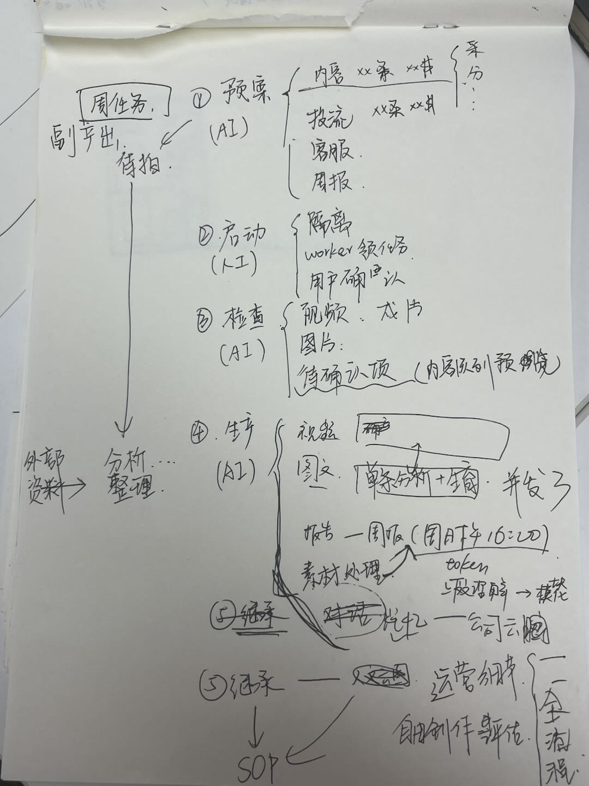

# 周任务包运行与多业务泳道视图：产品与工程实施蓝图

> 版本：产品目标稿，2026-10-30。用途：交给后续会话实施与验收；**不是“当前代码已完成”的声明**。本文汇总本轮讨论的用户决定，并以当前代码、已确认 ADR 和真实回执为实施校验依据。未确认的供应商、发布、投流和客服能力不得用示意数据冒充。

## 0. 一句话目标

用户确认周计划后，周任务包立即成为一个有运行身份的持续运营周期。内容、发布、投流、客服、素材和周报作为可分别观察、可局部受阻的业务分支运转；用户在一个“飞书项目式泳道”中看清本周各板块正在做什么、下一步是什么、哪里需要自己处理，再按需展开原有“采集 → 生产 → 分发”内容链与 Sprout Social 式发布周历。灵小枢是同一运行的对话入口，不另造一条任务或状态主流程。

## 1. 实施前必须认清的现状和边界

- 当前周计划确认弹窗是 `src/components/assistant/AssistantWeeklyPlanExperience.tsx`：820px Modal，含周期、平台、发布位、预计内容成本及三列“采集 / 生产 / 分发”。这三列是**计划结构和内容流程**，不是整个周包的实时状态。
- 启动后的实际内容任务与周包明细已在 `src/components/assistant/AssistantWeeklyProductionView.tsx`、`src/components/socialProgram/WeeklyOperatingWorkbench.tsx` 等页面展示，但信息密度高、偏内容制作，尚不能把整包的跨板块运行状况简洁呈现给用户。
- `docs/architecture/adr/2026-10-30-weekly-run-activation-and-image-isolation.md` 已记录“先启动、后逐项核验”和图片逐项隔离的目标边界；`docs/architecture/adr/2026-10-29-weekly-material-fallback.md` 已记录视频逐镜素材降级规则。实施时先核对当前代码与这些决定是否一致，不把 ADR 当成完成证据。
- 当前 `docs/product/PRD-灵枢AI全系统UI设计规范-v2-2026-10-09.md` 是唯一 UI 设计权威，且本次撰文时存在未提交修改。它已经约束三阶段确认弹窗、状态色、动效、经营页页内日历以及投流/客服的独立详情入口；也有“不另设实时状态卡组、不要把完整业务页挤在一屏”的规定。**后续实现先核对并把本文新确认的泳道总览规则并入该规范，解决表述冲突，不静默建立第二套 UI 规范。**本文件只给出需求和验收目标，不直接改动该规范。
- 本文件不授权真实付费供应商调用、自动发布、广告支出、客服外发、生产数据迁移、部署、推送或清理历史任务。源码通过测试也不等于真实供应商链路通过。

## 2. 参考图：具体借鉴什么

原始手绘讨论图保存在本文档旁，可与下文核对需求来源；手写内容如有歧义，以本文明确列出的产品规则为准。竞品参考图则以官方公开原图嵌入，供后续会话打开核对；它们是布局参考，**不复制品牌色、图标或业务数据**。如远程图片失效，使用对应“原始说明页”查找，不能用文字想象代替验图。



### 2.1 主视图：飞书项目泳道

借鉴左侧固定的业务行、横向进程/时间轴、节点间关联、当前节点和异常节点的分层。我们的泳道左侧是“内容与发布 / 投流 / 客服 / 素材 / 周报”，右侧是本周七天的活动与当前动作；不是把五个业务写成五列。参考：[飞书项目泳道说明](https://www.feishu.cn/content/77en5sm8) · [打开原图](https://p1-hera.feishucdn.com/tos-cn-i-jbbdkfciu3/a887a8b145da4752be24b0cda6d1a237~tplv-jbbdkfciu3-image%3A0%3A0.image)。


### 2.2 内容详情：飞书项目节点流 + 现有三列

借鉴“当前节点突出、上下游可追溯”，但保留灵枢已经确定的“采集 → 生产 → 分发”三列，用于**一条内容/一组内容的下钻**。不要再把整包的投流、客服、周报强塞成这条内容链的后继节点。参考：[飞书新媒体流程案例](https://project.feishu.cn/home/blogs/solution-newmedia) · [打开原图](https://p1-hera.feishucdn.com/tos-cn-i-jbbdkfciu3/6300db0011eb4320b71354730ff1090f~tplv-jbbdkfciu3-image%3A0%3A0.image)。


### 2.3 页面密度：飞书工作台与 Teambition 营销看板

借鉴“顶部看当前、下方看任务、异常可定位”的信息层级与紧凑任务卡，不借鉴满屏表格或把每一步画成巨大的等权卡片。参考：[飞书项目工作台](https://www.feishu.cn/content/3c6y1qwl) · [飞书原图](https://p1-hera.feishucdn.com/tos-cn-i-jbbdkfciu3/81848b62afe148d6b952d75f80bd6cb8~tplv-jbbdkfciu3-image%3A0%3A0.image)；[Teambition 市场团队](https://tb.dingtalk.com/marketing) · [Teambition 原图](https://g.alicdn.com/teambition-site/site/gatsby/static/market-img3-b23bc89cc43a8764d88c2660cbdf8e1e.png)。


### 2.4 发布日历：Sprout Social 周视图

按日期列展示各平台内容，卡片直接出现封面、平台、时刻和真实发布状态；点击看详情。周视图用于找空档和重叠，月视图用于看分布。**参考排版，不直接复制其发布/拖拽权限**；灵枢仍需使用现有版本确认、发布许可和平台回执门禁。参考：[Sprout Social 官方周历说明](https://support.sproutsocial.com/hc/en-us/articles/360000121343-How-do-I-use-the-Publishing-Calendar) · [图片来源文章](https://sproutsocial.com/insights/schedule-facebook-posts/) · [打开原图](https://media.sproutsocial.com/uploads/PI_Publishing_Calendar_Week_View.png)。


## 3. 从确认到复盘：周任务包的完整运行规则

### 3.1 计划生成与确认（尚未启动）

1. 经营 Agent 先形成周目标、市场、平台、产量、预算边界和发布时间范围；内容槽位在确认前已明确参考爆款、目标产品、内容类型和预定发布位。默认从三个主推产品中选择适用产品；不能只写“4 个图片位”而没有正式内容任务与产品绑定。
2. 数量口径分开：**发布位总数 ≠ 独立制作数**。例如 15 个发布位可以由 10 条独立内容（6 视频、4 图文）加 5 次跨平台适配构成；界面必须同时显示三者，不让用户误解只生产 3 条或把适配重复算作制作。
3. 周计划确认弹窗继续展示“采集 → 生产 → 分发”的内容流程和预计费用；同时增加紧凑的跨业务摘要：投流计划、客服值守、素材整理、周报时间。这里只做计划确认，不在弹窗中堆完整运行看板。
4. 用户确认时只一次性确认**本次计划中清楚列出的内容生产范围与费用边界**。发布、广告付费、真实客服外发及其他需单独授权的动作仍遵守现有业务门禁；不得把“确认周计划”解释成无限预算或一切对外动作的许可。
5. 确认之前只做必须保护身份、计划版本、结构、授权/费用上界和幂等性的事务校验。脚本、参考图补分析、素材匹配、数字人、供应商就绪等是启动后的分支工作，不把全部准备完成当成周包启动条件。

### 3.2 启动事务（确认即建立周运行）

用户点击“确认周计划并开始运营”后，后端须原子地记录周目标、版本、运行 ID、业务分支和任务身份，再返回真实启动回执。前端仅在拿到回执时显示“本周运营已启动”；结果未知时查询原请求，不二次创建或重发付费调用。Worker 的实际领取、生产回执和外部供应商 Ready 是**启动之后的独立状态**，不与“已启动”混用。

启动后的顺序是：持久化运行与任务 → 分支入队/Worker 领取 → 分支逐项检查 → 能做的继续、缺项的局部待处理 → 交付与外部回执 → 周日复盘。任务异常应保留原任务、幂等键、已完成产物和可检索证据；不能重建整包来掩盖错误。

### 3.3 分支隔离、依赖和顺序

| 分支 | 任务身份与执行 | 局部失败的影响 |
| --- | --- | --- |
| 内容—视频 | 每条独立内容有自己的任务/运行与必要镜头节点；下游只等真正依赖的上游 | 一条视频缺数字人、镜头或供应商回执，不暂停其他视频、图片、投流或客服 |
| 内容—图片 | 每张原始图片位单独持久化、单独状态与回执；**同一周包一次只准入一张图片**，上一张成功或进入待处理后再准入下一张 | 某张图片卡住，保留本张并让下一张按顺序继续；不把 4 张合成同一失败状态 |
| 发布 | 每个平台发布位有自己的时间、账号、许可和平台回执；复用母版不复制制作任务 | 一个账号不可发，仅影响该发布位及其真实依赖 |
| 投流 | 独立计划、预算和投放状态；以真实投放回执为准 | 不把投流问题回写为“内容生产失败” |
| 客服 | 按真实渠道/会话事件持续监听、去重、处理和必要审批 | 客服监听不等待视频成片，也不因周包中一条内容失败停摆 |
| 素材 | 新上传触发独立分析/入库任务；待拍请求可按单条内容关联 | 一条素材分析失败不冻结全素材库或全周 |
| 周报 | 按定时窗口收集各分支真实证据并生成报告 | 可如实报告未完成与阻塞，不必等“所有任务成功”才生成 |

跨分支只有**业务事实上的依赖**才可建边，如某发布位等待其对应成片验收；不能因为某张图片失败而让所有视频、投流、客服等待。周包顶层可以显示“运行中 · 2 项待处理”，不能把部分受阻投影成整周“未启动”。

### 3.4 内容、参考与素材的持续工作

- 参考视频/图片在创建周计划时就绑定到具体内容位。启动后若所选图文参考缺少**当前版本所需的合格分析**，系统自动对原参考重新分析，并将真实排队、处理中、失败或结果未知状态记录在该参考任务；不要向用户索要“素材授权”来代替系统分析。重分析必须遵守既有费用、唯一认领和结果未知保护。
- 图片爆款复刻只面向有产品的参考图；分析层明确识别“图中是否有产品”和适合借鉴的视觉结构。产品图仍需按当前图片策略生成多样化内容，避免全部退化为“相同背景＋产品”的广告模板。无产品参考不应被伪装为可生产的产品图任务。
- 视频镜头缺素材时按已确认 ADR 逐层尝试：当前产品企业实拍 → 当前租户可见的官方公共素材 → 带可观察动作/主体/足够时长的普通非产品素材。后两档仅作示意画面，不冒充产品效果或企业能力；不能跨租户拿私有素材。确实无可用素材时，只把**具体内容、具体镜头**置为待补。
- 创建周计划时可以派生两类待拍：本周内容硬需求，以及从采集的爆款参考发现的额外拍摄建议。周运行期间，用户不断上传新素材，系统持续做分析、归类、产品匹配、可用性判断和入库，并将“新素材已处理/还需补拍什么”回流到泳道和对话。新素材不静默改写已冻结的成片或发布计划；需要变更时走原计划的版本化调整。
- 数字人入口常驻企业知识库；只有实际需要人物口播的内容才检查人物与声音。缺少时，灵小枢直接给“录入数字人”，调用知识库里的同一套流程，不另造一套录入逻辑。纯产品内容不应受该条件牵连。

### 3.5 投流、客服、周报

- 投流分支展示“拟投放 / 待授权 / 运行中 / 暂停或异常 / 已结束”的真实状态，并区分**预算计划、实际消耗、效果回执**。内容已发布不代表广告已经投放；未取得外部授权和预算边界时只显示待处理，不自动花费。
- 客服是常态事件流，不强行画“完成 70%”。展示“监听中、今日进线、待回复、待人工确认、已处理”；无新消息是正常值守，不显示空转失败。模拟通道与真实客户消息必须显著隔离，模拟结果不计真实交付。
- 周报定在**每周日 16:00（按企业经营时区；无设置时用北京时间）**生成并发送给用户。报告包括内容制作/发布、投流、客服、素材库增长、本周未完成/阻塞及下周建议，数字均要有回执来源。没有已授权送达渠道时保留“报告已生成、待送达”，不得显示“已发送”。具体投递渠道和现有调度窗口须在实施前核对。

## 4. 两个不同场景，不能混成一页

### 4.1 首次确认：保留三列流程弹窗

目标是让用户在确认前看明白“本周要做什么、独立制作多少、发布到哪里、大致花费多少”。三列继续承载内容从采集到分发的路径；下方或侧边用一行小摘要说明其他分支，例如“投流：计划 2 项｜客服：持续值守｜素材：新上传自动整理｜周报：周日 16:00”。未启动时不画运行中动效，不把计划卡的勾号误读为实际已完成。

### 4.2 日常运营：飞书式周任务泳道为主视图

不是另起一个满屏大盘，也不是在原三列下面无限叠卡。主视图由一个紧凑顶部状态区、**多业务泳道**和一份按需展开的业务详情组成：

```text
本周运营中  ·  10 条独立内容 / 15 个发布位  ·  2 项需你处理   最近更新 14:28
┌──────────┬────一────┬────二────┬────三────┬────四────┬────五────┬────六────┬────日────┐
│ 内容与发布 │ 采集/选题 │ 视频 1 制作 ━━━▶ │ 图片 2/4 │ 待验收 │ 发布 3/15 │ ... │ 复盘证据 │
│ 投流       │ 待启动   │ 计划 A 运行━━━━━━━━━━▶ │ 效果回读 │ ... │ ... │ ... │
│ 客服       │ 7×24 监听━━━━━━━━━━━━━━━━━━━━━━━━━━━━━━━━━━▶  待回复 2 │
│ 素材       │ 入库 3   │ 新上传分析 │ 待拍 2 │ 入库 1 │ ... │ ... │
│ 周报       │ 收集数据━━━━━━━━━━━━━━━━━━━━━━━━━━━━━━▶ 周日 16:00 生成/发送 │
└──────────┴──────────┴──────────┴──────────┴──────────┴──────────┴──────────┴──────────┘
当前需你处理：仅列有准确对象和可在此完成的动作；点击泳道/节点看原任务详情。
页内切换：业务泳道 ｜ 发布日历 ｜ 内容任务
```

这只是信息结构示意，不是伪造运行数据。正式页面须由真实任务、日期和回执渲染，横轴按已持久化的经营周起点排列。内容行可有“采集、制作、发布”的微型阶段提示，但每一条内容仍有独立身份；点击内容行或节点进入已有内容任务详情/三阶段流程。投流和客服行只显示摘要，详细预算编辑或客户会话进入它们现有业务入口，避免把后台功能复制进泳道。

泳道的固定视觉规则：左侧业务名与状态吸附，右侧七天可横向查看；每行默认紧凑高度，只出现当前动作、最多一个重要下一步和必要的结果数。活动条、节点和日期对齐；用户可看到“刚完成什么/何时继续”，而不是只看到持续旋转的图案。阻塞节点标出确切对象，其他行仍保持自己的运行状态。详细输入、证据、日志、版本和恢复动作进入原任务 Drawer/Modal；不得在主视图展开 58 条缺口或长技术日志。

### 4.3 顶部与首页入口的状态

| 真实状态 | 首页“查看当前周计划” | 泳道顶部 | 不可做的暗示 |
| --- | --- | --- | --- |
| 无计划/已保存未确认 | 普通样式 | “待确认/尚未开始” | 不显示 Worker 已运行 |
| 已启动但仅排队/等待计划时间 | 普通样式、文字说明 | “运营已启动 · 等待下一项”＋时间 | 不用转圈冒充生产 |
| 有真实生产任务正在执行 | 按既有 UI 规范在按钮边缘显示细线动效、左侧生产图案 | “运行中”＋正在执行的内容/节点 | 不以周包 `active` 单字段触发动效 |
| 某分支需用户处理/失败 | 停止转圈，红边与感叹号；展开后左侧卡片写“解决当前问题” | “运行中 · N 项待处理”，定位具体泳道 | 不把其他正常分支一起画红或说“本周未开始” |
| 周期完成 | 静态完成态 | 已完成结果与周报入口 | 未送达周报不显示已发送 |

动效遵守现行 UI 规范的 `prefers-reduced-motion`。只用真实进度表示进度：内容为 `已交付/计划独立制作`，发布为 `已取得发布回执/发布位`，投流为预算消耗与实际投放状态，客服为待处理量和监听状态，素材为新上传处理结果；周报显示定时窗口与生成/送达状态。不发明全周“72%”来掩盖不同口径。

## 5. 发布日历的明确改法

发布日历作为周任务页/经营总览的**页内视图**，采用参考图中清爽的日期列和媒体卡密度，复用现有 FullCalendar、平台 Logo、内容生成队列和同源发布投影，不建立第二份发布任务。

- 默认本周视图，可切换日/周/月；按真实经营周起点和目标市场/账号时区处理日期。日期头保持清楚；跨平台同日卡按时间顺序稳定排列。
- 卡片优先呈现封面或首帧、标题、平台账号、计划时刻与异常状态。图片/视频比例保持稳定；没有媒体或媒体失败有可读占位。跨平台复用显示同一个制作母版与各自独立的发布位/回执。
- 周/日视图应完整展开本周期的紧凑卡，不裁切、分页或折叠成 `+N`；月视图才允许原生溢出。只有日期、没有具体时间的发布位显示“全天／时刻待定”，不补造 09:00。
- 点击卡片在现有同一任务详情容器内看制作进度、验收、发布许可与平台回执；不在日历上把“成片完成”画成“已发布”。计划时间变更须预览影响、版本确认和重排证据；不能把拖拽当成静默提交，真实发布仍需现有授权。
- 右上方可有平台/账号与内容类型筛选，但不能让筛选后的“看不见”误读成任务丢失。页面须能看到当前筛选范围、真实总数和清除筛选。

## 6. 灵小枢中的周任务交互

灵小枢读同一周目标、周包、分支和任务投影；它是**查看、调整、补录、确认**的对话层，不从历史聊天文本猜状态，不新建第二套队列。用户问“这周做到哪了”时，先回答周包是否已启动，再用最多几行显示各板块当前动作与结果，例如“内容：视频 1/6、图片 2/4；投流：计划 A 运行中；客服：监听中、待回复 2；素材：新上传 3 条已分析；周报：周日 16:00”。有异常时只把真正需要用户处理的项置顶。

周计划缺信息遵守“缺啥补啥”：在对话里写明**哪一条内容、哪一个镜头/账号、具体缺哪一项及其影响**，立即给该字段的输入框、选项、上传或已有流程弹窗。数字人用企业知识库同一录入流程；素材上传在参考画面/缺口卡旁完成。除非当前能力确实无法在对话或弹窗承载，不以“去素材库看看”“去核对资料”之类跳转按钮替代补录；存在待补信息时，不再同时给“查看内容任务”等分心按钮。补录完成显示“重新核验本项/周计划”的真实动作，核验只推进受影响任务。

用户要求“改这周的发布数量/时间/产品/预算”时：灵小枢先展示**修改前后差异**和受影响的未启动任务、已执行结果、预计费用与发布位；需要新费用或对外许可时分别征求确认。提交使用原包/目标版本和幂等键；冲突后刷新原对象，不能覆盖并发更新。已完成产物与平台回执不会因改计划自动消失。结果未知时只读核对原操作，不重新付费或重复发布。

对话回复面向用户，不暴露数据库状态枚举、任务 ID、模型名、HTTP 错误或内部 Worker 术语。可以说“图片 2 正在生成，图片 3 等待；视频 1 缺数字人物口播”，不说 `draft`、`managed`、`task_key`。真正的执行日志留在对应任务详情，不向聊天框倾倒。

## 7. 数据投影与实现约束

1. **单一事实源**：周目标/运行、周包版本、内容/发布任务、图片队列、视频任务、广告计划、客服事件、素材分析与周报各由现有领域模块持有。前端新增的是只读的“跨板块摘要投影”，不是并行状态机。`src/components/assistant/` 负责对话展示，`src/components/socialProgram/` 负责周任务视图，业务执行仍在对应服务/队列。
2. 摘要至少提供：租户与周包版本、业务分支、真实状态、关联任务身份、当前动作、已完成数、待处理数、最后更新时间、下一次计划动作时间、阻塞原因/责任归属、可用操作及回执来源。前端只能显示有证据的值；缺失字段显示“尚未取得”，不推断 0 或成功。
3. 状态映射复用现行 UI 字典：未开始、排队中、执行中、等待用户、失败、完成、暂停。另用文字区分“已启动但待排期”“监听中”“等待外部回执”和“结果未知”；不要把未知供应商结果直接标失败。平台色、Agent 身份色、任务状态色不可混用。
4. 依赖门只作用于真实下游。上游未验收，下游不能计入交付；已有孤立回执仍保留证据。不存在的任务写“尚未派生”，不画假节点。任务恢复要保留原运行、原幂等键和已付费结果。
5. 数据刷新不清空整页；标出最近更新时间，身份/租户切换立即清除旧账号投影。后台静默失败能投影到对应泳道及首页入口，并在用户打开时给确切下一步。读取失败时保持旧值并标“可能不是最新”，不能继续显示假在线。
6. 现行共享主题、Ant Design 控件、`LsStatusTag`/`LsGradientProgress`/`LsMediaStateFrame` 等复用。纯白表面、中性正文、蓝紫主操作；成功/警告/错误只表达各自语义。桌面优先泳道；窄屏按业务行变成纵向卡，保留同一状态和操作，不把七天压成不可读小字。键盘焦点、屏幕阅读、状态文字、减少动效和 44px 触控目标均按 UI 规范。
7. 新实现应尽量拆在现有业务模块中，避免把周任务详情组件继续堆大；普通生产 TypeScript 文件不得超过仓库架构预算，也不得新增平行主流程或绕过原服务端门禁。

## 8. 建议的实施顺序与验收

### 阶段 A：核对与契约

核对当前分支、HEAD、脏改动和现行 UI 规范；逐条标记本文目标在当前代码中“已实现/部分/未实现”，尤其核对启动、Worker、图片队列、投流、客服、周报和日历真实数据源。先把用户确认的泳道和日历规则合并入唯一 UI 规范；如业务状态合同不够，扩展现有只读投影，而非复制任务表。

### 阶段 B：运行语义与隔离

确保“确认即有真实运行”与逐分支检查成立；图片每张独立且顺序准入，视频/投流/客服不被其他图片失败连坐。补齐新素材入库分析事件、准确缺口投影、周报周日 16:00 调度与投递状态。每项都要有定向测试和幂等/结果未知测试。

### 阶段 C：前端

先做静态布局的**真实数据投影**：确认弹窗简洁跨业务摘要、启动后泳道、首页状态入口；再按 Sprout 周视图调整发布日历，最后接入灵小枢查看/调整/补录。不要为看图效果在正式构建里填假数据；设计预览若必须用 Mock，须显著标“界面示意”且不写入业务数据。

### 必须通过的验收场景

- 确认周计划后即有真实运行 ID；“参考图分析排队”不让整周显示未启动。
- 四张图片各有独立状态，并一次只生产一张；第二张受阻后第三张可继续，视频与客服不受其影响。
- 15 个发布位与 10 条独立内容分别统计；跨平台适配不重复计为生成或发布成功。
- 视频 1 某镜头缺素材时自动按允许的三级路线匹配；确实无素材才在该视频具体镜头待补，不出现 58 条泛化缺口堵整周。
- 新上传素材可触发分析入库并更新素材泳道；已冻结计划不会被静默改写。
- 投流暂停但内容仍继续；客服无新消息显示监听中、有待回复时显示数量；模拟消息不计真实进线。
- 发布日历同周卡片可看封面、平台、时刻与发布回执；成片完成但未发布必须仍显示未发布。
- 周日 16:00 周报能据真实证据生成；某一内容未完成也能如实报告，投递状态与生成状态分开。
- 灵小枢查询与泳道同源；缺数字人/素材/字段时在对话中准确补录，用户不用跳到陌生页面找问题。
- 权限、账号切换、读写超时、供应商结果未知和已有原任务恢复均不能产生假成功、重复花费或跨租户状态。

验证顺序：定向合同/组件测试 → `pnpm run check:architecture` → 受影响领域回归 → 浏览器键盘/响应式/视觉核验 → **另行授权后的真实供应商 E2E**。遵守仓库禁令，不运行全量 TypeScript 检查或间接触发它的脚本。报告每一层实际证据，不能把局部通过称为整周生产或发布就绪。

## 9. 交给下一会话时的明确指令

“请以本文件作为产品目标，以当前代码、Git 状态、现行 UI 规范和已确认 ADR 为事实依据。先做差距矩阵与冲突清单，再最小化扩展原周任务投影和运行链，最后实现泳道、发布日历与灵小枢交互。不要重建平行周任务流程，不要改写或清理本会话已有脏改动。每阶段交付文件列表、真实测试命令/结果、未验证外部能力和安全恢复点；未经单独授权不进行真实付费、发布、投流、客服发送、部署或推送。”
