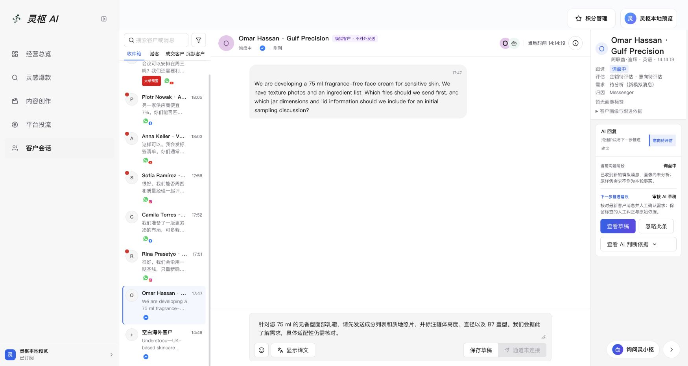

# 客服并行修复与统一验证

2026-10-24（Asia/Shanghai）。目录 `/Users/julia1/Documents/ChatGPT/1024客服`，功能分支 `feature/customer-service-20261024`，HEAD `89b175109149d4551aeb3ce590fe9c42c46bf23c`。用户授权多个子 agent 并行执行；分工为画像一致性、后台隔离、统一验证，主 agent 复核及归档。保留原有未提交内容，未提交、合并、推送、部署或执行数据库迁移。

## 已落地

- 修复替换模拟会话后沿用旧种子画像：当前消息未分析时，旧需求、估值、BANT、推进建议、种子归因及订单样例失效，显示“待分析／意向待评估”。保留与当前买家原文匹配的标签证据、人工纠正快照及联系限制；不凭规则生成新的 AI 标签。
- 修复旧轮询响应盖回新纠正的竞态：按标签原键和纠正时间合并，清理过期替换文字，人工移除不会被旧快照复活。轮询保留本地回复编辑及同条消息译文。
- 同客户新买家消息使旧 AI 建议失效，保留回复正文及译文；全局助手上下文也使用“待评估”，不把默认零分作为 AI 结论。异步生成原有取消机制保留。该 Effect 经代码复核，未额外声称完成浏览器中延迟模型请求竞态实验。
- 客服模拟预览不启动无关 Messenger 标签恢复和周任务恢复；其他环境保持原启动/停止行为。仍允许客户、通知及助手对本地接口的状态读取。
- 拒绝事件增加固定目标/用途分类，保存枚举，不保存 URL、主机名、凭据、正文或堆栈。分类是启发式辅助信息，未知用途仍为 unattributed，不能追补历史证据。
- 新增统一功能及静态检查入口，包含报价、标签、画像恢复、普通草稿/翻译、人工接管、审批、发送账本、WhatsApp 和隔离回归。旧未挂载 WorkspaceTools/tasks 暂留，其不属于当前可见 UI；未擅自删除或重新开放入口。

主要增量：`shared/contracts/localCustomerProfile.ts`、`src/hooks/localCustomerProfile.ts` 及前后端测试，原模拟服务、客户恢复、右栏和草稿 Effect；`customerPreviewRecoveryPolicy.ts`、原启动器、隔离诊断与测试；`customer-candidate-matrix.mjs` 及契约测试、package 三个命令。完整当前候选源文件清单及哈希见[证据索引](evidence/customer-parallel-fixes-20261024/index.json)，包括此前修改，不将其全部归为本轮新增。

## 当前预览复核

沿用已登录 Chrome `http://127.0.0.1:5225/?page=conversion`：

1. 修复前直接复现 Omar 面霜咨询与右栏机器视觉需求、旧建议并存。
2. 修复并重启后，Omar 显示“待分析（新模拟消息）”“金额待评估 · 意向待评估”，旧机器视觉需求/标签和跟进建议不再出现；原人工中文回复仍完整，DOM 中 AI 建议气泡为 0。
3. 切换 Piotr，原“竞品报价待同口径核验”人工标签保留；显式刷新后切换 Rina，原“二期扩产已确认”也保留，状态仍为已成交。
4. 再回 Omar，待分析状态及人工回复保留。未点击生成、翻译、发送或真实渠道入口。
5. 本地启动读取 Git 子进程被隔离拒绝会导致版本 SHA unknown；通过现有 `APP_BUILD_SHA` 启动环境传入实际 HEAD，不放行 Git 子进程。当前后端 PID 98758，health=ok、role=web、build.commitSha 为上述 HEAD，weeklyRecovery 为 not_started；隔离 installed=true、defaultPolicy=deny，检查时 blockedClasses=[]。SHA 表示提交起点，未提交差异由候选清单单独记录。

## 同一份源码的最终门禁

功能命令 `pnpm run test:customer-candidate`：

| 组 | 结果 |
| --- | --- |
| 编排契约 | 2/2 |
| 无 preload 启动隔离 | 1/1 |
| 隔离/AI 作用域 | 9/9 |
| 客服 pipeline | 93/93 |
| 完整客服 | 67/67 |
| WhatsApp onboarding | 12/12 |
| 报价、标签、画像及兼容专项 | 73/73 |

全部 0 失败、0 跳过；组间有重叠，不相加为独立用例总数。功能组使用 guard + 下层 canary，真实模型开关初始关闭，受控用例不访问真实提供方。

静态命令 `ARCHITECTURE_BASE_REF=89b17510 NODE_OPTIONS=--max-old-space-size=4096 pnpm run check:customer-candidate`：TypeScript、2702 生产 TS 的架构/ratchet、ratchet 自测、197 项迁移只读检查、临时目录迁移 fixture guard、构建及 `git diff --check` 全部通过。Studio 368838/485000 字节，既有 >500 kB chunk 提示仍在。静态组运行已审阅的文件检查/构建脚本，不宣称具备功能组的同等级网络隔离；迁移 fixture 的 Git 操作仅在临时目录。

功能 UTC 10:10:35.420—10:11:46.250，静态 UTC 10:10:35.537—10:11:59.803，即北京时间 18:10—18:11。两组均对 5258 个源码/脚本/配置/规范/迁移路径记录执行前后 SHA-256，HEAD 和文件哈希一致；归档后再次只读核对无源码变化。该证据不声称能检测中途修改再恢复。

第一轮 features 59 项通过但执行期间源码变化，哈希栅栏使整轮失败；随后预跑被主动停止，没有计入最终通过。最终结果以归档两组为准。

## 持久证据与仍保留的边界

[归档目录及 SHA-256 索引](evidence/customer-parallel-fixes-20261024/index.json) 保存完整最终功能/静态日志、原始结果 JSON 的 gzip、运行状态摘要；截图也已放入 docs/qa/evidence。未复制账号、认证令牌、密钥或完整业务运行库。原临时目录文件保留。

尚不构成真实模型标签重新分析、真实渠道模板/发送/回执、OAuth、生产库或发布验收。当前本地缺口以明确“未分析”和受控回归处理，不新增假分析按钮。历史隔离误触的渠道响应缺失无法追补，仍见原隔离审计。

最终候选仍未提交，未获基线合入授权；共享渠道/存储改动只完成隔离回归和本轮交叉代码复核，不宣称全仓 quality/verify 或远端 CI。保留旧未挂载文件，不擅自做清理。当前无本轮未解决的失败测试；构建 chunk 提示、真实模型标签整链及真实渠道验收继续明确保留。

安全恢复点：当前 HEAD、完整保留的未提交差异与候选哈希，模拟运行数据单独保留；不是授权 reset 的回滚点。本轮无外部 run/task/receipt。
