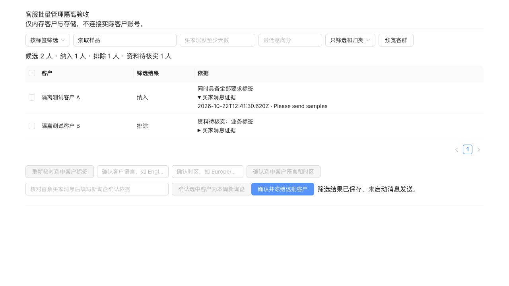

# 客服管线及批量管理隔离验收

源码起点：43892e74。工作分支：xixi智能客服隔离测试（原 feature/customer-service-workspace-20261022）。目录：`/Users/julia1/Documents/ChatGPT/客服`。

本批完成客服请求契约、结果判定、生成和聚合恢复，以及标签筛选、已有往来唤醒、已记录成交客户复购和新询盘管理的工作台及接口接线。保留原审批和实际发送适配，未修改集成基线工作树，未部署、推送或联系真实客户。

## 两份排查报告的处理结果

| 问题 | 本批处理 |
| --- | --- |
| 草稿入口和返回结构不一致 | 共享输入及输出 schema；未知字段、非法意图与非法条件返回明确错误；成功、降级、待人工、阻塞分开 |
| 前端隐藏接口失败 | 失败返回空草稿和错误状态；决策、事实版本、校验、气泡及来源保留；翻译失败保留原文并阻止本次发送 |
| 草稿中断无法恢复 | 持久请求身份、结果查询、总时限与未知结果；工作台提供读取原草稿结果；重复请求不重复生成 |
| 逐客生成与工作台保障不同 | 跟进正文使用既有知识检索和事实校验；批次目的进入生成；逐客生成和标签分类都有持久请求身份和具体失败原因 |
| 分群或批次部分落库 | 冻结计划、building、确定性子记录、完整性检查与恢复；不接受残缺快照为完成 |
| 审批写入失败仍可能表现成功 | 检查逐客和批次状态写入回执，失败明确报错 |
| 企业微信入口缺失 | 挂载工作台 API 与签名回调；先落库后 ACK、重放不重复处理，复用现有回调恢复 |
| 渠道入口语义混淆 | 客户列表补当前授权 WhatsApp；通用 WhatsApp outbox 返回明确不支持及能力入口，发送仍走原周派发和模板链 |
| 正式入站被误当自动接待 | 明确返回入站处理模式及自动接待未连接，关闭误导性的自动发送就绪标识；没有直接删除 skipAutonomy |
| 默认分群误选 | 默认阶段与意向门槛同时满足；支持标签全部、任一、排除、沉默区间、关系、成交、地区、语言、产品和待办进度条件 |
| 标签无法进入授权读取 | 从当前账号及有效买家消息证据投影分类，不恢复无证明的历史正向画像；保留限制性信号 |
| 阶段与新老关系混用 | 独立关系、成交台账、互动时间和业务进度；报价及知识异常使用真实业务记录，未知资料明确列出 |
| 没有可核对批量入口 | 工作区新增场景选择、条件预览、逐客证据、标签复核、资料确认、新询盘确认、冻结及逐客待审草稿入口 |
| 冻结后来源变化 | previewHash、成员复核与当前会话证据；旧批次和审批失效；有发送痕迹时不覆盖重做 |
| 常规权限证明刷新使长任务失效 | 区分实时证明时效与稳定业务身份；到期仍阻断，同权限和凭据的重新证明保持业务身份 |
| 旧契约测试定位错误 | 改查拆分后的 historyInbound.ts；增加真实父路由及行为回归 |

## 数字员工调用顺序

1. GET `/api/overseas/customer-batches/capabilities`，获取支持字段、JSON Schema、状态、操作入口及渠道限制。
2. POST `/api/overseas/customer-batches/runs/:runId/preview`，body 为 `{criteria}`。预览不生成客户消息，不修改客群。
3. 需要时对选定客户执行 classify、profile 或 confirm-new-inquiry，再重新预览。标签和资料操作每次最多 10 人，逐客结果明确。
4. POST 同一 run 下 `/segments`，提交原 criteria 与 expectedPreviewHash，冻结范围；重复提交读回原范围，来源变化拒绝。
5. managementAction=screen 时只保存结果；managementAction=draft 时复用 `/api/overseas/digital-employees/customer-segments/:segmentId/followup-batches` 生成待审逐客草稿。
6. 通过原审批、预检、渠道选择和调度，再进入原发送账本。未知结果读原请求；不重新发送。

场景条件必须显式给出，不由模型猜测沉默阈值、业务意向门槛或发送授权。新询盘需要真实买家证据和确认；既有往来、已记录成交、沉默状态是不同维度。

## 隔离验证

主回归入口为 `pnpm run test:customer-pipeline`。它预加载 `scripts/customer-isolated-test-guard.mjs`，只允许访问当前测试进程自己打开的本地 HTTP 服务；真实供应商、用户既有 PocketBase 和其他外部接口均被拦截。

覆盖以下链路和故障：

- HTTP 草稿输入验证、统一响应、事实版本、决策透传、请求重放、操作者/租户隔离。
- 超时后保留原请求、明确未知状态、晚到结果查询和供应商调用不重复。
- 源码标签证据、失效标签、撤销需求、退订、人工处理、新老关系和台账成交的区分。
- 客群预览、部分标签失败、成功项复用、人工资料确认、新询盘证据确认和原生渠道选择边界。
- 分群和批次成员写到一半失败、存储键顺序变化、子记录篡改、恢复后正文与排期不漂移。
- 新询盘冻结 → 原逐客批次生成 → 当前版本审批 → 模拟时钟到期 → 原生派发 → 持久平台回执 → 周任务证据完成；重放不再发送。
- 已有往来与已记录成交老客在沉默条件下可入选；旧客户不冒充新询盘。
- 报价待处理、已发报价等客户进度，以及有完整范围/哈希的知识异常；不以会话关键词冒充已报价或已处理。
- 人工接管、模板约束、真实无数据、部分发送、未知发送、回写失败恢复、权限改变和过期证明。
- 企业微信签名回调、持久 ACK、父服务挂载、回调重放与既有处理恢复。

另执行现有 `test:customer-service` 整条脚本链，使用同样网络隔离。历史测试中的 PocketBase 镜像访问被 guard 拦截，会输出 `isolated_test_network_blocked` 日志；这些日志不代表远端写入成功。

补充渠道回归使用以下文件：

```text
server/wecom/customerService.test.ts
server/digitalEmployees/customerChannelSendRequests.test.ts
server/digitalEmployees/followupNativeScheduledScan.test.ts
server/digitalEmployees/weeklyNativeScheduledDispatch.test.ts
server/digitalEmployees/customerTaskApprovalContinuation.test.ts
server/digitalEmployees/customerMessagingPolicy.test.ts
server/messenger/conversations.test.ts
server/instagram/conversations.test.ts
server/whatsapp/customerVisibility.test.ts
```

复核后主回归 80 项、补充渠道回归 54 项，共 134 项全部通过；现有客服脚本链另外通过，不重复计数。TypeScript、架构约束、192 个迁移文件完整性和生产构建检查均通过。详细结果保存在 [验证记录](./evidence/customer-service-validation-20261022.json)。

## 真实存储演练

执行 `node node_modules/tsx/dist/cli.mjs scripts/verify-customer-pocketbase-isolated.ts`。脚本创建并销毁一次性 PocketBase 0.39.5 数据库，应用既有 CAS 迁移和本次新迁移，用临时管理员验证真实 DataStore 的创建、CAS 写回、结果读回、重复请求复用、事实版本和分类 JSON。实际供应商调用数为 0。

新迁移为 `1792670400_create_customer_reply_requests.js`，创建 customer_reply_requests 和 customer_classifications。迁移校验和清单只追加新项。已演练新增集合及既有 CAS 依赖，不将其描述为目标生产数据库的升级验收。

## 浏览器验收

使用 `scripts/customer-batch-browser-fixture.ts` 启动独立内存 API 与真实 CustomerBatchPanel。实际操作通过：

1. 预览两个隔离客户。
2. 选择客户并复核标签，显示成功/失败数量。
3. 按“索取样品”筛选，纳入 1 人、排除并提示资料待核实 1 人。
4. 确认所选客户的语言和时区。
5. 展开买家消息证据并冻结客群，显示保存成功且未启动消息发送。



## 发布前仍需遵守的边界

- 当前验证是隔离联调；没有调用真实模型或平台，未证明真实账号可用性或正式发布就绪。
- 新集合迁移没有在现用数据库执行；部署前必须按既有发布流程迁移和验证目标环境。
- 正式 WhatsApp 入站自动接待未在本批启用；工作台草稿和经批准的周跟进继续使用已有路径。
- 原生私信仍须确认具体渠道会话范围；筛选不扩大原有发送权限。
- 任意自然语言到筛选条件的自动推断、任意嵌套规则、批量指派负责人和批量覆盖人工标签未开放；能力发现明确列出当前支持范围。
- 历史 Messenger 冻结范围若使用旧业务身份哈希，仍应显式重新核验或重建原审批范围，不自动改写历史回执。

两份原始排查报告及基线缺陷探针保留作为 43892e74 的历史证据；探针中的旧缺陷断言不能作为修复后行为验收，当前回归以 test:customer-pipeline 为准。

## 提交前代码复核

复核契约、权限、持久化恢复、标签证据、前端调用及生产挂载，补强以下问题后重新执行受影响回归：

- 分类缓存不再覆盖来源中的退订、黑名单及人工处理限制；不恢复未经证明的正向画像。
- 聚合恢复在完整读回、数量和内容校验后才发布；写入结果不确定后的既有子记录同样核验。已发布批次的发送状态和回执允许按原生命周期推进，不被当作初始草稿损坏。
- 主服务继续首先加载环境变量，再初始化新增路由依赖，避免改变原存储后端选择时机。

新增两项故障回归验证上述限制及聚合失败不提前发布；复核未留下已知阻塞提交的问题。分支及提交按用户要求命名为 `xixi智能客服隔离测试`，只普通推送该分支。仓库中的 push 工作流仅匹配 v* 标签；部署工作流为手动触发，本批不创建标签或触发部署，不合并或推进集成基线。
