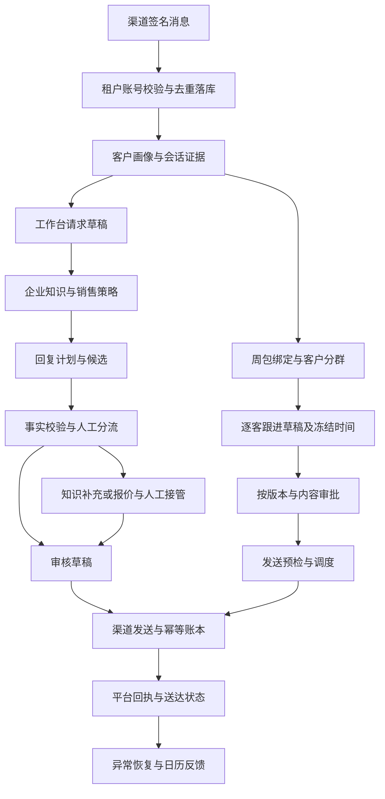

# 客服管线输入输出与数字员工调用排查

> 本文保留 43892e74 的历史排查结论。修复后的实现、验证结果和保留边界见[隔离验收报告](./customer-service-isolated-acceptance-2026-10-22.md)。

审查日期：2026-10-22。代码起点：`43892e74f828b97ad51401cd96d48936553464a2`。分支：`feature/customer-service-workspace-20261022`。

当前客服尚未达到“每个节点都能被数字员工稳定识别、调用、判断结果和恢复”的标准。主要缺口集中在渠道入口、草稿请求与响应、降级信号和生成过程持久化；周任务发送环节已有较强的授权、审批版本、幂等和真实回执约束，应该保留。

本次审查覆盖业务节点及其主要接口，不把内部所有工具函数视为独立业务节点。执行了隔离专项测试和故障注入，没有调用真实模型、发送客户消息、运行生产迁移或部署。因此，本报告能确认下面的代码缺口，不能据此把用户遇到的每次历史报错归因到同一个原因。

## 完整输入与最终输出

输入包括六类：租户与操作者身份；渠道账号及授权；客户、会话和入站消息证据；已确认企业资料与知识；周包及运行绑定；人工审批与修改。客户语言、时区、最后入站时间、退订和人工接管状态也是执行条件，不能只输入一段自然语言任务。

最终输出至少分开记录：待审核草稿、待人工处理任务、渠道已受理或已发送回执、送达或已读回执、未确认发送结果、真实无客户数据，以及客户画像和知识反馈。**草稿生成、审批通过、平台受理、客户收到，是四个不同结果。**

当前有三套入口：通用客户工作台、数字员工周跟进、企业微信客服。WhatsApp 的旧自动接待函数与当前正式签名 Webhook 入口也有行为差别，不能按相似函数名判断它们等价。



图中是业务链路关系，并不表示所有连接目前都自动执行。正式 WhatsApp 入站落库后不自动进入回复生成；企业微信 HTTP 路由没有挂到当前主服务，详见发现 F1、F2。

## 接待回复节点

表中的“明确”仅表示代码有对应定义，不代表真实渠道验收已通过。

| 节点 | 输入 | 输出与去向 | 当前边界或问题 |
| --- | --- | --- | --- |
| A1 企业配置与授权 | 服务开关、FAQ 审核状态、数字员工配置、账号凭据、操作者身份 | 客服状态、`inboundAutoSendAllowed`、跟进发送权限及原因 | 有明确授权模型；Ready 不等于实际已自动回复 |
| A2 签名入口与账号归属 | 原始请求体、签名、租户平台应用、原生账号 ID | 已过滤的本租户 WhatsApp、Messenger、Instagram 事件 | `server/routes/webhooks.ts`；签名和账号归属先校验 |
| A3 消息标准化与落库 | 平台消息 ID、发送人、正文、时间、账号证据 | 客户与 interaction/timeline、去重证据 | WhatsApp 正式入口显式 `skipAutonomy:true`；F1 |
| A4 客户画像与上下文标签 | 会话、已有 BANT/SPIN 或上下文标签 | 资质评分、阶段、下一步提示、标签 | WhatsApp 与原生私信使用不同处理模块；没有统一跨渠道输出类型 |
| A5 工作台客户读取 | 登录身份、可选 `source` | `{items,source}`，本地预览和历史会话也可能加入 | 实时读取主要是 Messenger、Instagram；不支持把 `source=whatsapp` 当作有效实时查询；F3 |
| A6 草稿请求 | `customerId,timeline,product,language,stage,intent,instruction,manualRequest` 等 | 路由内 body、最近 20 条会话、意图与企业快照 | 没有统一运行时请求 schema；未知 intent 默认为 reply；F4 |
| A7 确定性短回复 | 问候、感谢、延后决定、首轮产品询问 | draft/messages、中文对照、部分分支 decision | 快捷分支与普通生成响应字段不同；F4 |
| A8 企业知识检索 | 企业快照、客户概要、最新消息、会话 | `RetrievedContext`：事实版本、规则、产品、FAQ 匹配、证据、knowledgeMiss | 内部类型较明确；FAQ 歧义、知识不足需继续分流 |
| A9 销售动作及人工分流 | 消息、资质、销售动作、风险、fallbackCount | 需澄清、需人工、安全承接计划及原因 | 知识缺口有 `CustomerServiceDecision`；普通结果没有统一沿用；F4 |
| A10 策略与记忆检索 | 租户、客户、场景、最近消息 | 策略匹配、客户记忆、表达记忆、提示块 | 事实和风格有分离；故障与无匹配未收敛到统一节点状态 |
| A11 回复计划 | 会话阶段、事实、策略、目标、安全承接 | `ReplyPlan`，异常可用 fallbackPlan | 计划不是发送结果；中间结果主要在请求内存中；F8 |
| A12 候选生成与排序 | 计划、语言、最近消息、企业事实、风格 | 候选数组、排名、选中风格和分数 | 模型输出经过解析；没有候选可能使用兜底；F4、F8 |
| A13 确定性与模型事实校验 | 候选、知识证据、数字、风险信号 | `DraftVerification`，verified/revised/safe_fallback 等 | 有确定性拦截；调用失败走安全降级；正常响应和 UI 投影没有完整保留判定；F4 |
| A14 聊天气泡与中文对照 | 校验后的客户语言正文 | messages、draft、translatedMessages、translatedDraft | 客户语言原文与卖家中文编辑稿是不同字段；不能互换 |
| A15 前端草稿投影 | 草稿 HTTP 响应 | `DraftResult` 供编辑与展示 | 丢失 decision、verification、事实版本；HTTP 503 可变成本地草稿；F4、F5 |
| A16 中文编辑稿转客户语言 | 中文编辑内容、客户语言 | 翻译文本 | 翻译失败会按关键词替换成固定话术，并非忠实翻译；F5 |
| A17 人工接管 | 客户与账号范围、操作者、时长、expectedVersion | 持久化 hold、到期时间、release 结果 | 有版本和归属约束；真实自动发送必须经过共享 gate |
| A18 发送准备与提交 | requestId、正文、发送身份、账号 authority、接管状态 | 客户渠道发送请求、真实 message ID 或 unknown | 通用 outbox 类型仅含 Messenger/Instagram；本地预览是独立分支；F3 |
| A19 回执及本地历史修复 | 原请求 ID、签名平台回执、原发送身份 | accepted/sent/delivered/read/failed、historyWritebackPending | 有显式查原请求与仅修复历史的路径；未知结果不能重发 |
| A20 反馈与复用 | 已发送正文、原草稿、人工修改、后续会话 | 表达记忆、知识缺口统计、客户阶段与反馈主题 | 部分记忆失败仅日志记录；不应影响真实发送回执判断 |

主要实现位置：`server/routes/draftReply.ts`、`server/routes/draftReplyVerification.ts`、`server/knowledge/retrieve.ts`、`server/customerService/decision.ts`、`src/components/customers/customerReplyPreparation.ts`、`server/routes/customerSuggestions.ts`、`server/digitalEmployees/customerChannelSendRequests.ts`。

## 数字员工周跟进节点

| 节点 | 输入 | 输出与去向 | 当前边界或问题 |
| --- | --- | --- | --- |
| B1 周运行绑定 | tenant/program/package/version/run，操作者 | `social_weekly_customer_bindings`、唯一运行范围 | 明确且不可随意改绑；缺少绑定应阻塞 |
| B2 渠道与客户范围选择 | 周包、账号、原生 recipient、会话、客户关系证据 | 已确认渠道选择及哈希，客户准入证据 | 必须校验账号和原会话，不能只靠客户名称 |
| B3 客群筛选 | 规范化 criteria、授权客户、阶段/意向/来源/关系/退订 | 每客 included/excluded 和理由 | criteria 宽松转换；非法输入可能成为默认条件；F4 |
| B4 分群快照持久化 | evaluated 成员、criteriaHash、run/task | segment、members、version、member_count | 先 generated 后逐条写成员，故障重试复用残缺快照；F6 |
| B5 逐客草稿生成 | 分群、当前会话、冻结企业快照、修订意见/覆盖正文 | 每客正文或 draft_generation_failed | 与工作台回复生成不同路径；模型 JSON.parse 异常被折叠成同一错误；F7 |
| B6 草稿准入及时间冻结 | 正文、风险、时区、入站时间、频率、渠道 | blocked/draft、原因、send_mode、scheduled_at、content_hash | 有窗口、频率、风险检查；batch 先于 items 写入，同样存在部分落库风险 |
| B7 模板配置 | WhatsApp 批次/单客 ID、正式模板名、语言、变量 | 已渲染正文、新批次版本/hash，撤销原审批 | 有模板审核状态、变量数、租户与原发送痕迹约束 |
| B8 审批与修订 | 审批身份、批次版本、内容哈希、逐条/整批决定 | approval request、批准版本、批准人、item 状态 | 桥接会核对真实批准记录；不能用文本“批准”代替；底层部分 update 未检查成功，需后续补故障回归 |
| B9 发送预检 | 批次、审批、worker 模式、渠道权限、最新客户证据 | 可发送性与阻塞原因 | 有 preflight；普通阻塞应是业务结果，不应泛化为接口不存在 |
| B10 领取与按时发送 | 已批准单客项、scheduled_at、run 锁、幂等键 | claim、平台请求、逐气泡回执 | WhatsApp 与原生渠道有独立适配；不应由 Agent 拼装一个通用发送 URL |
| B11 回执与恢复 | message ID、平台回执、签名状态、原 authority | sent/partial_sent/blocked、送达已读、恢复任务 | unknown/partial 不计完成；陈旧 sending 转结果未知，禁止自动重发 |
| B12 周任务证据投影 | segment、members、batch、approval、receipt、task 状态 | succeeded/blocked/no_data 和版本化 resultRefs | 核对成员数、哈希、审批、真实回执；能挡住一部分上游残缺输出，但不负责补写缺失成员 |
| B13 无客户与重新入场 | 已完成空分群、新客户、运行窗口、原发送证据 | 明确 no_data，必要时重开待执行任务 | no_data 与 blocked 分开；隔离测试覆盖三渠道，不制造发送结果 |
| B14 知识或报价补齐 | exception scope、批次/单客 ID、负责人、审核人、知识/报价引用 | submit/verify/apply、重新审核和审批记录 | 有 expectedVersion、证据引用约束；应作为显式人工依赖 |
| B15 日历与反馈闭环 | 周任务证据、预约时间、异常、发送恢复、销售移交 | 可追溯日历状态、异常任务、销售移交与反馈主题 | 只读取真实业务证据；metadata 成功不能代替客户发送完成 |

关键区别：`server/routes/digitalEmployees.ts` 的自动任务分支直接调用 `createCustomerSegmentSnapshot` / `createFollowupBatch`，不是通过猜测 HTTP 地址执行。对话模型或外部编排器需要另外获得稳定的能力映射与 schema，`domain.ts` 的 capability 提示本身不包含完整请求响应契约。

## 企业微信旁路节点

| 节点 | 输入 | 输出 | 当前状态 |
| --- | --- | --- | --- |
| C1 回调校验与同步 | 企业凭据、加密回调、sync token/cursor | callback/sync state、conversation/messages | 有独立回调和游标模块；实际 HTTP 挂载需先补齐 |
| C2 草稿生成及风险识别 | 会话 ID、最近 20 条消息、instruction | 持久化 draft、risk_level、requires_human_review | 正文非空和 UTF-8 字节长度有检查 |
| C3 人工批准发送 | draftId、humanApproved、idempotencyKey、操作者 | outbound、provider_msg_id、accepted_unconfirmed | 受理不冒充送达；路由隔离测试通过 |
| C4 人工转接及查询 | 会话 ID、转接人或 outbound ID | 转接状态、原发送状态 | 与通用客户 outbox 不是同一 API；F2 |

## 已确认的问题与优先级

### F1 正式 WhatsApp 入站不自动接待

**P1，源码确认。** `server/routes/webhooks.ts:184` 调用 `handleVerifiedWhatsAppInbound`；后者在 `server/whatsapp/historyImport.ts:493` 起明确规定只保存消息和资质，并用 `skipAutonomy:true` 调用 `handleInboundMessage`。`server/whatsapp/historyInbound.ts` 在这个开关处返回，不进入后面的客服策略、知识、草稿和发送链。

影响：自动回复权限为 true、旧自动接待函数存在，都不能证明当前正式入站会自动回复。应先把“仅入库”声明成可发现能力边界；若产品确实要求自动接待，再设计已落库消息到持久化接待任务的明确交接，保留防重复和人工接管约束。不能简单去掉 skipAutonomy。

### F2 企业微信有路由实现但没有主服务挂载

**P1，主服务挂载源码确认。** `src/lib/wecomCustomerService.ts:3` 请求 `/api/overseas/wecom-customer-service`；`server/routes/wecomCustomerService.ts` 导出 router，但当前 server 主服务及其他生产模块没有引用或挂载它。隔离测试自行把 router 挂在 `/wecom`，因此可以通过而不证明正式入口可达。

影响：这是真实的“文件里存在接口，主服务却没有该接口”情形。需要主服务级路由可达性回归；本次未启动完整主服务，未把静态证据写成实测 HTTP 404。

### F3 通用客户接口和三渠道工作流的能力边界不同

**P1，源码确认。** `customerSuggestions.ts` 的列表实时聚合 Messenger、Instagram；传 `source=whatsapp` 返回空 items。普通 `customerChannel` 也只解析这两个渠道。`shared/contracts/customerChannelSendRequest.ts` 的 outbox context/request 明确仅含这两个渠道，人工接管则另有 WhatsApp 解析。

影响：数字员工若把 `/customers` 当作全部实时渠道，可能误判“没有 WhatsApp 客户”；若把通用 outbox 当成三渠道发送接口，会走到客户不存在。WhatsApp 已有独立读取/发送和周任务链，不应重复建设，需明确适配器与调用入口。

### F4 草稿请求和响应没有形成统一可校验契约

**P1，源码及隔离探针确认。** `/agents/conversion/draft` 直接从 body 取字段并转换，未知 intent 默认为 reply；快捷、澄清、润色、知识缺口和正常生成响应字段不同。`CustomerServiceDecision` 已定义，但正常生成成功及异常兜底响应没有统一携带 decision。前端 `DraftResult` 虽声明可选 decision，实际两条主要返回分支都未保留它；verification 和 enterpriseFactVersion 也被丢弃。

影响：下游不能稳定判断结果可供审核、应转人工还是已降级，也无法连续保留事实版本。探针喂入 decision/verification/factVersion 后，返回对象的这些字段均为 undefined。

### F5 接口与翻译失败被替代文案掩盖

**P1，故障注入确认草稿路径。** `requestDraft` 遇 HTTP 503 或异常，除一个特定 409 情况外，最终返回本地中英文话术，不带明确 error、degraded 或生成来源。隔离探针已复现。

`translateReplyToCustomerLanguage` 翻译失败后按“电话/新款”等关键词生成固定文本，属于替代回复，不是对原编辑内容的忠实翻译。这条为源码确认，未调用真实翻译服务验证。

影响：用户或 Agent 看得到可用文案，却无法据此知道原接口是否成功、编辑语义是否保留。应区分 provider_generated、deterministic、degraded 三类来源，降级时保留原文与错误码，另行让调用者决定使用替代文案。

### F6 分群中断后幂等重试无法补齐成员

**P1，内存存储故障注入确认。** `createCustomerSegmentSnapshot` 先以 generated 创建 segment，再逐条创建 members。第二个成员写入抛错后，重试会找到已有非失败 segment，直接 `created:false` 返回，不补缺失成员。实测 member_count=2、实际 members=1。

影响：桥接可能以证据不完整阻塞，重试分群却始终复用同一个残缺结果。批次创建也有先 batch 再 items 的相似结构，后者本次只确认源码风险，未作同样故障注入。

修复方向：写入中状态、完整性确认后再 generated/draft、重试补齐或明确废弃不完整版本；不要把“已找到主记录”当作“整个节点已成功”。

### F7 逐客草稿是独立生成路径且丢失具体失败原因

**P1，源码确认。** `personalizedFollowup` 使用独立提示词和 JSON.parse，检查非空、长度及内部标记；后续经过 outboundGuard、客户/窗口/风险门禁，但没有复用工作台候选规划和 `verifyGeneratedDraft` 的同一条处理链。生成异常被统一转换为 draft_generation_failed，原始失败原因不保存在该输出中。

影响：同样的客户与企业事实，在工作台和周任务下经过不同的生成、校验路径，结果可能不同；模型格式错误、超时、配置缺失也难以区分。差异本身不等于错误，但必须声明各自契约、共同事实/风险保障与可检索的原始错误。

### F8 草稿生成缺少请求级恢复及整体时限

**P2，源码确认的可靠性风险。** 前端 requestDraft 没有 requestId、AbortController 或任务查询接口；路由多阶段生成主要在内存中，未将回复计划、候选及阶段作为可恢复任务返回。底层 LLM 有单次超时和并发限制，不能据此认定整个多次调用链有相同总时限。

影响：断线、刷新、外层超时后缺少原生成任务的明确查询和复用入口，可能再次调用模型。此项没有做真实断网或供应商负载测试，不宣称已复现重复计费。

### F9 旧契约测试检查了拆分前文件

**P2，测试失败确认。** `customerMessagingIntegration.contract.test.ts:10` 在 historyImport.ts 文本中查找 readCustomerMessagingAuthorization，但该调用已经在 historyInbound.ts。首个断言失败，后续发送契约断言没有运行。

影响：基线存在测试漂移，且此类字符串匹配不证明生产入口已连接自动回复。需更新定位，并以真实主入口、隔离依赖的行为测试覆盖核心调用关系。

## 现有接口对照

所有身份字段以服务端登录态为准。下表列关键调用，不是穷举所有 CRUD；动态路径中的 ID 必须来自上游真实返回。

| 能力 | 当前调用 | 关键输入 | 输出及调用注意事项 |
| --- | --- | --- | --- |
| 客服开关与状态 | GET/PATCH `/api/overseas/enterprise/customer-service/status` | enabled、partialAutoReplyDecision | status/授权原因；不能推定入站自动接待已触发 |
| 客户列表 | GET `/api/overseas/customers` | source 可用 messenger/instagram | items；WhatsApp 实时列表不在此契约内 |
| 草稿 | POST `/api/overseas/agents/conversion/draft` | 客户、会话、语言、intent、instruction | draft/messages 等；F4、F5 |
| 主动建议 | GET `/api/overseas/customers/:id/suggestions` | 客户 ID | items/evidence，模型失败可回退固定建议 |
| 接管 | GET/POST `/api/overseas/customers/:id/manual-active`，POST `.../release` | minutes、expectedVersion | hold/item；支持的客户解析与普通 outbox 不同 |
| 发送身份与原请求 | GET `/api/overseas/customers/:id/outbox/context`、`.../outbox/:requestId` | 客户、原 requestId | scope/item；仅 Messenger/Instagram |
| 提交与本地历史修复 | POST `.../outbox`、`.../outbox/:requestId/reconcile` | requestId/body；reconcile 空 body | receipt/item，修复不应再次发送 |
| 创建分群 | POST `/api/overseas/digital-employees/runs/:runId/customer-segments` | criteria/name | 返回 overview，不直接返回 `{segment,members}`；上游需按业务 refs 查询 |
| 读取分群 | GET `/api/overseas/digital-employees/customer-segments/:segmentId` | segmentId | segment/members |
| 创建批次 | POST `.../customer-segments/:segmentId/followup-batches` | name | 返回 overview；自动编排则直接调内部服务 |
| 读取或修订批次 | GET `.../followup-batches/:batchId`，POST `.../:batchId/revise` | 批次、逐客修订内容 | 批次/明细或总览；修订要求重新审批 |
| WhatsApp 模板 | GET `/api/overseas/digital-employees/followup/templates`，PUT `.../batches/:batchId/items/:itemId/template` | templateName、language、variables | 配置模板并更新版本/审批状态 |
| 批次预检与发送 | GET `.../followup-batches/:batchId/dispatch-preflight`，POST `.../:batchId/dispatch` | batchId | preflight；发送返回 202/result/overview，不等于全部送达 |
| 原生私信周派发 | `/api/overseas/social-programs/:programId/operating-packages/:packageId/native-dispatch` 的 GET `/sources`、POST `/` | 显式周包及原单客范围 | 沿用真实授权、批准和发送请求账本 |
| 渠道范围 | 同周包下 `/customer-channel-scope` | packageVersion、账号/客户来源 | 渠道选择及版本证据 |
| 知识与报价异常 | 同周包下 `/customer-knowledge-quote-requests` | runId、packageVersion、batch/item、expectedVersion、证据 ref | create/submit/verify/apply/request-approval 等 |
| 未确认发送恢复 | 同周包下 `/send-recoveries`、`/native-send-recoveries` | 原请求/单客范围、expectedVersion | 原回执核对与恢复；不能默认重发 |
| 报价能力 | `/api/overseas/quote-skill` 下 availability/catalog/drafts/confirm/reply/card/send-card | 真实产品、数量、目的地、人工确认价格等 | 报价草稿、确认版本、回复或卡片；不等同普通自由回复 |
| 客户关系核验 | `/api/overseas/customer-relationships/:customerId` 及 confirmations/segment-revisions | 周窗口、入站证据、关系类型、expectedSegmentVersion | 关系证据与重新分群结果 |
| 内容反馈 | `/api/overseas/social-programs/:programId/customer-feedback-topics` | 反馈主题、证据及版本 | 客服到内容策略的反馈对象 |
| 企业微信 | `/api/overseas/wecom-customer-service` 下 conversations/draft/send/handoff/outbound | conversationId、draftId、humanApproved、idempotencyKey | 路由实现存在，当前主服务未挂载；禁止当作已就绪接口 |

## 使管线能够稳定编排的最低契约

下面是修复目标，尚未作为代码实现。应从现有 shared/contracts、审批、发送账本和运行证据扩展，避免新增平行流程。

每个可编排节点都应提供：能力名及版本、内部执行函数或已挂载 method/path、输入和输出运行时 schema、前置条件、状态枚举、稳定错误码、是否可重试、幂等键规则、结果查询与恢复入口、外部副作用类别。

节点结果应明确表达 succeeded、degraded、blocked、waiting_human、pending、no_data、failed；发送还需要原有 unknown 和 partial 语义。不要直接替换现有所有状态枚举，应先制定映射，并保持原回执和审批状态作为事实源。人类可读 message 与机器判定 code 分开。

草稿结果至少统一包含 schemaVersion、requestId、generationSource、decision、verification、enterpriseFactVersion、draft/messages、客户语言与中文编辑稿；无法生成时也要输出明确状态，不凭非空 draft 判断成功。发送结果继续保留 providerMessageId、原请求身份和受理/送达区别。

建议修复顺序：

1. 先冻结能力边界：明确 WhatsApp 正式入站、通用私信、企业微信的可用入口；补主服务挂载回归。
2. 统一草稿 schema、结果判定和错误码，完整透传决策与事实版本；让降级显式可见。
3. 修复分群和批次的部分写入恢复，再测试断点重试和重复执行。
4. 对齐工作台与周跟进的事实和风险校验，保留不同业务意图，记录模型解析/超时等具体错误。
5. 为草稿生成增加整体时限、请求身份和恢复查询；发布一份可校验的能力清单。
6. 使用同一租户、账号、客户、会话、周包跑隔离全链，再单独进行有明确授权的真实渠道验收。

验收必须覆盖正常输入、字段缺失、未知字段/意图、渠道不支持、无数据、权限不足、知识缺口、模型非法 JSON、超时、部分落库、重复请求、旧版本审批、发送结果未知、部分发送、刷新恢复和账号变化。每种情况都应得到可判断的节点状态，不能出现假成功或自动重发。

## 本次验证

两轮 `tsx --test --test-concurrency=1` 合计 **46 项，45 通过，1 失败**。失败项为 F9，不能据此宣称客服全链测试已通过。

第一轮文件：

```text
server/whatsapp/autoReplyDelivery.test.ts
server/agents/customerReplyUiContract.test.ts
server/routes/draftReplyModules.test.ts
server/digitalEmployees/customerMessagingIntegration.contract.test.ts
server/digitalEmployees/followupSafety.test.ts
server/digitalEmployees/customerWorkflow.templates.test.ts
server/digitalEmployees/weeklyNativeFollowupDispatch.test.ts
server/digitalEmployees/weeklyCustomerNoData.execution.test.ts
src/components/customers/customerReplyPreparation.test.ts
```

第一轮 runner 结果：14 项，13 通过，1 失败。第二轮文件：

```text
server/routes/wecomCustomerService.test.ts
server/digitalEmployees/customerMessagingPolicy.test.ts
server/digitalEmployees/followupDispatchWorker.test.ts
server/digitalEmployees/followupBatchFreeze.integration.test.ts
server/runtime/socialWeeklyCustomerBridge.test.ts
server/customerService/customerManualTakeover.test.ts
server/agents/replyPlanning.test.ts
server/agents/draftSafety.test.ts
server/agents/knowledgeGapPlaybook.test.ts
server/routes/draftReplyFactVersion.contract.test.ts
```

第二轮 runner 结果：32 项全部通过。覆盖了审批版本、授权、人工接管、气泡部分发送、未知结果、防重复、回写失败恢复、真正 no_data 与周运行证据校验。部分测试是源码契约断言；它们通过不代表实际生产父路由或真实供应商通过。

额外隔离探针：[故障复现脚本](./evidence/customer-service-pipeline-20261022.probe.mts)。它记录当前缺陷行为，并非期望保留的正确行为；修复后需要改成对正确行为的正式回归。

```sh
pnpm exec tsx docs/qa/evidence/customer-service-pipeline-20261022.probe.mts
```

探针三项均复现：HTTP 503 无降级标记、本地投影丢失决策及事实版本、分群部分写入后重试复用残缺结果。所有 provider 和存储交互均由假 fetch / 内存 store 替代。

本轮只新增排查文档和隔离复现脚本，未修复生产代码。没有运行全仓 TypeScript、构建、全量客服测试或真实端到端；这些结果不能由上述专项测试代替。HEAD 仍为 43892e74，基线工作树未写入。
